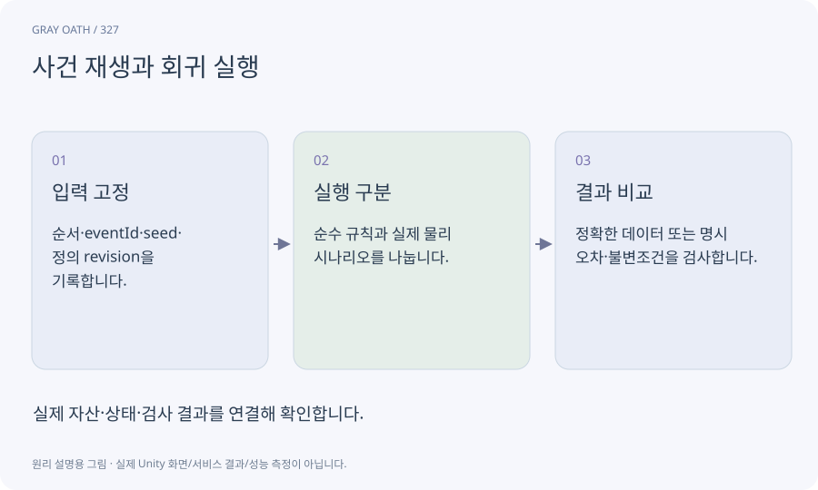

# 사건 재생과 회귀 실행

기록된 의미 사건과 입력을 다시 실행해 결과를 비교하는 방식입니다. 논리 사건의 결정성과 물리 엔진·프레임·화면의 동일성을 혼동하지 않습니다.

## 익숙한 비유

같은 주문 내역을 장부에 다시 넣어 같은 잔액이 되는지 검사하는 것입니다.



## 작동 원리

### 1. 입력 고정

순서·eventId·seed·정의 revision을 기록합니다.

### 2. 실행 구분

순수 규칙과 실제 물리 시나리오를 나눕니다.

### 3. 결과 비교

정확한 데이터 또는 명시 오차·불변조건을 검사합니다.

## 게임 속 예

H01에서 단서 조사 순서를 바꿔도 두 단서를 모았을 때 다음 단계로 가는지 시험합니다. 실제 캐릭터가 돌다리에 갈 수 있는지는 별도 플레이로 검사합니다.

## 혼동하지 않기

사건 재생 성공을 새 플레이어가 UI만 보고 완주한 증거라고 부르지 않습니다.

## 확인 질문

프레임이 다르면 논리 테스트도 모두 실패해야 하나요?

규칙을 물리/시간과 잘 분리했다면 같은 의미 사건의 결과는 정확히 비교할 수 있습니다.

## 내 프로젝트에서 확인하기

```text
현재 GrayOathRPG3D에서 사건 재생과 회귀 실행을 사용하는 실제 대상과 동작을 읽기 전용으로 확인해 줘. 쉬운 말과 작은 사례로 설명하고 사건 재생 성공을 새 플레이어가 UI만 보고 완주한 증거라고 부르지 않습니다. 이 문제를 어떻게 막는지 보여 줘. 코드·데이터·설정은 아직 수정하지 마.
```

## 관련 해설

[deterministic](deterministic.md) · [regression](regression.md) · [fixture](fixture.md)

## 공식 참고

- [Unity · CLI reference](https://docs.unity.com/en-us/unity-cli/unity-cli-reference)
