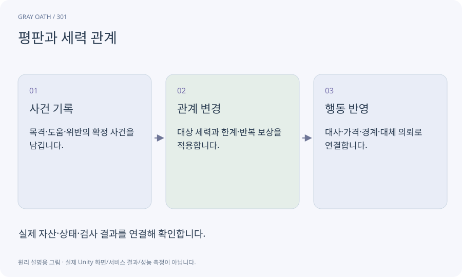

# 평판과 세력 관계

어떤 집단이 플레이어를 어떻게 대하는지 나타내는 기록과 규칙입니다. 숫자 하나로 모든 NPC 반응을 설명하기보다 원인이 되는 사건과 범위를 정합니다.

## 익숙한 비유

한 동네에서 쌓은 신뢰가 다른 집단의 신뢰와 반드시 같지 않은 관계입니다.



## 작동 원리

### 1. 사건 기록

목격·도움·위반의 확정 사건을 남깁니다.

### 2. 관계 변경

대상 세력과 한계·반복 보상을 적용합니다.

### 3. 행동 반영

대사·가격·경계·대체 의뢰로 연결합니다.

## 게임 속 예

목격자 없는 행동을 모든 주민이 즉시 아는 식의 전지적 처벌은 피합니다. 낮은 평판이어도 메인 진행의 유일한 길이 사라지지 않게 합니다.

## 혼동하지 않기

평판 값의 변화만 구현하고 대화·상점이 실제 읽지 않으면 게임에 효과가 없습니다.

## 확인 질문

낮은 평판 때문에 문이 닫히면 게임이 끝나나요?

의도한 실패가 아니라면 비용·우회 조사 등 대체 경로를 제공합니다.

## 내 프로젝트에서 확인하기

```text
현재 GrayOathRPG3D에서 평판과 세력 관계을 사용하는 실제 대상과 동작을 읽기 전용으로 확인해 줘. 쉬운 말과 작은 사례로 설명하고 평판 값의 변화만 구현하고 대화·상점이 실제 읽지 않으면 게임에 효과가 없습니다. 이 문제를 어떻게 막는지 보여 줘. 코드·데이터·설정은 아직 수정하지 마.
```

## 관련 해설

[world-state](world-state.md) · [dialogue-node](dialogue-node.md) · [predicate-dsl](predicate-dsl.md)

## 공식 참고

- [Unity · AssetDatabase](https://docs.unity3d.com/6000.3/Documentation/ScriptReference/AssetDatabase.html)
