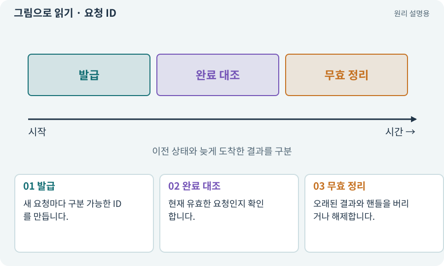

# 요청 ID·세대 ID·오래된 응답

**분야:** 코드·데이터·저장·검사

비동기 요청에 식별자를 붙여 어느 요청의 결과인지 확인하는 방법입니다. 취소·새 지도 생성·새 클릭 이후 늦게 온 응답이 현재 상태를 덮어쓰지 않게 합니다.

**찾아오는 이름:** 요청 ID·세대 ID·오래된 응답, 요청 ID, requestId, generationId, 세대 ID, 오래된 응답, stale response

## 익숙한 것에 비유하면

새 택배 주소로 바꿨는데 옛 주문의 배송 완료 메시지가 새 주문을 완료시키지 않도록 번호를 대조하는 것입니다.



개념도입니다. 실제 Unity 화면이나 검사 결과가 아닙니다. 그림의 순서·색은 역할을 구분하며 실제 설정값은 프로젝트에서 확인합니다.

## 이렇게 작동합니다

### 1. 발급

새 요청마다 구분 가능한 ID를 만듭니다.

### 2. 완료 대조

현재 유효한 요청인지 확인합니다.

### 3. 무효 정리

오래된 결과와 핸들을 버리거나 해제합니다.

## 우리 RPG에서는 이렇게 만나요

지도 A 생성 후 바로 B를 요청했는데 A가 늦게 완료되면 B 지형을 덮어쓰지 않습니다. 다운로드 취소 뒤 늦게 도착한 로드 결과도 같습니다.

## 이것과 혼동하지 마세요

취소 토큰만 전달했다고 모든 외부 작업이 즉시 중단됐다고 보장하지 않습니다.

## 이해했는지 한 번 생각해 보기

화면을 닫았는데 다운로드가 끝나며 옛 창이 다시 뜨면?

<details><summary>답과 이유</summary>

요청의 세대·유효성 검사와 완료 콜백 수명주기를 확인합니다.

</details>

## 내 프로젝트에서 확인하고 싶다면

아래 요청은 읽기 전용으로 실제 대상을 확인하는 선택 요청입니다. 코드나 설정을 직접 편집할 필요는 없습니다.

```text
현재 프로젝트에서 요청 ID·세대 ID·오래된 응답 관련 요소가 어떻게 사용되는지 읽기 전용으로 확인해 줘. 실제 대상과 설정을 찾아 쉬운 말과 작은 예로 설명해 줘. 특히 다음 혼동을 구분해 줘: 취소 토큰만 전달했다고 모든 외부 작업이 즉시 중단됐다고 보장하지 않습니다. 아직 코드·설정·파일은 바꾸지 말고, 확인할 수 없는 내용은 따로 알려 줘.
```

## 이어지는 개념

[비동기·await·콜백](async.md) · [취소 신호·늦은 완료·정리](cancellation.md) · [경로와 경유점](navigation.md) · [수명주기·초기화·정리](lifecycle.md)

## 이 개념을 사용하는 실습

[09 · 클릭한 곳까지 벽을 돌아가기](../index.html#lesson-009) · [46 · 랜덤 지도 위를 실제로 걷기](../index.html#lesson-046) · [76 · 연결이 끊겨도 게임 계속하기](../index.html#lesson-076) · [94 · 같은 랜덤 던전을 3D로 생성하기](../index.html#lesson-094) · [106 · 도구가 상태를 기억하게 만들기](../index.html#lesson-106) · [138 · 장비를 분해해 재료 얻기](../index.html#lesson-138) · [139 · 재료로 장비 제작하기](../index.html#lesson-139)

## 참고와 설명의 범위

이 항목의 비유·그림·RPG 수치·운영 규칙은 개념을 이해하기 위한 자체 설계 예제입니다. 특정 도구가 이 규칙을 자동으로 구현한다는 뜻은 아닙니다.


그림·계산 예제·조작 모형은 자체 제작한 설명입니다. 실제 Unity 화면, 서비스 생성 결과, 성능 실측 또는 게임 테스트 결과가 아닙니다. 자료 확인: 2026년 9월 26일.
