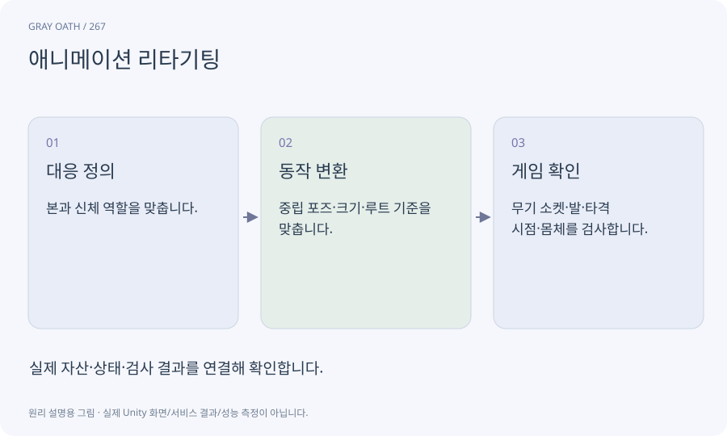

# 애니메이션 리타기팅

한 골격에서 만든 동작을 다른 골격의 신체에 맞춰 적용하는 과정입니다. 이름이 비슷한 뼈를 복사하는 것보다 자세·비율·루트·발 접지를 함께 확인해야 합니다.

## 익숙한 비유

키가 다른 두 배우에게 같은 안무를 맞추는 일입니다.



## 작동 원리

### 1. 대응 정의

본과 신체 역할을 맞춥니다.

### 2. 동작 변환

중립 포즈·크기·루트 기준을 맞춥니다.

### 3. 게임 확인

무기 소켓·발·타격 시점·몸체를 검사합니다.

## 게임 속 예

Meshy의 달리기 클립을 서린에 적용한 뒤 칼이 손에서 뜨거나 발이 미끄러지지 않는지 확인합니다.

## 혼동하지 않기

비율이 다른 모델에 동작을 넣었다고 공격 사거리·타격 판정까지 바꾸면 안 됩니다.

## 확인 질문

클립이 재생되면 리타기팅 성공인가요?

재생뿐 아니라 관절 자세·루트·접지·소켓·실제 게임 속도까지 확인해야 합니다.

## 내 프로젝트에서 확인하기

```text
현재 GrayOathRPG3D에서 애니메이션 리타기팅을 사용하는 실제 대상과 동작을 읽기 전용으로 확인해 줘. 쉬운 말과 작은 사례로 설명하고 비율이 다른 모델에 동작을 넣었다고 공격 사거리·타격 판정까지 바꾸면 안 됩니다. 이 문제를 어떻게 막는지 보여 줘. 코드·데이터·설정은 아직 수정하지 마.
```

## 관련 해설

[humanoid](humanoid.md) · [root-motion](root-motion.md) · [ik](ik.md)

## 공식 참고

- [Meshy · Animation](https://docs.meshy.ai/en/api/animation)
- [Unity · Animation Rigging](https://docs.unity3d.com/Packages/com.unity.animation.rigging@1.3/manual/index.html)
