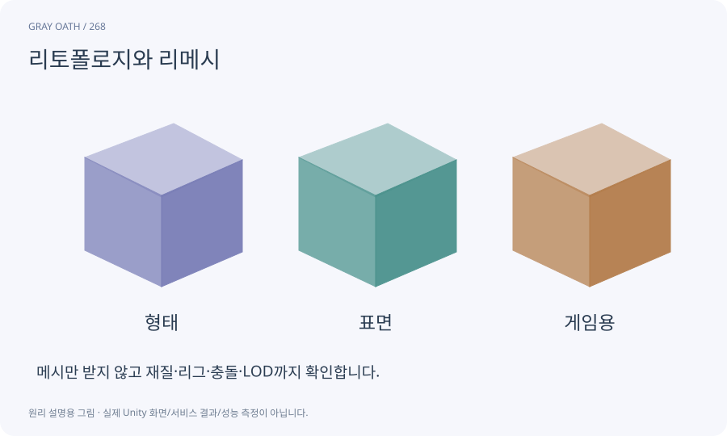

# 리토폴로지와 리메시

메시의 면 연결과 밀도를 다시 구성하는 작업입니다. 면 수를 줄이는 것과 관절이 잘 휘는 좋은 연결 구조는 같은 목표가 아닙니다.

## 익숙한 비유

울퉁불퉁한 포장 천을 새 재단선으로 다시 만드는 일입니다.



## 작동 원리

### 1. 목적 선정

배경용인지 관절 변형용인지 정합니다.

### 2. 새 구조 생성

면 수·형식·경계를 맞춥니다.

### 3. 결과 검사

실루엣·UV·재질·본·애니메이션을 다시 확인합니다.

## 게임 속 예

석상은 면을 줄여도 괜찮지만 팔꿈치가 있는 캐릭터는 관절 주변 연결이 중요합니다. Meshy remesh 후 리그와 UV가 보존됐다고 가정하지 않습니다.

## 혼동하지 않기

요청한 target polygon 수가 정확한 결과 수나 모바일 성능을 보장하지 않습니다.

## 확인 질문

면 수가 절반이면 GPU 시간도 절반인가요?

아닙니다. 재질·픽셀·그림자·스키닝 등이 병목일 수 있으므로 실제 측정합니다.

## 내 프로젝트에서 확인하기

```text
현재 GrayOathRPG3D에서 리토폴로지와 리메시을 사용하는 실제 대상과 동작을 읽기 전용으로 확인해 줘. 쉬운 말과 작은 사례로 설명하고 요청한 target polygon 수가 정확한 결과 수나 모바일 성능을 보장하지 않습니다. 이 문제를 어떻게 막는지 보여 줘. 코드·데이터·설정은 아직 수정하지 마.
```

## 관련 해설

[mesh](mesh.md) · [lod](lod.md) · [profiler](profiler.md)

## 공식 참고

- [Meshy · Remesh](https://docs.meshy.ai/en/api/remesh)
