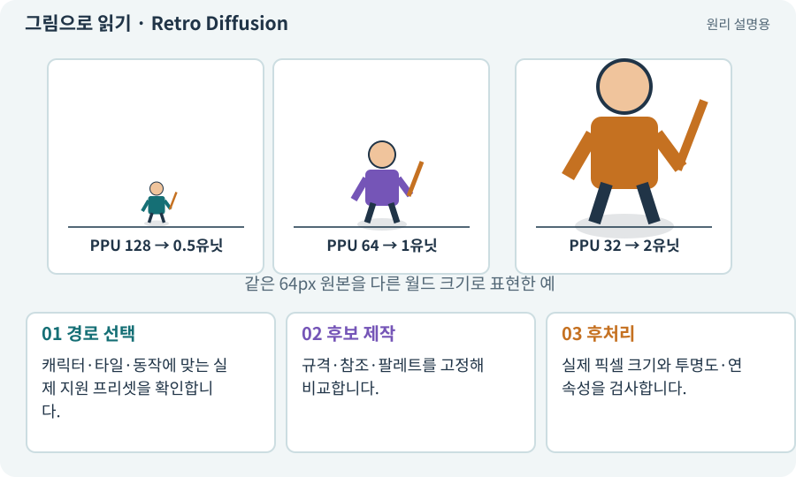

# Retro Diffusion·픽셀 모델·프리셋

**분야:** 자산 제작·렌더링 보충

Retro Diffusion은 픽셀 아트에 맞춘 이미지 제작 모델과 프리셋을 제공하는 도구입니다. 프리셋은 스타일·크기·작업 목적에 맞춘 출발 설정이지 모든 프레임의 품질 보증은 아닙니다.

**찾아오는 이름:** Retro Diffusion·픽셀 모델·프리셋, Retro Diffusion, RetroDiffusion, 레트로 디퓨전

## 익숙한 것에 비유하면

연필 종류와 도화지 크기를 작업에 맞춰 선택하는 것과 같습니다.



개념도입니다. 실제 Unity 화면이나 검사 결과가 아닙니다. 그림의 순서·색은 역할을 구분하며 실제 설정값은 프로젝트에서 확인합니다.

## 이렇게 작동합니다

### 1. 경로 선택

캐릭터·타일·동작에 맞는 실제 지원 프리셋을 확인합니다.

### 2. 후보 제작

규격·참조·팔레트를 고정해 비교합니다.

### 3. 후처리

실제 픽셀 크기와 투명도·연속성을 검사합니다.

## 우리 RPG에서는 이렇게 만나요

64픽셀 캐릭터를 256픽셀 시안에서 대충 줄이면 작은 장비가 뭉칠 수 있습니다. 목표 화면 크기에서 읽히는지 확인하고 그림만 크다고 고품질로 판단하지 않습니다.

## 이것과 혼동하지 마세요

모델·프리셋 이름이 바뀔 수 있으므로 외워야 할 명령으로 고정하지 않습니다.

## 이해했는지 한 번 생각해 보기

큰 그림을 줄이면 항상 좋은 픽셀 캐릭터가 되나요?

<details><summary>답과 이유</summary>

아닙니다. 픽셀 격자·윤곽·색·작은 크기의 읽힘이 맞아야 합니다.

</details>

## 내 프로젝트에서 확인하고 싶다면

아래 요청은 읽기 전용으로 실제 대상을 확인하는 선택 요청입니다. 코드나 설정을 직접 편집할 필요는 없습니다.

```text
현재 프로젝트에서 Retro Diffusion·픽셀 모델·프리셋 관련 요소가 어떻게 사용되는지 읽기 전용으로 확인해 줘. 실제 대상과 설정을 찾아 쉬운 말과 작은 예로 설명해 줘. 특히 다음 혼동을 구분해 줘: 모델·프리셋 이름이 바뀔 수 있으므로 외워야 할 명령으로 고정하지 않습니다. 아직 코드·설정·파일은 바꾸지 말고, 확인할 수 없는 내용은 따로 알려 줘.
```

## 이어지는 개념

[픽셀 퍼펙트와 화면 배율](scale-pixel.md) · [아트 규격·레퍼런스·키 포즈](art-spec.md) · [생성형 아트·참조 이미지·후처리](image-service.md) · [Point·Bilinear 필터와 픽셀 아트](filter.md)

## 이 개념을 사용하는 실습

[59 · Retro Diffusion으로 캐릭터와 타일 만들기](../index.html#lesson-059) · [67 · 내 게임의 아트 제작 경로 선택하기](../index.html#lesson-067)

## 참고와 설명의 범위

기본 도구 동작은 아래 공식 자료를 참고했습니다. 비유·그림·RPG의 예시 수치와 정책은 이해를 위한 자체 예제입니다. 실제 API·지원 기능은 설치 버전과 계정에서 확인합니다.

- [Retro Diffusion · 스타일·작업 프리셋](https://retrodiffusion.ai/styles/)

그림·계산 예제·조작 모형은 자체 제작한 설명입니다. 실제 Unity 화면, 서비스 생성 결과, 성능 실측 또는 게임 테스트 결과가 아닙니다. 자료 확인: 2026년 9월 26일.
