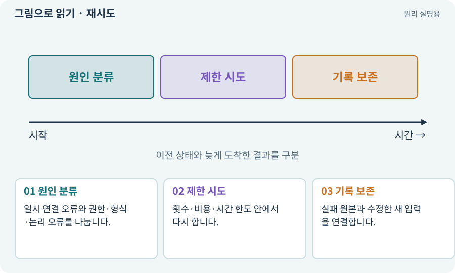

# 재시도·백오프·복구

**분야:** AI·스킬·훅·하네스 운영

재시도는 일시적 실패를 다시 시도하는 것이고 백오프는 재시도 사이 간격을 늘리는 방식입니다. 원인이 변하지 않은 논리 오류를 무한히 반복하는 것과 다릅니다.

**찾아오는 이름:** 재시도·백오프·복구, 재시도, Retry, retry, 백오프, Backoff, resume, 재개

## 익숙한 것에 비유하면

문이 잠겨 있을 때 계속 세게 당기는 대신 열쇠·시간·관리자 확인을 하는 것입니다.



개념도입니다. 실제 Unity 화면이나 검사 결과가 아닙니다. 그림의 순서·색은 역할을 구분하며 실제 설정값은 프로젝트에서 확인합니다.

## 이렇게 작동합니다

### 1. 원인 분류

일시 연결 오류와 권한·형식·논리 오류를 나눕니다.

### 2. 제한 시도

횟수·비용·시간 한도 안에서 다시 합니다.

### 3. 기록 보존

실패 원본과 수정한 새 입력을 연결합니다.

## 우리 RPG에서는 이렇게 만나요

없는 API 이름을 같은 프롬프트로 20번 재시도해도 해결되지 않습니다. 실제 도움말·버전·응답을 읽고 원인을 수정해야 합니다.

## 이것과 혼동하지 마세요

재개는 모든 이전 결과를 믿고 넘어가는 것이 아닙니다. 현재 소스와 살아 있는 프로세스를 확인합니다.

## 이해했는지 한 번 생각해 보기

같은 오류가 세 번 반복되면 무조건 더 기다릴까요?

<details><summary>답과 이유</summary>

원인·입력·한도·필요한 수정을 확인하고 무한 반복을 중단합니다.

</details>

## 내 프로젝트에서 확인하고 싶다면

아래 요청은 읽기 전용으로 실제 대상을 확인하는 선택 요청입니다. 코드나 설정을 직접 편집할 필요는 없습니다.

```text
현재 프로젝트에서 재시도·백오프·복구 관련 요소가 어떻게 사용되는지 읽기 전용으로 확인해 줘. 실제 대상과 설정을 찾아 쉬운 말과 작은 예로 설명해 줘. 특히 다음 혼동을 구분해 줘: 재개는 모든 이전 결과를 믿고 넘어가는 것이 아닙니다. 현재 소스와 살아 있는 프로세스를 확인합니다. 아직 코드·설정·파일은 바꾸지 말고, 확인할 수 없는 내용은 따로 알려 줘.
```

## 이어지는 개념

[타임아웃·중단·취소](timeout.md) · [멱등성·재시도해도 한 번](idempotency.md) · [run·attempt·revision·인수인계](run.md) · [버그 재현·최소 재현·디버깅](repro.md)

## 이 개념을 사용하는 실습

[05 · 말로 스프라이트 하나 만들기](../index.html#lesson-005) · [32 · 길 안내와 처음 하는 사람의 동선 만들기](../index.html#lesson-032) · [40 · 작은 RPG를 처음부터 끝까지 플레이하기](../index.html#lesson-040) · [45 · 무작위 방과 통로 만들기](../index.html#lesson-045) · [47 · 실패하는 시드를 찾고 복구하기](../index.html#lesson-047) · [53 · 입력은 빠르게, 취소 규칙은 명확하게](../index.html#lesson-053) · [58 · PixelLab로 방향별 픽셀 캐릭터 만들기](../index.html#lesson-058) · [62 · OpenAI 이미지로 게임 자산 만들기](../index.html#lesson-062) · [67 · 내 게임의 아트 제작 경로 선택하기](../index.html#lesson-067) · [76 · 연결이 끊겨도 게임 계속하기](../index.html#lesson-076) · [79 · 추가 기능을 하나의 게임으로 합치기](../index.html#lesson-079) · [94 · 같은 랜덤 던전을 3D로 생성하기](../index.html#lesson-094) · [108 · 기획·구현·QA·검토 역할 만들기](../index.html#lesson-108) · [110 · 작업마다 필요한 자료만 준비하기](../index.html#lesson-110) · [112 · 네 역할을 순서대로 실행하기](../index.html#lesson-112) · [119 · 막힌 작업을 안전하게 이어가기](../index.html#lesson-119) · [128 · 내 도구를 대화로 운영하기](../index.html#lesson-128) · [133 · 첫 기능의 실패를 고쳐 다음 기준 만들기](../index.html#lesson-133) · [140 · 개인 창고와 즐겨찾기 만들기](../index.html#lesson-140) · [144 · 이번 탐험에만 남는 유물 고르기](../index.html#lesson-144) · [157 · 하네스가 실패해도 기록 지키기](../index.html#lesson-157)

## 참고와 설명의 범위

이 항목의 비유·그림·RPG 수치·운영 규칙은 개념을 이해하기 위한 자체 설계 예제입니다. 특정 도구가 이 규칙을 자동으로 구현한다는 뜻은 아닙니다.


그림·계산 예제·조작 모형은 자체 제작한 설명입니다. 실제 Unity 화면, 서비스 생성 결과, 성능 실측 또는 게임 테스트 결과가 아닙니다. 자료 확인: 2026년 9월 26일.
