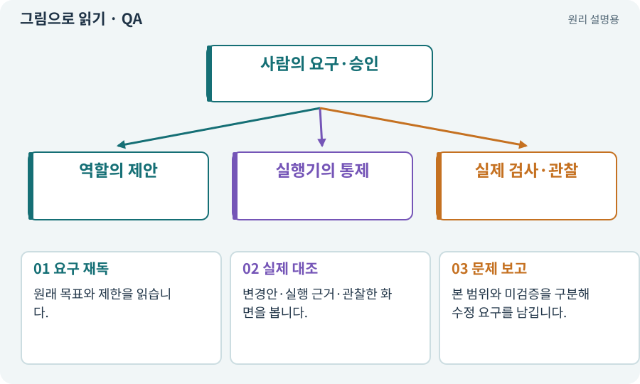

# QA·비평·독립 검토

**분야:** AI·스킬·훅·하네스 운영

QA는 결함을 재현·검사하고, 비평·검토는 원래 요구와 실제 결과 사이의 문제를 평가합니다. 구현자가 자기 설명만 검토하는 것보다 입력과 권한을 분리하는 것이 중요합니다.

**찾아오는 이름:** QA·비평·독립 검토, QA, critic, 비평, 독립 검토, 검토자, review

## 익숙한 것에 비유하면

요리사가 “맛있다”고 말한 것과 다른 사람이 실제로 먹고 간·온도·주문과의 차이를 확인한 것을 구분합니다.



개념도입니다. 실제 Unity 화면이나 검사 결과가 아닙니다. 그림의 순서·색은 역할을 구분하며 실제 설정값은 프로젝트에서 확인합니다.

## 이렇게 작동합니다

### 1. 요구 재독

원래 목표와 제한을 읽습니다.

### 2. 실제 대조

변경안·실행 근거·관찰한 화면을 봅니다.

### 3. 문제 보고

본 범위와 미검증을 구분해 수정 요구를 남깁니다.

## 우리 RPG에서는 이렇게 만나요

미술 검토자는 실제 새 스프라이트를 보지 않고 파일명과 생성 노력만으로 화풍을 통과시키지 않습니다. 기술 검토는 검사 조건을 낮춰 해결하지 않습니다.

## 이것과 혼동하지 마세요

같은 모델의 별도 세션이라는 이유만으로 자동 독립성이 보장되지 않습니다.

## 이해했는지 한 번 생각해 보기

검토자가 같은 후보 코드를 직접 고쳐도 되나요?

<details><summary>답과 이유</summary>

이 구조에서는 수정 역할에 되돌려 새 후보와 검토 기록을 남깁니다.

</details>

## 내 프로젝트에서 확인하고 싶다면

아래 요청은 읽기 전용으로 실제 대상을 확인하는 선택 요청입니다. 코드나 설정을 직접 편집할 필요는 없습니다.

```text
현재 프로젝트에서 QA·비평·독립 검토 관련 요소가 어떻게 사용되는지 읽기 전용으로 확인해 줘. 실제 대상과 설정을 찾아 쉬운 말과 작은 예로 설명해 줘. 특히 다음 혼동을 구분해 줘: 같은 모델의 별도 세션이라는 이유만으로 자동 독립성이 보장되지 않습니다. 아직 코드·설정·파일은 바꾸지 말고, 확인할 수 없는 내용은 따로 알려 줘.
```

## 이어지는 개념

[에이전트·서브에이전트·역할](agent.md) · [diff·패치·변경 검토](diff.md) · [증거·검사 상태·미실행](evidence.md) · [버그 재현·최소 재현·디버깅](repro.md)

## 이 개념을 사용하는 실습

[108 · 기획·구현·QA·검토 역할 만들기](../index.html#lesson-108) · [111 · AI 답변을 안전한 변경안으로 받기](../index.html#lesson-111) · [112 · 네 역할을 순서대로 실행하기](../index.html#lesson-112) · [113 · 검토한 후보만 승인해 적용하기](../index.html#lesson-113) · [121 · 필요한 역할을 하나 추가하기](../index.html#lesson-121) · [125 · 하네스로 작은 전리품 화면 만들기](../index.html#lesson-125) · [126 · 한 요청으로 필터 기능 끝내기](../index.html#lesson-126) · [129 · 기존 2D 게임에서 확장팩 시작하기](../index.html#lesson-129) · [130 · 첫 확장 작업을 하네스에 연결하기](../index.html#lesson-130) · [131 · 중요한 전리품만 표시하는 규칙 만들기](../index.html#lesson-131) · [132 · 필터를 실제 던전과 모바일에 연결하기](../index.html#lesson-132) · [133 · 첫 기능의 실패를 고쳐 다음 기준 만들기](../index.html#lesson-133) · [134 · 화상·냉기·표식으로 전투 확장하기](../index.html#lesson-134) · [135 · 벽을 통과하지 않는 회피 만들기](../index.html#lesson-135) · [136 · 방패병과 화염술사 정예 추가하기](../index.html#lesson-136) · [137 · 기름·폭발통·밸브로 공간 활용하기](../index.html#lesson-137) · [138 · 장비를 분해해 재료 얻기](../index.html#lesson-138) · [139 · 재료로 장비 제작하기](../index.html#lesson-139) · [140 · 개인 창고와 즐겨찾기 만들기](../index.html#lesson-140) · [141 · 소켓 한 칸에 룬 장착하기](../index.html#lesson-141) · [142 · 배운 스킬의 변형 선택하기](../index.html#lesson-142) · [143 · 새 랜덤 지역 봉인된 대장간 만들기](../index.html#lesson-143) · [144 · 이번 탐험에만 남는 유물 고르기](../index.html#lesson-144) · [145 · 지원 동료 하나 만들기](../index.html#lesson-145) · [146 · 대장장이 구조 퀘스트 만들기](../index.html#lesson-146) · [147 · 용광로 감시자와 3단계 전투 만들기](../index.html#lesson-147) · [148 · 아트 역할로 새 지역 외형 완성하기](../index.html#lesson-148) · [149 · 상태와 보스 효과를 같은 데이터로 맞추기](../index.html#lesson-149) · [150 · 소리가 없어도 읽히는 전투 만들기](../index.html#lesson-150) · [151 · 도감과 장비 비교로 새 기능 찾기](../index.html#lesson-151) · [152 · 이전 저장을 새 확장판으로 가져오기](../index.html#lesson-152) · [153 · 대장간 고해상도팩 선택 다운로드하기](../index.html#lesson-153) · [154 · 확장 기능을 켠 휴대폰 성능 고치기](../index.html#lesson-154) · [155 · 기록을 보고 제작 경제와 전투 조정하기](../index.html#lesson-155) · [156 · 기능 조합에서 숨은 오류 찾기](../index.html#lesson-156) · [157 · 하네스가 실패해도 기록 지키기](../index.html#lesson-157) · [158 · 룬 교체 버그를 역할로 수정하기](../index.html#lesson-158) · [159 · 최종 확장판 배포 후보 만들기](../index.html#lesson-159) · [160 · 대장간 보스까지 완주하고 새 기능 맡기기](../index.html#lesson-160)

## 참고와 설명의 범위

이 항목의 비유·그림·RPG 수치·운영 규칙은 개념을 이해하기 위한 자체 설계 예제입니다. 특정 도구가 이 규칙을 자동으로 구현한다는 뜻은 아닙니다.


그림·계산 예제·조작 모형은 자체 제작한 설명입니다. 실제 Unity 화면, 서비스 생성 결과, 성능 실측 또는 게임 테스트 결과가 아닙니다. 자료 확인: 2026년 9월 26일.
