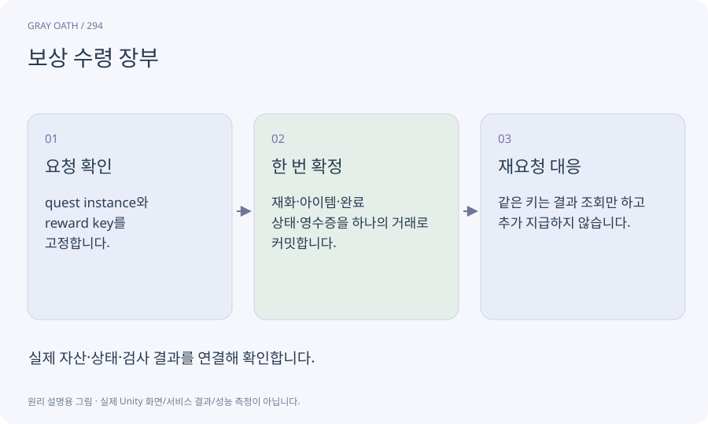

# 보상 수령 장부

퀘스트 실행 인스턴스의 보상이 이미 확정되었는지 기록하는 자료입니다. UI 버튼 연타·재시작·중복 이벤트에서 동일 지급을 반복하지 않게 합니다.

## 익숙한 비유

같은 주문 번호를 두 번 결제하지 않도록 보관하는 영수증입니다.



## 작동 원리

### 1. 요청 확인

quest instance와 reward key를 고정합니다.

### 2. 한 번 확정

재화·아이템·완료 상태·영수증을 하나의 거래로 커밋합니다.

### 3. 재요청 대응

같은 키는 결과 조회만 하고 추가 지급하지 않습니다.

## 게임 속 예

보상을 받은 직후 저장하는 중 앱이 중단되어도 복구한 상태는 전부 지급 또는 전부 미지급이어야 합니다. 화폐만 두 번 증가하면 안 됩니다.

## 혼동하지 않기

보상 버튼을 비활성화하는 UI만으로는 중복 지급을 막을 수 없습니다.

## 확인 질문

같은 종류 의뢰를 다시 받으면 보상을 못 받나요?

새 실행 인스턴스에는 새 거래 키를 사용합니다. 같은 한 번의 실행만 중복을 막습니다.

## 내 프로젝트에서 확인하기

```text
현재 GrayOathRPG3D에서 보상 수령 장부을 사용하는 실제 대상과 동작을 읽기 전용으로 확인해 줘. 쉬운 말과 작은 사례로 설명하고 보상 버튼을 비활성화하는 UI만으로는 중복 지급을 막을 수 없습니다. 이 문제를 어떻게 막는지 보여 줘. 코드·데이터·설정은 아직 수정하지 마.
```

## 관련 해설

[idempotency](idempotency.md) · [transaction](transaction.md) · [save](save.md)

## 공식 참고

- [Unity · AssetDatabase](https://docs.unity3d.com/6000.3/Documentation/ScriptReference/AssetDatabase.html)
