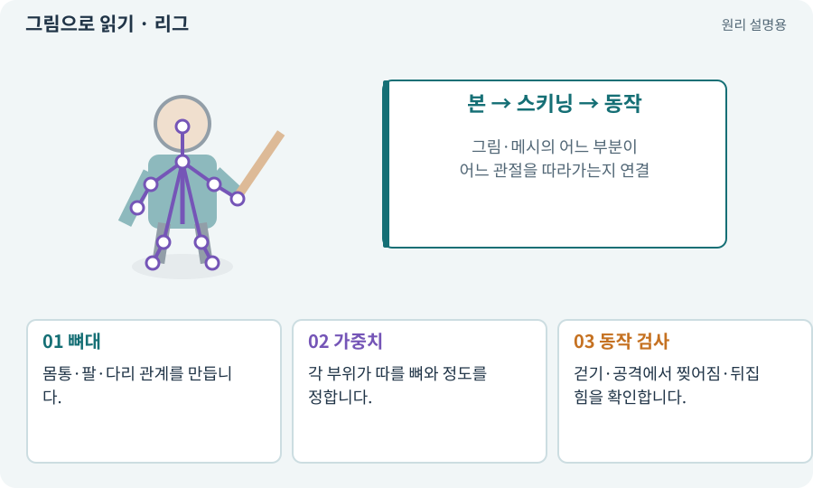

# 리그·본·스키닝·Avatar

**분야:** 그림·애니메이션·화면 만들기

리그는 모델이나 부위 그림을 움직이는 뼈대 구조입니다. 스키닝은 그림·메시의 부분이 어느 뼈를 얼마나 따라갈지 정하는 작업입니다. Avatar는 사람형 뼈 매핑 등에 사용됩니다.

**찾아오는 이름:** 리그·본·스키닝·Avatar, 리그, Rig, 본, Bone, 스키닝, Skinning, Avatar, Humanoid, Generic

## 익숙한 것에 비유하면

종이 인형의 관절과 연결선입니다. 팔 관절을 돌렸는데 배까지 늘어나면 어느 부위가 그 관절을 따르는지 잘못 연결된 것입니다.



개념도입니다. 실제 Unity 화면이나 검사 결과가 아닙니다. 그림의 순서·색은 역할을 구분하며 실제 설정값은 프로젝트에서 확인합니다.

## 이렇게 작동합니다

### 1. 뼈대

몸통·팔·다리 관계를 만듭니다.

### 2. 가중치

각 부위가 따를 뼈와 정도를 정합니다.

### 3. 동작 검사

걷기·공격에서 찢어짐·뒤집힘을 확인합니다.

## 우리 RPG에서는 이렇게 만나요

2D 부위 애니메이션은 머리·몸·팔 Sprite를 뼈로 움직일 수 있고, 3D는 메시 정점을 뼈에 연결합니다. 프레임 시트와 다른 제작 경로입니다.

## 이것과 혼동하지 마세요

같은 사람형이라도 비율·소켓·루트 설정이 다르면 동작을 그대로 재사용할 때 어긋날 수 있습니다.

## 이해했는지 한 번 생각해 보기

팔을 돌렸는데 검이 손에서 떨어지면?

<details><summary>답과 이유</summary>

무기 소켓의 부모 뼈·로컬 위치·리그 연결을 확인합니다.

</details>

## 내 프로젝트에서 확인하고 싶다면

아래 요청은 읽기 전용으로 실제 대상을 확인하는 선택 요청입니다. 코드나 설정을 직접 편집할 필요는 없습니다.

```text
현재 프로젝트에서 리그·본·스키닝·Avatar 관련 요소가 어떻게 사용되는지 읽기 전용으로 확인해 줘. 실제 대상과 설정을 찾아 쉬운 말과 작은 예로 설명해 줘. 특히 다음 혼동을 구분해 줘: 같은 사람형이라도 비율·소켓·루트 설정이 다르면 동작을 그대로 재사용할 때 어긋날 수 있습니다. 아직 코드·설정·파일은 바꾸지 말고, 확인할 수 없는 내용은 따로 알려 줘.
```

## 이어지는 개념

[애니메이션 클립·프레임·키프레임](animation-clip.md) · [소켓: 무기 부착점과 장비 홈](socket.md) · [루트 모션과 제자리 동작](root-motion.md) · [메시·정점·삼각형·노멀](mesh.md)

## 이 개념을 사용하는 실습

[88 · 3D 모델에 걷기와 공격 연결하기](../index.html#lesson-088) · [92 · 무기를 손에 쥐고 전리품 표시하기](../index.html#lesson-092) · [101 · 3D Android 성능 다시 측정하기](../index.html#lesson-101)

## 참고와 설명의 범위

기본 도구 동작은 아래 공식 자료를 참고했습니다. 비유·그림·RPG의 예시 수치와 정책은 이해를 위한 자체 예제입니다. 실제 API·지원 기능은 설치 버전과 계정에서 확인합니다.

- [Unity · 애니메이션 개요](https://docs.unity3d.com/6000.3/Documentation/Manual/AnimationOverview.html)

그림·계산 예제·조작 모형은 자체 제작한 설명입니다. 실제 Unity 화면, 서비스 생성 결과, 성능 실측 또는 게임 테스트 결과가 아닙니다. 자료 확인: 2026년 9월 26일.
