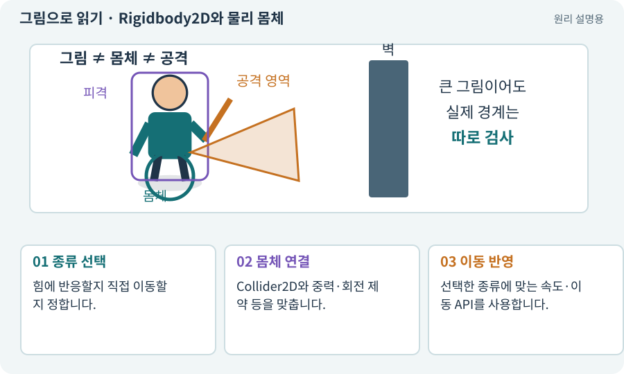

# Rigidbody2D와 물리 몸체

**분야:** 오브젝트·좌표·움직임

Rigidbody2D는 2D 물리 시스템이 객체를 어떻게 움직이고 접촉에 반응시킬지 관리하는 몸체입니다. Dynamic·Kinematic·Static은 물리적 행동 방식이 다른 설정입니다.

**찾아오는 이름:** Rigidbody2D와 물리 몸체, Rigidbody2D, 리지드바디, Rigidbody, Dynamic, Kinematic, Static, MovePosition, gravityScale, Body Type

## 익숙한 것에 비유하면

당구공처럼 힘에 반응하는 물건과 레일 위 장치처럼 지정 위치로 움직이는 물건, 고정 벽을 구분합니다.



개념도입니다. 실제 Unity 화면이나 검사 결과가 아닙니다. 그림의 순서·색은 역할을 구분하며 실제 설정값은 프로젝트에서 확인합니다.

## 이렇게 작동합니다

### 1. 종류 선택

힘에 반응할지 직접 이동할지 정합니다.

### 2. 몸체 연결

Collider2D와 중력·회전 제약 등을 맞춥니다.

### 3. 이동 반영

선택한 종류에 맞는 속도·이동 API를 사용합니다.

## 어떤 몸체인가에 따라 움직이는 책임이 달라져요

Dynamic은 물리 시뮬레이션에 참여해 힘·충돌 반응을 처리하는 몸체입니다. Kinematic은 보통 코드가 움직임을 정하는 몸체이고, Static은 움직이지 않는 환경에 사용합니다. 정확한 충돌 조합과 설정은 설치된 Unity API에서 확인합니다.

코드 주도 탑다운 이동에서 Kinematic을 골랐다고 벽 통과가 자동으로 막히지는 않습니다. 이동 전 Cast로 여유를 검사하고, 실제 이동은 한 모터에서 처리하며, 물리 스텝과 렌더링을 구분합니다.

Transform.position, Rigidbody2D.MovePosition, 별도 넉백 스크립트가 동시에 최종 위치를 쓰지 않게 합니다. 이동 입력·넉백·회피는 모터에 의도를 전달하고 모터가 한 번 결합해 처리하는 구조가 유용합니다.

| 설정 | 대표 용도 | 추가 확인 |
| --- | --- | --- |
| Dynamic | 물리 반응이 필요한 몸체 | 중력·회전·충돌 |
| Kinematic | 코드 주도 이동 | Cast·필터·접촉 정책 |
| Static | 고정된 벽·환경 | 이동 필요 여부 |

## 우리 RPG에서는 이렇게 만나요

탑다운 캐릭터는 아래로 떨어지는 게임이 아니므로 중력과 회전 제약을 의도에 맞춥니다. Kinematic을 골랐다고 모든 충돌 상대가 자동으로 막아 주는 것은 아니어서 캐스트와 접촉 설정을 확인합니다.

## 이것과 혼동하지 마세요

3D Rigidbody와 2D Rigidbody2D는 별개의 물리 세계에 참여합니다. 혼용한다고 서로 부딪히지 않습니다.

## 이해했는지 한 번 생각해 보기

Collider2D와 BoxCollider를 겹치면 서로 막나요?

<details><summary>답과 이유</summary>

그대로는 아닙니다. 2D와 3D 물리 API·컴포넌트를 맞춰야 합니다.

</details>

## 내 프로젝트에서 확인하고 싶다면

아래 요청은 읽기 전용으로 실제 대상을 확인하는 선택 요청입니다. 코드나 설정을 직접 편집할 필요는 없습니다.

```text
현재 프로젝트에서 Rigidbody2D와 물리 몸체 관련 요소가 어떻게 사용되는지 읽기 전용으로 확인해 줘. 실제 대상과 설정을 찾아 쉬운 말과 작은 예로 설명해 줘. 특히 다음 혼동을 구분해 줘: 3D Rigidbody와 2D Rigidbody2D는 별개의 물리 세계에 참여합니다. 혼용한다고 서로 부딪히지 않습니다. 아직 코드·설정·파일은 바꾸지 말고, 확인할 수 없는 내용은 따로 알려 줘.
```

## 이어지는 개념

[Collider와 몸체 경계](collider.md) · [Physics2D와 3D Physics](physics2d.md) · [Update·FixedUpdate·LateUpdate](fixed-update.md) · [이동 모터와 단일 위치 책임](motor.md)

## 이 개념을 사용하는 실습

[07 · 캐릭터와 벽이 있는 공간 만들기](../index.html#lesson-007) · [08 · WASD로 벽에 부딪히며 이동하기](../index.html#lesson-008) · [28 · 여덟 구역의 첫 던전 만들기](../index.html#lesson-028) · [85 · 3D 캐릭터를 한 모터로 움직이기](../index.html#lesson-085) · [135 · 벽을 통과하지 않는 회피 만들기](../index.html#lesson-135) · [156 · 기능 조합에서 숨은 오류 찾기](../index.html#lesson-156)

## 참고와 설명의 범위

기본 도구 동작은 아래 공식 자료를 참고했습니다. 비유·그림·RPG의 예시 수치와 정책은 이해를 위한 자체 예제입니다. 실제 API·지원 기능은 설치 버전과 계정에서 확인합니다.

- [Unity · Rigidbody2D](https://docs.unity3d.com/6000.3/Documentation/Manual/2d-physics/rigidbody/introduction-to-rigidbody-2d.html)
- [Unity · Rigidbody2D.MovePosition](https://docs.unity3d.com/6000.3/Documentation/ScriptReference/Rigidbody2D.MovePosition.html)

그림·계산 예제·조작 모형은 자체 제작한 설명입니다. 실제 Unity 화면, 서비스 생성 결과, 성능 실측 또는 게임 테스트 결과가 아닙니다. 자료 확인: 2026년 9월 26일.
