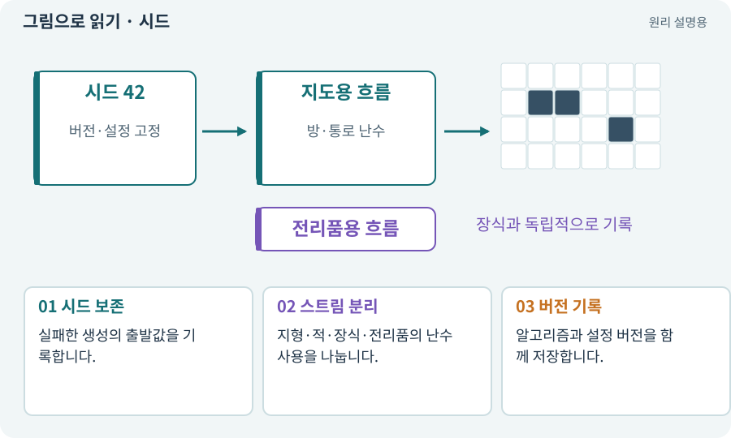

# 시드·난수·PRNG

**분야:** 지도·적 AI·전투 규칙

의사난수 생성기(PRNG)는 정해진 계산으로 불규칙해 보이는 수열을 만듭니다. 시드는 그 수열의 출발값입니다. 같은 시드만이 아니라 생성기·설정·호출 순서가 같아야 결과를 재현하기 쉽습니다.

**찾아오는 이름:** 시드·난수·PRNG, 시드, seed, Seed, 난수, PRNG, RNG, 랜덤 스트림, generatorVersion

## 익숙한 것에 비유하면

같은 시작 페이지에서 같은 순서로 숫자표를 읽는 것과 같습니다. 중간에 한 칸을 더 읽으면 뒤의 숫자도 달라집니다.



개념도입니다. 실제 Unity 화면이나 검사 결과가 아닙니다. 그림의 순서·색은 역할을 구분하며 실제 설정값은 프로젝트에서 확인합니다.

## 이렇게 작동합니다

### 1. 시드 보존

실패한 생성의 출발값을 기록합니다.

### 2. 스트림 분리

지형·적·장식·전리품의 난수 사용을 나눕니다.

### 3. 버전 기록

알고리즘과 설정 버전을 함께 저장합니다.

## 시드 외에도 고정할 것이 있어요

난수 생성기는 내부 상태를 다음 상태로 바꾸며 숫자를 냅니다. 같은 시드로 시작해도 호출 순서가 달라지면 어느 숫자가 어느 작업에 사용되는지 달라질 수 있습니다.

지도용·적 배치용·전리품용·장식용 난수 흐름을 분리하면 장식 하나 추가 때문에 다음 전리품이 달라지는 결합을 줄일 수 있습니다. 생성 알고리즘 버전과 설정도 함께 기록합니다.

아래는 작은 결정적 의사난수 모형입니다. Unity의 실제 Random 구현이나 보안 난수를 재현한 것은 아닙니다. 같은 숫자로 다시 생성하면 같은 배치가 나오는 원리만 확인합니다.

| 고정할 것 | 이유 | 예 |
| --- | --- | --- |
| 시드 | 시작 상태 | 42 |
| 알고리즘·버전 | 숫자와 구조의 생성 순서 | layout-v1 |
| 설정·호출 순서 | 같은 난수를 쓰는 위치 | 방 수·장식 흐름 |

## 직접 값을 바꾸며 보기

[웹 해설의 조작 모형 열기](../index.html#tech-rng). 조작은 설명용 모형만 바꿉니다. 실제 프로젝트·AI·진행 체크·게임 테스트는 실행하거나 변경하지 않습니다.

## 우리 RPG에서는 이렇게 만나요

꽃 장식을 하나 추가할 때 같은 난수 스트림을 소모하면 이후 검의 옵션까지 바뀔 수 있습니다. 서로 독립적인 스트림을 사용해 불필요한 변화를 줄입니다.

## 이것과 혼동하지 마세요

시드가 같다는 이유만으로 서로 다른 버전·플랫폼·물리 결과까지 동일하다고 단정하지 않습니다.

## 이해했는지 한 번 생각해 보기

시드 42가 어제와 오늘 다른 맵을 만든다면?

<details><summary>답과 이유</summary>

생성기 버전·설정·난수 호출 순서가 바뀌었는지 확인합니다.

</details>

## 내 프로젝트에서 확인하고 싶다면

아래 요청은 읽기 전용으로 실제 대상을 확인하는 선택 요청입니다. 코드나 설정을 직접 편집할 필요는 없습니다.

```text
현재 프로젝트에서 시드·난수·PRNG 관련 요소가 어떻게 사용되는지 읽기 전용으로 확인해 줘. 실제 대상과 설정을 찾아 쉬운 말과 작은 예로 설명해 줘. 특히 다음 혼동을 구분해 줘: 시드가 같다는 이유만으로 서로 다른 버전·플랫폼·물리 결과까지 동일하다고 단정하지 않습니다. 아직 코드·설정·파일은 바꾸지 말고, 확인할 수 없는 내용은 따로 알려 줘.
```

## 이어지는 개념

[절차적·무작위 지형 생성](generation.md) · [스냅샷·기준선·baseline](snapshot.md) · [재현성·결정성·동등성](deterministic.md) · [전리품·가중치·드롭 확률](loot.md)

## 이 개념을 사용하는 실습

[21 · 몬스터가 장비를 떨어뜨리게 하기](../index.html#lesson-021) · [29 · 방마다 적과 상자 배치하기](../index.html#lesson-029) · [37 · 느려지는 원인을 측정해 고치기](../index.html#lesson-037) · [44 · 시드로 같은 던전 다시 만들기](../index.html#lesson-044) · [45 · 무작위 방과 통로 만들기](../index.html#lesson-045) · [46 · 랜덤 지도 위를 실제로 걷기](../index.html#lesson-046) · [47 · 실패하는 시드를 찾고 복구하기](../index.html#lesson-047) · [54 · 느낌을 근거로 밸런스 고치기](../index.html#lesson-054) · [66 · 타일 경계와 랜덤맵 외형 연결하기](../index.html#lesson-066) · [71 · 카메라·소리·피해 숫자 맞추기](../index.html#lesson-071) · [72 · 모바일 효과를 줄여도 위험은 남기기](../index.html#lesson-072) · [80 · 나만의 2D RPG 완성하기](../index.html#lesson-080) · [81 · 2D 게임을 남기고 3D 작업 시작하기](../index.html#lesson-081) · [82 · 게임 규칙은 재사용하고 공간만 바꾸기](../index.html#lesson-082) · [94 · 같은 랜덤 던전을 3D로 생성하기](../index.html#lesson-094) · [100 · 두 버전이 같은 게임인지 비교하기](../index.html#lesson-100) · [101 · 3D Android 성능 다시 측정하기](../index.html#lesson-101) · [103 · 같은 전투를 2D와 3D로 플레이하기](../index.html#lesson-103) · [131 · 중요한 전리품만 표시하는 규칙 만들기](../index.html#lesson-131) · [139 · 재료로 장비 제작하기](../index.html#lesson-139) · [143 · 새 랜덤 지역 봉인된 대장간 만들기](../index.html#lesson-143) · [151 · 도감과 장비 비교로 새 기능 찾기](../index.html#lesson-151) · [154 · 확장 기능을 켠 휴대폰 성능 고치기](../index.html#lesson-154) · [156 · 기능 조합에서 숨은 오류 찾기](../index.html#lesson-156)

## 참고와 설명의 범위

이 항목의 비유·그림·RPG 수치·운영 규칙은 개념을 이해하기 위한 자체 설계 예제입니다. 특정 도구가 이 규칙을 자동으로 구현한다는 뜻은 아닙니다.


그림·계산 예제·조작 모형은 자체 제작한 설명입니다. 실제 Unity 화면, 서비스 생성 결과, 성능 실측 또는 게임 테스트 결과가 아닙니다. 자료 확인: 2026년 9월 26일.
