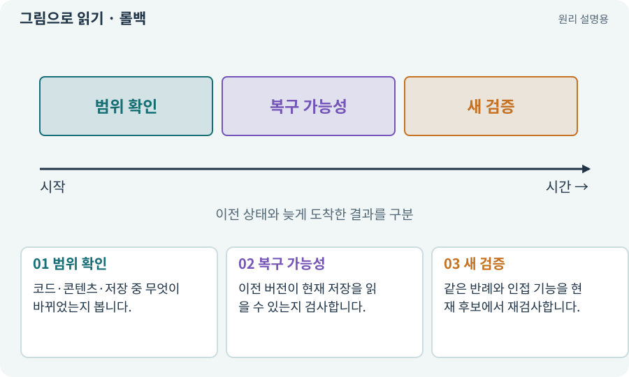

# 롤백·핫픽스·이전 버전

**분야:** 비동기·다운로드·빌드·버전 관리

롤백은 문제가 있는 변경 대신 이전 정상 버전으로 돌아가는 것이고, 핫픽스는 결함을 작게 고친 새 변경입니다. 앱·콘텐츠·저장 데이터는 되돌릴 수 있는 조건이 다릅니다.

**찾아오는 이름:** 롤백·핫픽스·이전 버전, 롤백, Rollback, rollback, 핫픽스, Hotfix, hotfix, 되돌리기

## 익숙한 것에 비유하면

새 메뉴에 문제가 있으면 이전 메뉴로 돌아가거나 조리법 한 부분만 고치는 것과 같습니다. 이미 판매한 내역까지 사라지지는 않습니다.



개념도입니다. 실제 Unity 화면이나 검사 결과가 아닙니다. 그림의 순서·색은 역할을 구분하며 실제 설정값은 프로젝트에서 확인합니다.

## 이렇게 작동합니다

### 1. 범위 확인

코드·콘텐츠·저장 중 무엇이 바뀌었는지 봅니다.

### 2. 복구 가능성

이전 버전이 현재 저장을 읽을 수 있는지 검사합니다.

### 3. 새 검증

같은 반례와 인접 기능을 현재 후보에서 재검사합니다.

## 우리 RPG에서는 이렇게 만나요

schema 3로 변한 저장을 schema 2 앱으로 억지로 열면 데이터가 사라질 수 있습니다. 원본 백업을 보존하고 역이전 정책 없는 경우 안전하게 거부합니다.

## 이것과 혼동하지 마세요

카탈로그를 이전 버전으로 바꿨다고 이미 로드된 오브젝트나 저장이 자동 복원되지는 않습니다.

## 이해했는지 한 번 생각해 보기

실패 로그를 지우고 이전 파일만 두면 복구 완료인가요?

<details><summary>답과 이유</summary>

실제 동작·호환성을 검사하고 실패와 복구 이력을 보존해야 합니다.

</details>

## 내 프로젝트에서 확인하고 싶다면

아래 요청은 읽기 전용으로 실제 대상을 확인하는 선택 요청입니다. 코드나 설정을 직접 편집할 필요는 없습니다.

```text
현재 프로젝트에서 롤백·핫픽스·이전 버전 관련 요소가 어떻게 사용되는지 읽기 전용으로 확인해 줘. 실제 대상과 설정을 찾아 쉬운 말과 작은 예로 설명해 줘. 특히 다음 혼동을 구분해 줘: 카탈로그를 이전 버전으로 바꿨다고 이미 로드된 오브젝트나 저장이 자동 복원되지는 않습니다. 아직 코드·설정·파일은 바꾸지 말고, 확인할 수 없는 내용은 따로 알려 줘.
```

## 이어지는 개념

[저장 이전·마이그레이션](migration.md) · [스냅샷·기준선·baseline](snapshot.md) · [회귀·기준선·수정 전후 비교](regression.md) · [호환성·코드와 콘텐츠 계약](compatibility.md)

## 이 개념을 사용하는 실습

[77 · 앱을 바꾸지 않고 외형 업데이트하기](../index.html#lesson-077) · [98 · 3D 팩을 2D 팩과 따로 내려받기](../index.html#lesson-098) · [153 · 대장간 고해상도팩 선택 다운로드하기](../index.html#lesson-153) · [158 · 룬 교체 버그를 역할로 수정하기](../index.html#lesson-158) · [159 · 최종 확장판 배포 후보 만들기](../index.html#lesson-159)

## 참고와 설명의 범위

기본 도구 동작은 아래 공식 자료를 참고했습니다. 비유·그림·RPG의 예시 수치와 정책은 이해를 위한 자체 예제입니다. 실제 API·지원 기능은 설치 버전과 계정에서 확인합니다.

- [Unity Addressables · 콘텐츠 업데이트](https://docs.unity3d.com/Packages/com.unity.addressables@2.7/manual/builds-update-build.html)

그림·계산 예제·조작 모형은 자체 제작한 설명입니다. 실제 Unity 화면, 서비스 생성 결과, 성능 실측 또는 게임 테스트 결과가 아닙니다. 자료 확인: 2026년 9월 26일.
