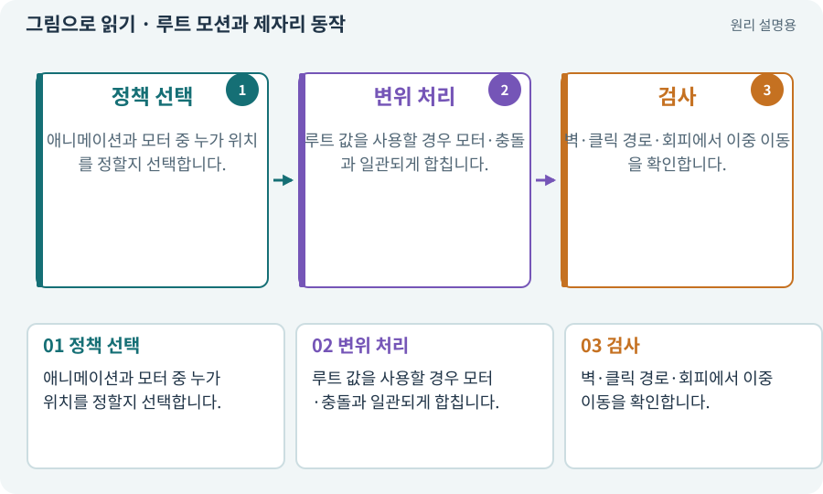

# 루트 모션과 제자리 동작

**분야:** 그림·애니메이션·화면 만들기

루트 모션은 애니메이션에 들어 있는 전체 이동·회전 정보를 캐릭터 이동에 반영하는 방식입니다. 제자리 동작은 그림이나 모델은 걷지만 월드 위치 이동을 모터가 맡는 방식입니다.

**찾아오는 이름:** 루트 모션과 제자리 동작, Root Motion, 루트 모션, in-place, 제자리 애니메이션

## 익숙한 것에 비유하면

러닝머신 위 걷기와 실제 길을 걷는 차이입니다. 벨트 이동과 바깥 위치 이동을 동시에 더하면 두 배로 갈 수 있습니다.



개념도입니다. 실제 Unity 화면이나 검사 결과가 아닙니다. 그림의 순서·색은 역할을 구분하며 실제 설정값은 프로젝트에서 확인합니다.

## 이렇게 작동합니다

### 1. 정책 선택

애니메이션과 모터 중 누가 위치를 정할지 선택합니다.

### 2. 변위 처리

루트 값을 사용할 경우 모터·충돌과 일관되게 합칩니다.

### 3. 검사

벽·클릭 경로·회피에서 이중 이동을 확인합니다.

## 우리 RPG에서는 이렇게 만나요

3D 추가편의 출발은 단일 모터와 제자리 애니메이션으로 단순화합니다. 이후 루트 모션을 쓰더라도 기존 위치 책임을 바꾸는 계약이 필요합니다.

## 이것과 혼동하지 마세요

모델이 앞으로 나아가는 클립에 모터 이동까지 더하면 속도가 달라질 수 있습니다.

## 이해했는지 한 번 생각해 보기

걷기 클립을 바꿨는데 이동 속도가 갑자기 두 배면?

<details><summary>답과 이유</summary>

루트 모션과 모터가 동시에 이동을 적용하는지 봅니다.

</details>

## 내 프로젝트에서 확인하고 싶다면

아래 요청은 읽기 전용으로 실제 대상을 확인하는 선택 요청입니다. 코드나 설정을 직접 편집할 필요는 없습니다.

```text
현재 프로젝트에서 루트 모션과 제자리 동작 관련 요소가 어떻게 사용되는지 읽기 전용으로 확인해 줘. 실제 대상과 설정을 찾아 쉬운 말과 작은 예로 설명해 줘. 특히 다음 혼동을 구분해 줘: 모델이 앞으로 나아가는 클립에 모터 이동까지 더하면 속도가 달라질 수 있습니다. 아직 코드·설정·파일은 바꾸지 말고, 확인할 수 없는 내용은 따로 알려 줘.
```

## 이어지는 개념

[이동 모터와 단일 위치 책임](motor.md) · [Animator·Controller·전이](animator.md) · [리그·본·스키닝·Avatar](rig.md) · [CharacterController](controller.md)

## 이 개념을 사용하는 실습

[85 · 3D 캐릭터를 한 모터로 움직이기](../index.html#lesson-085) · [88 · 3D 모델에 걷기와 공격 연결하기](../index.html#lesson-088)

## 참고와 설명의 범위

기본 도구 동작은 아래 공식 자료를 참고했습니다. 비유·그림·RPG의 예시 수치와 정책은 이해를 위한 자체 예제입니다. 실제 API·지원 기능은 설치 버전과 계정에서 확인합니다.

- [Unity · 루트 모션](https://docs.unity3d.com/6000.3/Documentation/Manual/RootMotion.html)

그림·계산 예제·조작 모형은 자체 제작한 설명입니다. 실제 Unity 화면, 서비스 생성 결과, 성능 실측 또는 게임 테스트 결과가 아닙니다. 자료 확인: 2026년 9월 26일.
