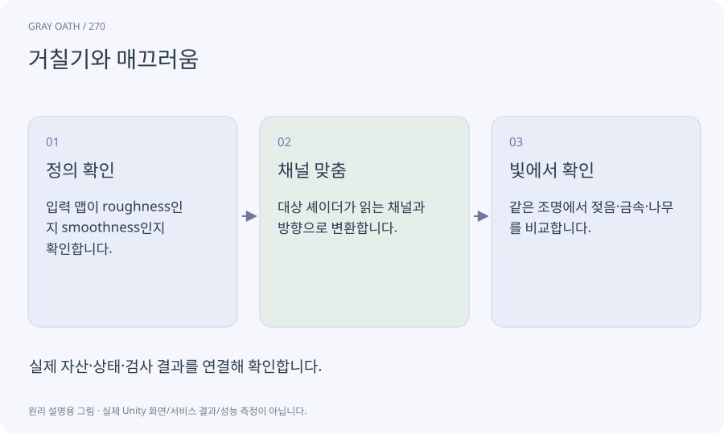

# 거칠기와 매끄러움

표면 반사가 얼마나 넓게 퍼지는지 나타내는 값입니다. 거칠기가 높을수록 반사가 퍼지고 매끄러움 값은 반대 방향으로 해석되는 경우가 많습니다.

## 익숙한 비유

거울과 무광 금속의 빛 반사 차이입니다.



## 작동 원리

### 1. 정의 확인

입력 맵이 roughness인지 smoothness인지 확인합니다.

### 2. 채널 맞춤

대상 셰이더가 읽는 채널과 방향으로 변환합니다.

### 3. 빛에서 확인

같은 조명에서 젖음·금속·나무를 비교합니다.

## 게임 속 예

단순 변환이1-roughness인 경로라도 맵의 선형 값과 패킹 채널을 함께 맞춰야 합니다. 실제 셰이더의 규격을 따릅니다.

## 혼동하지 않기

파일명이 metallic이라고 해서 모든 채널이 금속성만 담고 있다고 가정하지 않습니다.

## 확인 질문

나무가 거울처럼 빛나면 어디를 볼까요?

거칠기/매끄러움 반전·채널·색 공간·금속성 설정을 확인합니다.

## 내 프로젝트에서 확인하기

```text
현재 GrayOathRPG3D에서 거칠기와 매끄러움을 사용하는 실제 대상과 동작을 읽기 전용으로 확인해 줘. 쉬운 말과 작은 사례로 설명하고 파일명이 metallic이라고 해서 모든 채널이 금속성만 담고 있다고 가정하지 않습니다. 이 문제를 어떻게 막는지 보여 줘. 코드·데이터·설정은 아직 수정하지 마.
```

## 관련 해설

[pbr](pbr.md) · [texture](texture.md) · [shader-graph](shader-graph.md)

## 공식 참고

- [Meshy · Retexture](https://docs.meshy.ai/en/api/retexture)
- [Unity · URP performance](https://docs.unity3d.com/6000.3/Documentation/Manual/urp/understand-performance.html)
