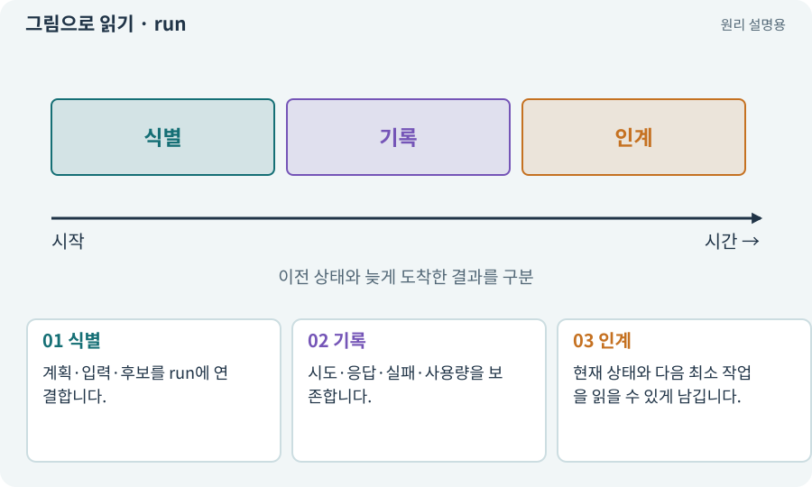

# run·attempt·revision·인수인계

**분야:** AI·스킬·훅·하네스 운영

run은 고정한 작업 계획을 실행한 한 묶음, attempt는 그 안의 개별 시도, revision은 계획이나 후보의 새 버전입니다. 이 용어의 세부 정책은 하네스 구현에서 정합니다.

**찾아오는 이름:** run·attempt·revision·인수인계, run, attempt, revision, 작업 실행, 실행 이력, 인수인계, 대시보드, attempts

## 익숙한 것에 비유하면

하나의 수리 접수번호 아래 여러 점검 시도가 있고, 요청 범위가 바뀌면 새 접수를 연결하는 것입니다.



개념도입니다. 실제 Unity 화면이나 검사 결과가 아닙니다. 그림의 순서·색은 역할을 구분하며 실제 설정값은 프로젝트에서 확인합니다.

## 이렇게 작동합니다

### 1. 식별

계획·입력·후보를 run에 연결합니다.

### 2. 기록

시도·응답·실패·사용량을 보존합니다.

### 3. 인계

현재 상태와 다음 최소 작업을 읽을 수 있게 남깁니다.

## 우리 RPG에서는 이렇게 만나요

실패한 run의 로그를 덮어쓰고 성공 결과만 남기면 원인을 추적하기 어렵습니다. 코드·계획이 바뀐 수정은 새 이력으로 연결합니다.

## 이것과 혼동하지 마세요

게임의 한 던전 탐험을 뜻하는 run과 개발 작업 run을 혼동하지 않습니다.

## 이해했는지 한 번 생각해 보기

재개할 때 이전 PASS부터 그대로 복사하면?

<details><summary>답과 이유</summary>

현재 후보·실행 중 프로세스·증거가 유효한지 먼저 확인해야 합니다.

</details>

## 내 프로젝트에서 확인하고 싶다면

아래 요청은 읽기 전용으로 실제 대상을 확인하는 선택 요청입니다. 코드나 설정을 직접 편집할 필요는 없습니다.

```text
현재 프로젝트에서 run·attempt·revision·인수인계 관련 요소가 어떻게 사용되는지 읽기 전용으로 확인해 줘. 실제 대상과 설정을 찾아 쉬운 말과 작은 예로 설명해 줘. 특히 다음 혼동을 구분해 줘: 게임의 한 던전 탐험을 뜻하는 run과 개발 작업 run을 혼동하지 않습니다. 아직 코드·설정·파일은 바꾸지 말고, 확인할 수 없는 내용은 따로 알려 줘.
```

## 이어지는 개념

[컨텍스트·세션·작업 기록](context.md) · [스케줄러·순차·병렬](scheduler.md) · [재시도·백오프·복구](retry.md) · [증거·검사 상태·미실행](evidence.md)

## 이 개념을 사용하는 실습

[21 · 몬스터가 장비를 떨어뜨리게 하기](../index.html#lesson-021) · [29 · 방마다 적과 상자 배치하기](../index.html#lesson-029) · [30 · 예고를 보고 피하는 보스 만들기](../index.html#lesson-030) · [31 · 퀘스트를 받아 엔딩까지 이어가기](../index.html#lesson-031) · [32 · 길 안내와 처음 하는 사람의 동선 만들기](../index.html#lesson-032) · [47 · 실패하는 시드를 찾고 복구하기](../index.html#lesson-047) · [48 · 적이 나를 보고 놓치게 만들기](../index.html#lesson-048) · [110 · 작업마다 필요한 자료만 준비하기](../index.html#lesson-110) · [112 · 네 역할을 순서대로 실행하기](../index.html#lesson-112) · [115 · 지금 코드의 검사만 인정하기](../index.html#lesson-115) · [116 · “어디까지 됐어?”에 근거로 답하기](../index.html#lesson-116) · [117 · Unity 작업을 한 창구로 모으기](../index.html#lesson-117) · [127 · 내 반복 업무에 맞게 도구 개조하기](../index.html#lesson-127) · [128 · 내 도구를 대화로 운영하기](../index.html#lesson-128) · [129 · 기존 2D 게임에서 확장팩 시작하기](../index.html#lesson-129) · [130 · 첫 확장 작업을 하네스에 연결하기](../index.html#lesson-130) · [133 · 첫 기능의 실패를 고쳐 다음 기준 만들기](../index.html#lesson-133) · [138 · 장비를 분해해 재료 얻기](../index.html#lesson-138) · [139 · 재료로 장비 제작하기](../index.html#lesson-139) · [140 · 개인 창고와 즐겨찾기 만들기](../index.html#lesson-140) · [144 · 이번 탐험에만 남는 유물 고르기](../index.html#lesson-144) · [152 · 이전 저장을 새 확장판으로 가져오기](../index.html#lesson-152) · [156 · 기능 조합에서 숨은 오류 찾기](../index.html#lesson-156) · [157 · 하네스가 실패해도 기록 지키기](../index.html#lesson-157) · [158 · 룬 교체 버그를 역할로 수정하기](../index.html#lesson-158) · [159 · 최종 확장판 배포 후보 만들기](../index.html#lesson-159) · [160 · 대장간 보스까지 완주하고 새 기능 맡기기](../index.html#lesson-160)

## 참고와 설명의 범위

이 항목의 비유·그림·RPG 수치·운영 규칙은 개념을 이해하기 위한 자체 설계 예제입니다. 특정 도구가 이 규칙을 자동으로 구현한다는 뜻은 아닙니다.


그림·계산 예제·조작 모형은 자체 제작한 설명입니다. 실제 Unity 화면, 서비스 생성 결과, 성능 실측 또는 게임 테스트 결과가 아닙니다. 자료 확인: 2026년 9월 26일.
