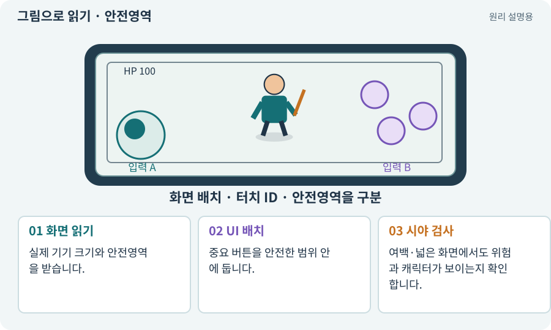

# 안전영역·화면 비율·Viewport

**분야:** 입력·UI·소리·성능

안전영역은 노치·둥근 모서리·시스템 영역 때문에 가려지지 않는 UI 범위입니다. 화면 비율은 가로와 세로의 관계이고, Viewport는 카메라나 UI가 사용하는 화면 영역입니다.

**찾아오는 이름:** 안전영역·화면 비율·Viewport, 안전영역, Safe Area, safeArea, 화면 비율, Aspect, 뷰포트, 레터박스

## 익숙한 것에 비유하면

창문 테두리를 피해서 안내문을 붙이는 것입니다. 전체 유리 크기와 실제 잘 보이는 면적은 다를 수 있습니다.



개념도입니다. 실제 Unity 화면이나 검사 결과가 아닙니다. 그림의 순서·색은 역할을 구분하며 실제 설정값은 프로젝트에서 확인합니다.

## 이렇게 작동합니다

### 1. 화면 읽기

실제 기기 크기와 안전영역을 받습니다.

### 2. UI 배치

중요 버튼을 안전한 범위 안에 둡니다.

### 3. 시야 검사

여백·넓은 화면에서도 위험과 캐릭터가 보이는지 확인합니다.

## 우리 RPG에서는 이렇게 만나요

16:9에서 맞춘 HUD가 길쭉한 휴대폰에서 과도하게 멀어질 수 있습니다. 노치 양방향과 앱 복귀 후 영역 변화를 검사합니다.

## 이것과 혼동하지 마세요

에디터 해상도 프리셋은 실제 터치·시스템 영역 검증을 완전히 대체하지 않습니다.

## 이해했는지 한 번 생각해 보기

화면이 넓어졌다고 캐릭터 크기를 무조건 키우면?

<details><summary>답과 이유</summary>

주변 위험 시야가 줄 수 있습니다. 카메라 범위와 UI 정책을 나눠 봅니다.

</details>

## 내 프로젝트에서 확인하고 싶다면

아래 요청은 읽기 전용으로 실제 대상을 확인하는 선택 요청입니다. 코드나 설정을 직접 편집할 필요는 없습니다.

```text
현재 프로젝트에서 안전영역·화면 비율·Viewport 관련 요소가 어떻게 사용되는지 읽기 전용으로 확인해 줘. 실제 대상과 설정을 찾아 쉬운 말과 작은 예로 설명해 줘. 특히 다음 혼동을 구분해 줘: 에디터 해상도 프리셋은 실제 터치·시스템 영역 검증을 완전히 대체하지 않습니다. 아직 코드·설정·파일은 바꾸지 말고, 확인할 수 없는 내용은 따로 알려 줘.
```

## 이어지는 개념

[Canvas·RectTransform·앵커](canvas.md) · [카메라·직교·원근](camera.md) · [멀티터치·가상 조이스틱](multitouch.md) · [화면 좌표에서 월드 좌표로](screen-world.md)

## 이 개념을 사용하는 실습

[07 · 캐릭터와 벽이 있는 공간 만들기](../index.html#lesson-007) · [10 · 모바일 조이스틱과 버튼 배치하기](../index.html#lesson-010) · [36 · 휴대폰에서 두 손가락으로 전투하기](../index.html#lesson-036) · [83 · 3D 카메라와 재질로 공간 보기](../index.html#lesson-083) · [96 · 3D 카메라 가림과 터치 조작 다듬기](../index.html#lesson-096) · [104 · 2D와 3D를 두 플랫폼에서 완주하기](../index.html#lesson-104)

## 참고와 설명의 범위

기본 도구 동작은 아래 공식 자료를 참고했습니다. 비유·그림·RPG의 예시 수치와 정책은 이해를 위한 자체 예제입니다. 실제 API·지원 기능은 설치 버전과 계정에서 확인합니다.

- [Unity Input System · UI 지원](https://docs.unity3d.com/Packages/com.unity.inputsystem@1.17/manual/UISupport.html)

그림·계산 예제·조작 모형은 자체 제작한 설명입니다. 실제 Unity 화면, 서비스 생성 결과, 성능 실측 또는 게임 테스트 결과가 아닙니다. 자료 확인: 2026년 9월 26일.
