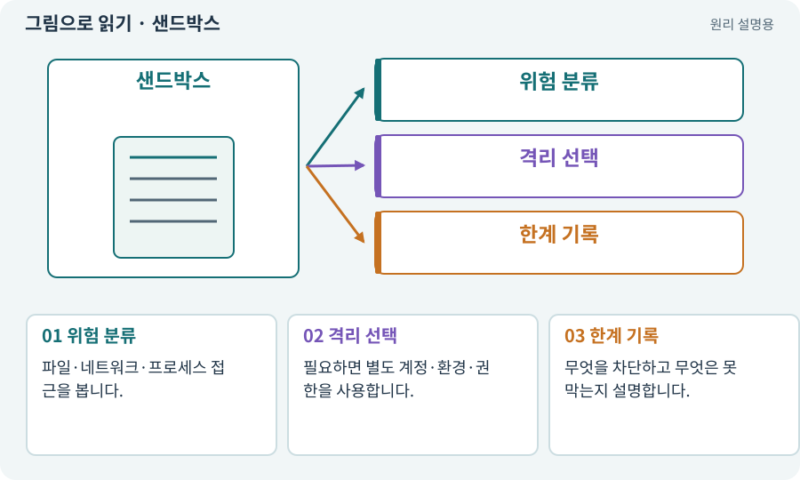

# 샌드박스·후보 폴더·격리

**분야:** AI·스킬·훅·하네스 운영

샌드박스는 프로그램이 접근·실행할 수 있는 범위를 제한하는 환경입니다. 단순히 후보 폴더를 따로 만들거나 프롬프트에 금지를 적는 것과 운영체제 수준의 격리는 다릅니다.

**찾아오는 이름:** 샌드박스·후보 폴더·격리, 샌드박스, sandbox, 격리, 보안 경계, 격리 실행

## 익숙한 것에 비유하면

상자에 “손대지 마시오”를 적는 것과 실제 잠금장치가 있는 방에 넣는 차이입니다.



개념도입니다. 실제 Unity 화면이나 검사 결과가 아닙니다. 그림의 순서·색은 역할을 구분하며 실제 설정값은 프로젝트에서 확인합니다.

## 이렇게 작동합니다

### 1. 위험 분류

파일·네트워크·프로세스 접근을 봅니다.

### 2. 격리 선택

필요하면 별도 계정·환경·권한을 사용합니다.

### 3. 한계 기록

무엇을 차단하고 무엇은 못 막는지 설명합니다.

## 우리 RPG에서는 이렇게 만나요

검토한 Python 테스트나 Unity Editor 스크립트도 실행하면 컴퓨터에서 코드를 수행합니다. 새 후보에 있다는 이유만으로 악의적인 코드에 안전한 것은 아닙니다.

## 이것과 혼동하지 마세요

AI 프롬프트·경로 검사·협력 잠금은 유용하지만 완전한 보안 제품으로 과장하지 않습니다.

## 이해했는지 한 번 생각해 보기

후보 폴더에서 실행한 코드가 밖의 파일에 접근할 수 있나요?

<details><summary>답과 이유</summary>

실제 OS 권한이 허용하면 가능할 수 있습니다. 격리 조건을 확인해야 합니다.

</details>

## 내 프로젝트에서 확인하고 싶다면

아래 요청은 읽기 전용으로 실제 대상을 확인하는 선택 요청입니다. 코드나 설정을 직접 편집할 필요는 없습니다.

```text
현재 프로젝트에서 샌드박스·후보 폴더·격리 관련 요소가 어떻게 사용되는지 읽기 전용으로 확인해 줘. 실제 대상과 설정을 찾아 쉬운 말과 작은 예로 설명해 줘. 특히 다음 혼동을 구분해 줘: AI 프롬프트·경로 검사·협력 잠금은 유용하지만 완전한 보안 제품으로 과장하지 않습니다. 아직 코드·설정·파일은 바꾸지 말고, 확인할 수 없는 내용은 따로 알려 줘.
```

## 이어지는 개념

[권한·승인·최소 권한](permission.md) · [프로세스·종료 코드·표준 출력](process.md) · [후보·스테이징·변경 적용](candidate.md) · [환각·프롬프트 인젝션·신뢰 경계](hallucination.md)

## 이 개념을 사용하는 실습

[25 · 게임을 껐다 켜도 장비 유지하기](../index.html#lesson-025) · [41 · 선택할 수 있는9노드 스킬트리 만들기](../index.html#lesson-041) · [80 · 나만의 2D RPG 완성하기](../index.html#lesson-080) · [99 · 2D와 3D 사이에 진행 가져오기](../index.html#lesson-099) · [105 · 내 개발 도구를 빈 폴더에서 시작하기](../index.html#lesson-105) · [106 · 도구가 상태를 기억하게 만들기](../index.html#lesson-106) · [107 · 원본을 보호하고 허용 경로 정하기](../index.html#lesson-107) · [118 · 모의 응답 대신 실제 Claude 연결하기](../index.html#lesson-118) · [119 · 막힌 작업을 안전하게 이어가기](../index.html#lesson-119) · [122 · 내 게임에 맞는 검사기 추가하기](../index.html#lesson-122) · [128 · 내 도구를 대화로 운영하기](../index.html#lesson-128) · [133 · 첫 기능의 실패를 고쳐 다음 기준 만들기](../index.html#lesson-133) · [157 · 하네스가 실패해도 기록 지키기](../index.html#lesson-157)

## 참고와 설명의 범위

기본 도구 동작은 아래 공식 자료를 참고했습니다. 비유·그림·RPG의 예시 수치와 정책은 이해를 위한 자체 예제입니다. 실제 API·지원 기능은 설치 버전과 계정에서 확인합니다.

- [Claude Code · CLI 명령 옵션](https://code.claude.com/docs/en/cli-reference)

그림·계산 예제·조작 모형은 자체 제작한 설명입니다. 실제 Unity 화면, 서비스 생성 결과, 성능 실측 또는 게임 테스트 결과가 아닙니다. 자료 확인: 2026년 9월 26일.
