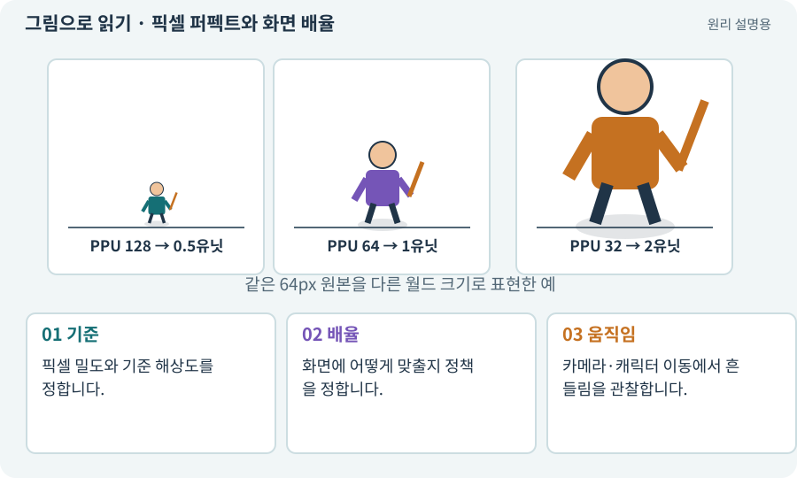

# 픽셀 퍼펙트와 화면 배율

**분야:** 그림·애니메이션·화면 만들기

픽셀 퍼펙트는 원본 픽셀과 화면 픽셀의 대응을 안정적으로 유지하려는 표시 방식입니다. 월드 위치, 카메라, 기준 해상도와 배율을 함께 다룹니다.

**찾아오는 이름:** 픽셀 퍼펙트와 화면 배율, Pixel Perfect, 픽셀 퍼펙트, 정수 배율, 서브픽셀

## 익숙한 것에 비유하면

바둑판 한 칸을 화면의 정확한 2×2칸으로 확대하면 선이 일정하지만 2.3칸씩 쓰면 칸 너비가 들쭉날쭉할 수 있습니다.



개념도입니다. 실제 Unity 화면이나 검사 결과가 아닙니다. 그림의 순서·색은 역할을 구분하며 실제 설정값은 프로젝트에서 확인합니다.

## 이렇게 작동합니다

### 1. 기준

픽셀 밀도와 기준 해상도를 정합니다.

### 2. 배율

화면에 어떻게 맞출지 정책을 정합니다.

### 3. 움직임

카메라·캐릭터 이동에서 흔들림을 관찰합니다.

## 우리 RPG에서는 이렇게 만나요

픽셀 아트 캐릭터만 정수 배율인데 UI·배경이 다른 규칙을 쓰면 스타일이 어긋날 수 있습니다. 화면 비율이 다를 때 여백과 시야도 확인합니다.

## 이것과 혼동하지 마세요

픽셀 퍼펙트는 충돌·길찾기 정밀도를 높여 주는 물리 기능이 아닙니다.

## 이해했는지 한 번 생각해 보기

그림을 픽셀에 맞추려고 물리 좌표를 매번 반올림하면?

<details><summary>답과 이유</summary>

이동이 끊기거나 충돌이 달라질 수 있습니다. 표시와 논리 좌표를 분리해 검토합니다.

</details>

## 내 프로젝트에서 확인하고 싶다면

아래 요청은 읽기 전용으로 실제 대상을 확인하는 선택 요청입니다. 코드나 설정을 직접 편집할 필요는 없습니다.

```text
현재 프로젝트에서 픽셀 퍼펙트와 화면 배율 관련 요소가 어떻게 사용되는지 읽기 전용으로 확인해 줘. 실제 대상과 설정을 찾아 쉬운 말과 작은 예로 설명해 줘. 특히 다음 혼동을 구분해 줘: 픽셀 퍼펙트는 충돌·길찾기 정밀도를 높여 주는 물리 기능이 아닙니다. 아직 코드·설정·파일은 바꾸지 말고, 확인할 수 없는 내용은 따로 알려 줘.
```

## 이어지는 개념

[Point·Bilinear 필터와 픽셀 아트](filter.md) · [카메라·직교·원근](camera.md) · [PPU: 픽셀과 월드 크기](ppu.md) · [XY·XZ 평면과 논리 좌표](coordinates.md)

## 이 개념을 사용하는 실습

다른 개념을 이해하기 위한 보충 해설입니다.

## 참고와 설명의 범위

기본 도구 동작은 아래 공식 자료를 참고했습니다. 비유·그림·RPG의 예시 수치와 정책은 이해를 위한 자체 예제입니다. 실제 API·지원 기능은 설치 버전과 계정에서 확인합니다.

- [Unity · Sprite](https://docs.unity3d.com/6000.3/Documentation/Manual/sprite/sprite-landing.html)

그림·계산 예제·조작 모형은 자체 제작한 설명입니다. 실제 Unity 화면, 서비스 생성 결과, 성능 실측 또는 게임 테스트 결과가 아닙니다. 자료 확인: 2026년 9월 26일.
