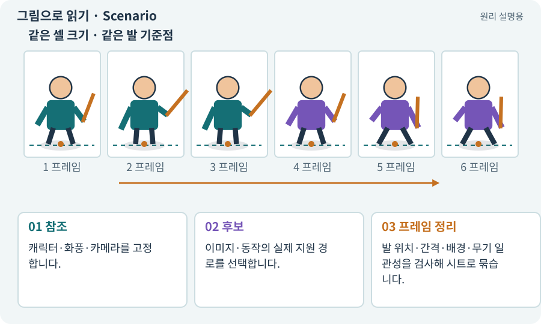

# Scenario·스타일 유지·영상 프레임

**분야:** 자산 제작·렌더링 보충

Scenario는 참조와 여러 생성 경로를 사용해 게임 아트 제작 흐름을 구성하는 서비스입니다. 스프라이트 제작에서는 방향 확장이나 동작 영상에서 프레임을 고르는 경로도 사용할 수 있습니다.

**찾아오는 이름:** Scenario·스타일 유지·영상 프레임, Scenario, 시나리오 AI

## 익숙한 것에 비유하면

같은 미술 지침으로 여러 시안을 만들고 필요한 컷을 편집해 납품하는 제작실에 가깝습니다.



개념도입니다. 실제 Unity 화면이나 검사 결과가 아닙니다. 그림의 순서·색은 역할을 구분하며 실제 설정값은 프로젝트에서 확인합니다.

## 이렇게 작동합니다

### 1. 참조

캐릭터·화풍·카메라를 고정합니다.

### 2. 후보

이미지·동작의 실제 지원 경로를 선택합니다.

### 3. 프레임 정리

발 위치·간격·배경·무기 일관성을 검사해 시트로 묶습니다.

## 우리 RPG에서는 이렇게 만나요

영상에서 프레임을 뽑았더라도 카메라가 움직이거나 몸 비율이 변하면 게임 스프라이트로 곧바로 사용할 수 없습니다. 고정 시점과 정확한 동작 범위를 요청합니다.

## 이것과 혼동하지 마세요

영상 생성 성공은 반복 가능한 프레임 시트 성공과 다릅니다.

## 이해했는지 한 번 생각해 보기

동작 영상이 멋있으면 모든 프레임을 그대로 쓰면 되나요?

<details><summary>답과 이유</summary>

루프·프레임 간 일관성·타격 시점과 규격을 확인해 선택·정리해야 합니다.

</details>

## 내 프로젝트에서 확인하고 싶다면

아래 요청은 읽기 전용으로 실제 대상을 확인하는 선택 요청입니다. 코드나 설정을 직접 편집할 필요는 없습니다.

```text
현재 프로젝트에서 Scenario·스타일 유지·영상 프레임 관련 요소가 어떻게 사용되는지 읽기 전용으로 확인해 줘. 실제 대상과 설정을 찾아 쉬운 말과 작은 예로 설명해 줘. 특히 다음 혼동을 구분해 줘: 영상 생성 성공은 반복 가능한 프레임 시트 성공과 다릅니다. 아직 코드·설정·파일은 바꾸지 말고, 확인할 수 없는 내용은 따로 알려 줘.
```

## 이어지는 개념

[스프라이트 시트](sprite-sheet.md) · [트리밍·오프셋·고정 셀](trimming.md) · [애니메이션 클립·프레임·키프레임](animation-clip.md) · [생성형 아트·참조 이미지·후처리](image-service.md)

## 이 개념을 사용하는 실습

[60 · Scenario로 스타일과 동작 유지하기](../index.html#lesson-060) · [67 · 내 게임의 아트 제작 경로 선택하기](../index.html#lesson-067)

## 참고와 설명의 범위

기본 도구 동작은 아래 공식 자료를 참고했습니다. 비유·그림·RPG의 예시 수치와 정책은 이해를 위한 자체 예제입니다. 실제 API·지원 기능은 설치 버전과 계정에서 확인합니다.

- [Scenario · 스프라이트 시트 제작](https://help.scenario.com/articles/9088582240-create-spritesheets-with-scenario)

그림·계산 예제·조작 모형은 자체 제작한 설명입니다. 실제 Unity 화면, 서비스 생성 결과, 성능 실측 또는 게임 테스트 결과가 아닙니다. 자료 확인: 2026년 9월 26일.
