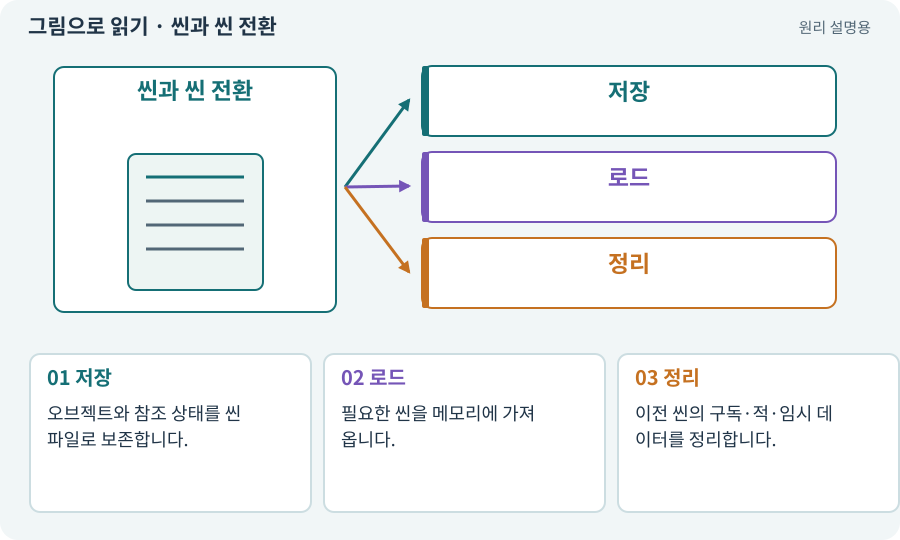

# 씬과 씬 전환

**분야:** 시작·도구·작업 공간

씬은 오브젝트의 배치와 연결을 저장한 공간 단위입니다. 마을·던전·실습장을 다른 씬으로 나누거나, 한 씬 안에서 여러 구역을 관리할 수 있습니다.

**찾아오는 이름:** 씬과 씬 전환, 씬, Scene, 씬 전환, Boot, MainMenu, TestArena

## 익숙한 것에 비유하면

연극의 무대 세트 한 벌입니다. 세트가 바뀌어도 주인공이 얻은 검이라는 이야기는 이어져야 합니다.



개념도입니다. 실제 Unity 화면이나 검사 결과가 아닙니다. 그림의 순서·색은 역할을 구분하며 실제 설정값은 프로젝트에서 확인합니다.

## 이렇게 작동합니다

### 1. 저장

오브젝트와 참조 상태를 씬 파일로 보존합니다.

### 2. 로드

필요한 씬을 메모리에 가져옵니다.

### 3. 정리

이전 씬의 구독·적·임시 데이터를 정리합니다.

## 우리 RPG에서는 이렇게 만나요

Boot는 공통 준비, MainMenu는 새 게임·이어하기, Town은 정비에 쓰는 프로젝트상의 이름입니다. Unity가 모든 프로젝트에 자동으로 만들어 주는 필수 씬 이름은 아닙니다.

## 이것과 혼동하지 마세요

씬 전환은 저장 파일 작성과 다릅니다. 영구 데이터는 별도 저장해야 합니다.

## 이해했는지 한 번 생각해 보기

마을로 돌아가면 던전의 바닥 아이템도 영구 저장되나요?

<details><summary>답과 이유</summary>

그렇게 설계했을 때만 그렇습니다. 이 게임은 영구 진행과 이번 탐험 상태를 분리합니다.

</details>

## 내 프로젝트에서 확인하고 싶다면

아래 요청은 읽기 전용으로 실제 대상을 확인하는 선택 요청입니다. 코드나 설정을 직접 편집할 필요는 없습니다.

```text
현재 프로젝트에서 씬과 씬 전환 관련 요소가 어떻게 사용되는지 읽기 전용으로 확인해 줘. 실제 대상과 설정을 찾아 쉬운 말과 작은 예로 설명해 줘. 특히 다음 혼동을 구분해 줘: 씬 전환은 저장 파일 작성과 다릅니다. 영구 데이터는 별도 저장해야 합니다. 아직 코드·설정·파일은 바꾸지 말고, 확인할 수 없는 내용은 따로 알려 줘.
```

## 이어지는 개념

[GameObject](gameobject.md) · [수명주기·초기화·정리](lifecycle.md) · [파일 저장·게임 세이브·백업](save.md) · [영구 진행·탐험 세션·런타임 상태](session.md)

## 이 개념을 사용하는 실습

[03 · AI와 실행 중인 Unity 연결하기](../index.html#lesson-003) · [04 · 되돌릴 수 있는 작업 습관 만들기](../index.html#lesson-004) · [05 · 말로 스프라이트 하나 만들기](../index.html#lesson-005) · [06 · 시작 메뉴와 테스트 공간 연결하기](../index.html#lesson-006) · [07 · 캐릭터와 벽이 있는 공간 만들기](../index.html#lesson-007) · [08 · WASD로 벽에 부딪히며 이동하기](../index.html#lesson-008) · [09 · 클릭한 곳까지 벽을 돌아가기](../index.html#lesson-009) · [11 · PC와 휴대폰에서 처음 실행하기](../index.html#lesson-011) · [12 · 체력과 피해를 눈으로 확인하기](../index.html#lesson-012) · [13 · 적을 클릭해 접근하고 공격하기](../index.html#lesson-013) · [14 · 나를 발견하고 공격하는 적 만들기](../index.html#lesson-014) · [15 · 다른 방식으로 싸우는 적 추가하기](../index.html#lesson-015) · [16 · 물약을 쓰고 죽은 뒤 다시 시작하기](../index.html#lesson-016) · [18 · 베기·마력탄·회전 공격 만들기](../index.html#lesson-018) · [26 · 새 게임·이어하기·마을 연결하기](../index.html#lesson-026) · [31 · 퀘스트를 받아 엔딩까지 이어가기](../index.html#lesson-031) · [33 · 기본 캐릭터·몬스터·타일 아트 만들기](../index.html#lesson-033) · [34 · 걷기·공격·피격·사망 움직임 연결하기](../index.html#lesson-034) · [37 · 느려지는 원인을 측정해 고치기](../index.html#lesson-037) · [38 · 테스트 결과와 실제 플레이 구분하기](../index.html#lesson-038) · [39 · 다른 PC와 Android 에서 실행할 파일 만들기](../index.html#lesson-039) · [48 · 적이 나를 보고 놓치게 만들기](../index.html#lesson-048) · [49 · 여러 근접 적의 공격 나누기](../index.html#lesson-049) · [52 · 전투에서 선택할 이유 만들기](../index.html#lesson-052) · [68 · 피격 불꽃과 먼지 만들기](../index.html#lesson-068) · [69 · 베기와 폭발을 시트 애니메이션으로 만들기](../index.html#lesson-069) · [72 · 모바일 효과를 줄여도 위험은 남기기](../index.html#lesson-072) · [73 · 주소로 에셋 불러오기](../index.html#lesson-073) · [83 · 3D 카메라와 재질로 공간 보기](../index.html#lesson-083) · [93 · 3D 마을과 퀘스트 연결하기](../index.html#lesson-093) · [95 · 3D 조명과 환경을 읽기 좋게 만들기](../index.html#lesson-095) · [96 · 3D 카메라 가림과 터치 조작 다듬기](../index.html#lesson-096) · [97 · 선택: 3D 모델에서 2D 시트 만들기](../index.html#lesson-097) · [102 · 네 배포물을 구분해 만들기](../index.html#lesson-102) · [117 · Unity 작업을 한 창구로 모으기](../index.html#lesson-117) · [123 · 기존 게임의 실제 파일 찾아 연결하기](../index.html#lesson-123) · [124 · 현재 컴퓨터의 Unity 명령 등록하기](../index.html#lesson-124) · [125 · 하네스로 작은 전리품 화면 만들기](../index.html#lesson-125) · [129 · 기존 2D 게임에서 확장팩 시작하기](../index.html#lesson-129) · [132 · 필터를 실제 던전과 모바일에 연결하기](../index.html#lesson-132) · [145 · 지원 동료 하나 만들기](../index.html#lesson-145) · [146 · 대장장이 구조 퀘스트 만들기](../index.html#lesson-146) · [149 · 상태와 보스 효과를 같은 데이터로 맞추기](../index.html#lesson-149) · [150 · 소리가 없어도 읽히는 전투 만들기](../index.html#lesson-150) · [154 · 확장 기능을 켠 휴대폰 성능 고치기](../index.html#lesson-154)

## 참고와 설명의 범위

기본 도구 동작은 아래 공식 자료를 참고했습니다. 비유·그림·RPG의 예시 수치와 정책은 이해를 위한 자체 예제입니다. 실제 API·지원 기능은 설치 버전과 계정에서 확인합니다.

- [Unity · 2D 게임 제작 흐름](https://docs.unity3d.com/6000.3/Documentation/Manual/2d-game-creation-wokflow.html)

그림·계산 예제·조작 모형은 자체 제작한 설명입니다. 실제 Unity 화면, 서비스 생성 결과, 성능 실측 또는 게임 테스트 결과가 아닙니다. 자료 확인: 2026년 9월 26일.
