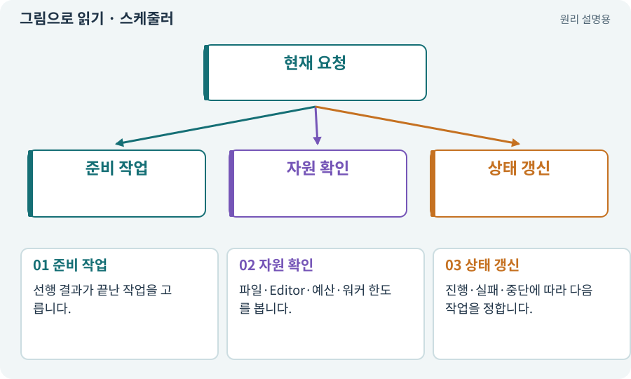

# 스케줄러·순차·병렬

**분야:** AI·스킬·훅·하네스 운영

스케줄러는 어떤 작업을 언제 실행할지 결정합니다. 순차는 하나씩, 병렬은 서로 독립적인 작업을 겹쳐 실행합니다. 병렬 수가 많을수록 항상 빠르거나 정확한 것은 아닙니다.

**찾아오는 이름:** 스케줄러·순차·병렬, 스케줄러, Scheduler, 스케줄링, 순차 실행, 병렬, Parallel, 워커, worker

## 익숙한 것에 비유하면

같은 주방에서 여러 요리를 만들되 오븐 하나는 동시에 여러 온도로 쓸 수 없다는 조건을 관리하는 것입니다.



개념도입니다. 실제 Unity 화면이나 검사 결과가 아닙니다. 그림의 순서·색은 역할을 구분하며 실제 설정값은 프로젝트에서 확인합니다.

## 이렇게 작동합니다

### 1. 준비 작업

선행 결과가 끝난 작업을 고릅니다.

### 2. 자원 확인

파일·Editor·예산·워커 한도를 봅니다.

### 3. 상태 갱신

진행·실패·중단에 따라 다음 작업을 정합니다.

## 우리 RPG에서는 이렇게 만나요

UI 코드와 순수 규칙 코드는 분리할 수 있어도 같은 씬 저장과 Play는 한 Editor 창구로 직렬화합니다. 현재 기본 하네스는 순차 기능을 먼저 완성합니다.

## 이것과 혼동하지 마세요

역할 수와 동시 프로세스 수를 같은 것으로 보지 않습니다.

## 이해했는지 한 번 생각해 보기

15개 역할이면 항상 15개 프로세스가 필요한가요?

<details><summary>답과 이유</summary>

아닙니다. 필요한 역할만 선택하고 독립성과 자원을 고려해 실행합니다.

</details>

## 내 프로젝트에서 확인하고 싶다면

아래 요청은 읽기 전용으로 실제 대상을 확인하는 선택 요청입니다. 코드나 설정을 직접 편집할 필요는 없습니다.

```text
현재 프로젝트에서 스케줄러·순차·병렬 관련 요소가 어떻게 사용되는지 읽기 전용으로 확인해 줘. 실제 대상과 설정을 찾아 쉬운 말과 작은 예로 설명해 줘. 특히 다음 혼동을 구분해 줘: 역할 수와 동시 프로세스 수를 같은 것으로 보지 않습니다. 아직 코드·설정·파일은 바꾸지 말고, 확인할 수 없는 내용은 따로 알려 줘.
```

## 이어지는 개념

[의존성·DAG·위상 정렬](dependency.md) · [잠금·경합·경쟁 상태](lock.md) · [파일 소유권·읽기 범위·쓰기 범위](ownership.md) · [비용 한도·예약·실사용량](budget.md)

## 이 개념을 사용하는 실습

[120 · 자연어 요청을 계획으로 바꾸기](../index.html#lesson-120) · [130 · 첫 확장 작업을 하네스에 연결하기](../index.html#lesson-130)

## 참고와 설명의 범위

이 항목의 비유·그림·RPG 수치·운영 규칙은 개념을 이해하기 위한 자체 설계 예제입니다. 특정 도구가 이 규칙을 자동으로 구현한다는 뜻은 아닙니다.


그림·계산 예제·조작 모형은 자체 제작한 설명입니다. 실제 Unity 화면, 서비스 생성 결과, 성능 실측 또는 게임 테스트 결과가 아닙니다. 자료 확인: 2026년 9월 26일.
