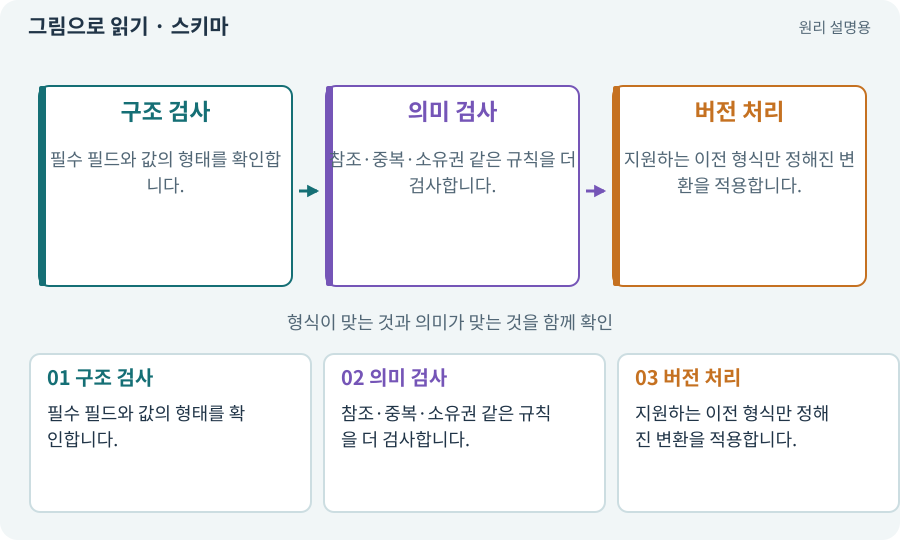

# 스키마·JSON Schema·계약

**분야:** 코드·데이터·저장·검사

스키마는 데이터가 어떤 필드·타입·범위를 가져야 하는지 정한 구조 약속입니다. 스키마 버전은 구조가 바뀌었음을 식별하고 이전 데이터 변환에 사용합니다.

**찾아오는 이름:** 스키마·JSON Schema·계약, 스키마, schema, JSON Schema, schemaVersion, schema1, schema2, schema3, 데이터 계약, schema 3, schema 2

## 익숙한 것에 비유하면

구형 신청서에는 이름·주소만 있고 신형에는 연락처가 추가된 상황입니다. 옛 신청서를 버리지 않고 새 형식에 맞춰 옮겨야 합니다.



개념도입니다. 실제 Unity 화면이나 검사 결과가 아닙니다. 그림의 순서·색은 역할을 구분하며 실제 설정값은 프로젝트에서 확인합니다.

## 이렇게 작동합니다

### 1. 구조 검사

필수 필드와 값의 형태를 확인합니다.

### 2. 의미 검사

참조·중복·소유권 같은 규칙을 더 검사합니다.

### 3. 버전 처리

지원하는 이전 형식만 정해진 변환을 적용합니다.

## 우리 RPG에서는 이렇게 만나요

창고와 룬을 추가한 schema3는 이전 schema2의 검과 옵션을 보존하면서 새 필드의 기본값을 넣어야 합니다. 버전 숫자만 3으로 바꾸면 변환이 아닙니다.

## 이것과 혼동하지 마세요

JSON Schema 통과가 게임의 모든 불변 조건을 보장하지는 않습니다.

## 이해했는지 한 번 생각해 보기

미래 버전 저장을 읽을 수 없으면 초기화해도 되나요?

<details><summary>답과 이유</summary>

원본을 보존하고 지원하지 않는 버전이라고 안내하는 경로가 필요합니다.

</details>

## 내 프로젝트에서 확인하고 싶다면

아래 요청은 읽기 전용으로 실제 대상을 확인하는 선택 요청입니다. 코드나 설정을 직접 편집할 필요는 없습니다.

```text
현재 프로젝트에서 스키마·JSON Schema·계약 관련 요소가 어떻게 사용되는지 읽기 전용으로 확인해 줘. 실제 대상과 설정을 찾아 쉬운 말과 작은 예로 설명해 줘. 특히 다음 혼동을 구분해 줘: JSON Schema 통과가 게임의 모든 불변 조건을 보장하지는 않습니다. 아직 코드·설정·파일은 바꾸지 말고, 확인할 수 없는 내용은 따로 알려 줘.
```

## 이어지는 개념

[저장 이전·마이그레이션](migration.md) · [JSON·객체·배열·필드](json.md) · [불변 조건·경계값·속성 검사](invariant.md) · [DTO·저장 데이터와 런타임 상태](dto.md)

## 이 개념을 사용하는 실습

[25 · 게임을 껐다 켜도 장비 유지하기](../index.html#lesson-025) · [31 · 퀘스트를 받아 엔딩까지 이어가기](../index.html#lesson-031) · [42 · 트리에서 투자하고 저장하기](../index.html#lesson-042) · [77 · 앱을 바꾸지 않고 외형 업데이트하기](../index.html#lesson-077) · [79 · 추가 기능을 하나의 게임으로 합치기](../index.html#lesson-079) · [99 · 2D와 3D 사이에 진행 가져오기](../index.html#lesson-099) · [138 · 장비를 분해해 재료 얻기](../index.html#lesson-138) · [142 · 배운 스킬의 변형 선택하기](../index.html#lesson-142) · [152 · 이전 저장을 새 확장판으로 가져오기](../index.html#lesson-152) · [159 · 최종 확장판 배포 후보 만들기](../index.html#lesson-159)

## 참고와 설명의 범위

기본 도구 동작은 아래 공식 자료를 참고했습니다. 비유·그림·RPG의 예시 수치와 정책은 이해를 위한 자체 예제입니다. 실제 API·지원 기능은 설치 버전과 계정에서 확인합니다.

- [Claude Code · 비대화형 실행](https://code.claude.com/docs/en/headless)
- [Python · JSON](https://docs.python.org/3/library/json.html)

그림·계산 예제·조작 모형은 자체 제작한 설명입니다. 실제 Unity 화면, 서비스 생성 결과, 성능 실측 또는 게임 테스트 결과가 아닙니다. 자료 확인: 2026년 9월 26일.
