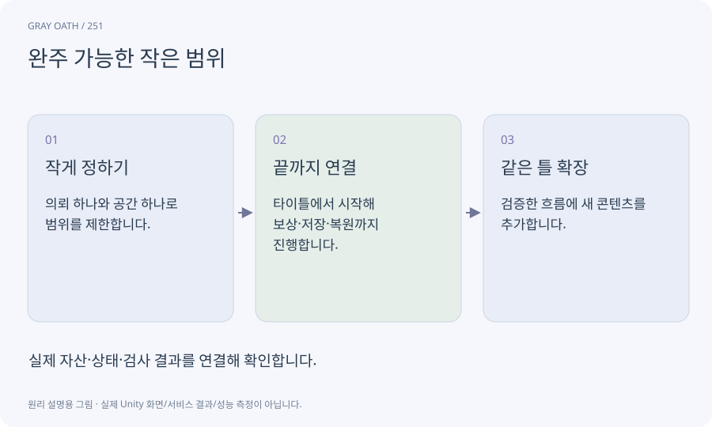

# 완주 가능한 작은 범위

이동·대화·전투·보상·저장처럼 제품의 핵심 흐름을 아주 작은 콘텐츠로 끝까지 연결한 상태입니다. 기능 메뉴만 여러 개 있는 프로토타입과 다릅니다.

## 익숙한 비유

큰 식당을 열기 전에 메뉴 한 가지를 주문부터 결제까지 실제로 제공해 보는 일입니다.



## 작동 원리

### 1. 작게 정하기

의뢰 하나와 공간 하나로 범위를 제한합니다.

### 2. 끝까지 연결

타이틀에서 시작해 보상·저장·복원까지 진행합니다.

### 3. 같은 틀 확장

검증한 흐름에 새 콘텐츠를 추가합니다.

## 게임 속 예

잃어버린 등불이라는 임시 의뢰로 NPC 대화→수색→보상→재실행을 먼저 확인합니다. 임시 의뢰는 출시용28개 수량에 넣지 않습니다.

## 혼동하지 않기

작은 구간이 성공했다고 모든 맵·기기·엔딩까지 검증된 것은 아닙니다.

## 확인 질문

적 한 마리를 공격할 수 있으면 완주 가능한 범위인가요?

전투만 확인한 상태입니다. 적을 만나는 경로·끝나는 조건·보상·저장까지 연결해야 합니다.

## 내 프로젝트에서 확인하기

```text
현재 GrayOathRPG3D에서 완주 가능한 작은 범위을 사용하는 실제 대상과 동작을 읽기 전용으로 확인해 줘. 쉬운 말과 작은 사례로 설명하고 작은 구간이 성공했다고 모든 맵·기기·엔딩까지 검증된 것은 아닙니다. 이 문제를 어떻게 막는지 보여 줘. 코드·데이터·설정은 아직 수정하지 마.
```

## 관련 해설

[quest-machine](quest-machine.md) · [save](save.md) · [release-candidate](release-candidate.md)

## 공식 참고

- [Unity · CLI reference](https://docs.unity.com/en-us/unity-cli/unity-cli-reference)
