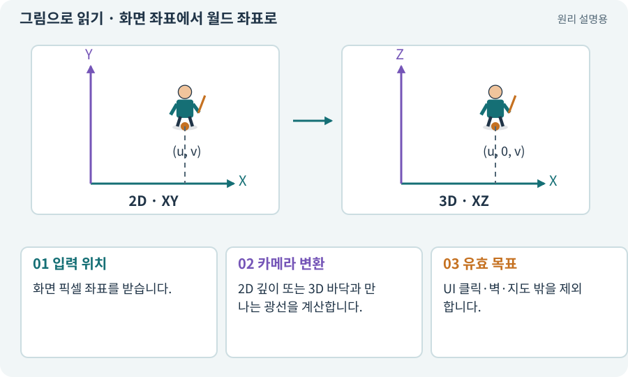

# 화면 좌표에서 월드 좌표로

**분야:** 오브젝트·좌표·움직임

마우스·터치는 화면의 픽셀 위치를 주지만 이동 목표는 게임 세계 좌표여야 합니다. 카메라와 바닥 평면을 이용해 두 좌표를 변환합니다.

**찾아오는 이름:** 화면 좌표에서 월드 좌표로, ScreenToWorldPoint, ScreenPointToRay, 화면 좌표, 월드 변환, 역투영

## 익숙한 것에 비유하면

사진 위 찍은 점이 실제 방의 어디인지 알아내는 문제입니다. 사진의 오른쪽 끝과 방의 10m 지점은 같은 단위가 아닙니다.



개념도입니다. 실제 Unity 화면이나 검사 결과가 아닙니다. 그림의 순서·색은 역할을 구분하며 실제 설정값은 프로젝트에서 확인합니다.

## 이렇게 작동합니다

### 1. 입력 위치

화면 픽셀 좌표를 받습니다.

### 2. 카메라 변환

2D 깊이 또는 3D 바닥과 만나는 광선을 계산합니다.

### 3. 유효 목표

UI 클릭·벽·지도 밖을 제외합니다.

## 우리 RPG에서는 이렇게 만나요

2D 직교 카메라는 지정 평면 깊이가 중요하고, 3D 사선 카메라는 바닥 Raycast가 일반적인 경로입니다. 화면 해상도가 바뀌어도 실제 바닥 클릭이 맞는지 검사합니다.

## 이것과 혼동하지 마세요

화면 X·Y를 그대로 Transform의 X·Y에 넣지 않습니다.

## 이해했는지 한 번 생각해 보기

해상도를 바꾼 뒤 클릭 목표가 멀리 튀는 이유는?

<details><summary>답과 이유</summary>

픽셀과 월드 단위를 혼용하거나 카메라·깊이 변환이 틀렸을 수 있습니다.

</details>

## 내 프로젝트에서 확인하고 싶다면

아래 요청은 읽기 전용으로 실제 대상을 확인하는 선택 요청입니다. 코드나 설정을 직접 편집할 필요는 없습니다.

```text
현재 프로젝트에서 화면 좌표에서 월드 좌표로 관련 요소가 어떻게 사용되는지 읽기 전용으로 확인해 줘. 실제 대상과 설정을 찾아 쉬운 말과 작은 예로 설명해 줘. 특히 다음 혼동을 구분해 줘: 화면 X·Y를 그대로 Transform의 X·Y에 넣지 않습니다. 아직 코드·설정·파일은 바꾸지 말고, 확인할 수 없는 내용은 따로 알려 줘.
```

## 이어지는 개념

[카메라·직교·원근](camera.md) · [XY·XZ 평면과 논리 좌표](coordinates.md) · [Raycast·Linecast·Cast](raycast.md) · [EventSystem·UI 입력·클릭 차단](event-system.md)

## 이 개념을 사용하는 실습

[09 · 클릭한 곳까지 벽을 돌아가기](../index.html#lesson-009) · [86 · 3D에서도 클릭한 곳까지 돌아가기](../index.html#lesson-086)

## 참고와 설명의 범위

기본 도구 동작은 아래 공식 자료를 참고했습니다. 비유·그림·RPG의 예시 수치와 정책은 이해를 위한 자체 예제입니다. 실제 API·지원 기능은 설치 버전과 계정에서 확인합니다.

- [Unity · Transform](https://docs.unity3d.com/6000.3/Documentation/Manual/class-Transform.html)

그림·계산 예제·조작 모형은 자체 제작한 설명입니다. 실제 Unity 화면, 서비스 생성 결과, 성능 실측 또는 게임 테스트 결과가 아닙니다. 자료 확인: 2026년 9월 26일.
