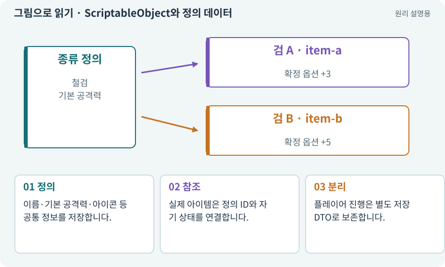

# ScriptableObject와 정의 데이터

**분야:** 코드·데이터·저장·검사

ScriptableObject는 여러 객체가 공유할 데이터 등을 에셋으로 관리할 수 있게 하는 Unity 방식입니다. 아이템 원형·스킬 정의처럼 바뀌지 않는 설계 자료에 유용합니다.

**찾아오는 이름:** ScriptableObject와 정의 데이터, ScriptableObject, SO, 스크립터블 오브젝트, 정의 데이터

## 익숙한 것에 비유하면

여러 제품이 참고하는 제품 설명서입니다. 손님이 산 물건의 흠집을 설명서에 적으면 모든 제품의 설명이 바뀝니다.



개념도입니다. 실제 Unity 화면이나 검사 결과가 아닙니다. 그림의 순서·색은 역할을 구분하며 실제 설정값은 프로젝트에서 확인합니다.

## 이렇게 작동합니다

### 1. 정의

이름·기본 공격력·아이콘 등 공통 정보를 저장합니다.

### 2. 참조

실제 아이템은 정의 ID와 자기 상태를 연결합니다.

### 3. 분리

플레이어 진행은 별도 저장 DTO로 보존합니다.

## 우리 RPG에서는 이렇게 만나요

녹슨 검 정의를 100개 인스턴스가 참고할 수 있지만, 한 검의 랜덤 옵션을 공유 정의에 덮어쓰면 다른 검도 변할 수 있습니다.

## 이것과 혼동하지 마세요

배포된 게임의 진행 저장을 ScriptableObject 에셋에 직접 쓰는 방식으로 가정하지 않습니다.

## 이해했는지 한 번 생각해 보기

검 한 자루 강화 후 다른 검도 강해지는 이유는?

<details><summary>답과 이유</summary>

공유 정의와 소유 인스턴스 데이터를 섞었는지 확인합니다.

</details>

## 내 프로젝트에서 확인하고 싶다면

아래 요청은 읽기 전용으로 실제 대상을 확인하는 선택 요청입니다. 코드나 설정을 직접 편집할 필요는 없습니다.

```text
현재 프로젝트에서 ScriptableObject와 정의 데이터 관련 요소가 어떻게 사용되는지 읽기 전용으로 확인해 줘. 실제 대상과 설정을 찾아 쉬운 말과 작은 예로 설명해 줘. 특히 다음 혼동을 구분해 줘: 배포된 게임의 진행 저장을 ScriptableObject 에셋에 직접 쓰는 방식으로 가정하지 않습니다. 아직 코드·설정·파일은 바꾸지 말고, 확인할 수 없는 내용은 따로 알려 줘.
```

## 이어지는 개념

[아이템 정의와 콘텐츠 ID](item-definition.md) · [아이템 인스턴스와 소유권](item-instance.md) · [파일 저장·게임 세이브·백업](save.md) · [DTO·저장 데이터와 런타임 상태](dto.md)

## 이 개념을 사용하는 실습

[06 · 시작 메뉴와 테스트 공간 연결하기](../index.html#lesson-006) · [20 · 같은 검 두 자루를 다른 물건으로 다루기](../index.html#lesson-020) · [23 · 장비를 바꾸고 능력치 확인하기](../index.html#lesson-023) · [25 · 게임을 껐다 켜도 장비 유지하기](../index.html#lesson-025) · [41 · 선택할 수 있는9노드 스킬트리 만들기](../index.html#lesson-041)

## 참고와 설명의 범위

기본 도구 동작은 아래 공식 자료를 참고했습니다. 비유·그림·RPG의 예시 수치와 정책은 이해를 위한 자체 예제입니다. 실제 API·지원 기능은 설치 버전과 계정에서 확인합니다.

- [Unity · ScriptableObject](https://docs.unity3d.com/6000.3/Documentation/Manual/class-ScriptableObject.html)

그림·계산 예제·조작 모형은 자체 제작한 설명입니다. 실제 Unity 화면, 서비스 생성 결과, 성능 실측 또는 게임 테스트 결과가 아닙니다. 자료 확인: 2026년 9월 26일.
