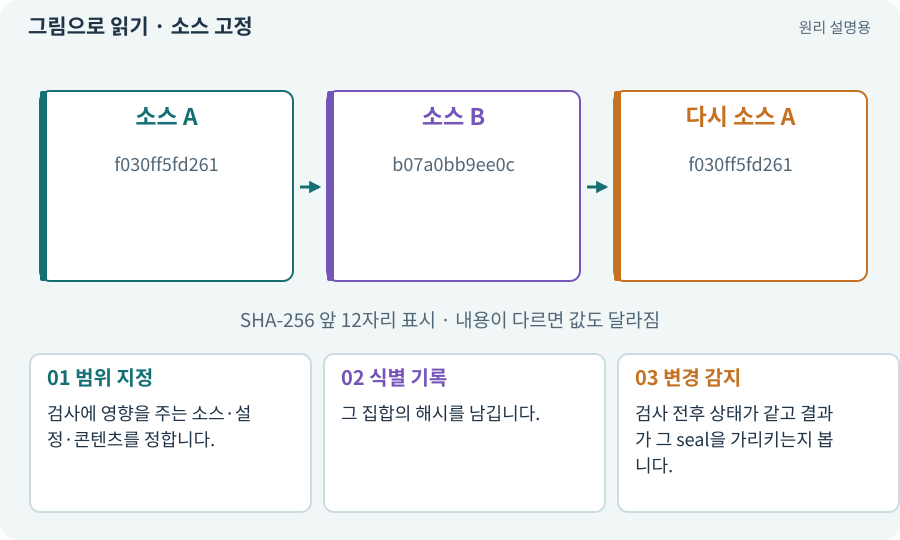

# 소스 고정·seal·증거 결속

**분야:** AI·스킬·훅·하네스 운영

seal은 이번 하네스에서 검사할 후보의 소스 상태를 식별해 기록하는 절차입니다. 파일을 물리적으로 영원히 못 바꾸게 잠그는 마법 기능은 아닙니다.

**찾아오는 이름:** 소스 고정·seal·증거 결속, seal, 소스 고정, 소스 동결, source seal, sourceStable

## 익숙한 것에 비유하면

검사 대상 제품에 제조 번호와 사진을 붙여 어떤 물건을 검사했는지 고정하는 것입니다.



개념도입니다. 실제 Unity 화면이나 검사 결과가 아닙니다. 그림의 순서·색은 역할을 구분하며 실제 설정값은 프로젝트에서 확인합니다.

## 이렇게 작동합니다

### 1. 범위 지정

검사에 영향을 주는 소스·설정·콘텐츠를 정합니다.

### 2. 식별 기록

그 집합의 해시를 남깁니다.

### 3. 변경 감지

검사 전후 상태가 같고 결과가 그 seal을 가리키는지 봅니다.

## 우리 RPG에서는 이렇게 만나요

검사 후 PNG만 바꿔도 시각 검토 근거는 오래된 것일 수 있습니다. 코드 테스트와 화면·콘텐츠 증거의 범위를 분리해 기록합니다.

## 이것과 혼동하지 마세요

seal이 있다고 외부 Editor나 사용자의 수동 변경을 자동으로 차단한 것은 아닙니다.

## 이해했는지 한 번 생각해 보기

seal 후 수정한 코드를 옛 테스트로 완료해도 되나요?

<details><summary>답과 이유</summary>

아닙니다. 새 상태를 고정하고 관련 검사를 다시 실행해야 합니다.

</details>

## 내 프로젝트에서 확인하고 싶다면

아래 요청은 읽기 전용으로 실제 대상을 확인하는 선택 요청입니다. 코드나 설정을 직접 편집할 필요는 없습니다.

```text
현재 프로젝트에서 소스 고정·seal·증거 결속 관련 요소가 어떻게 사용되는지 읽기 전용으로 확인해 줘. 실제 대상과 설정을 찾아 쉬운 말과 작은 예로 설명해 줘. 특히 다음 혼동을 구분해 줘: seal이 있다고 외부 Editor나 사용자의 수동 변경을 자동으로 차단한 것은 아닙니다. 아직 코드·설정·파일은 바꾸지 말고, 확인할 수 없는 내용은 따로 알려 줘.
```

## 이어지는 개념

[해시·SHA-256·체크섬](hash.md) · [증거·검사 상태·미실행](evidence.md) · [검증 게이트·필수 검사](gate.md) · [잠금·경합·경쟁 상태](lock.md)

## 이 개념을 사용하는 실습

[132 · 필터를 실제 던전과 모바일에 연결하기](../index.html#lesson-132) · [157 · 하네스가 실패해도 기록 지키기](../index.html#lesson-157) · [158 · 룬 교체 버그를 역할로 수정하기](../index.html#lesson-158) · [159 · 최종 확장판 배포 후보 만들기](../index.html#lesson-159)

## 참고와 설명의 범위

이 항목의 비유·그림·RPG 수치·운영 규칙은 개념을 이해하기 위한 자체 설계 예제입니다. 특정 도구가 이 규칙을 자동으로 구현한다는 뜻은 아닙니다.


그림·계산 예제·조작 모형은 자체 제작한 설명입니다. 실제 Unity 화면, 서비스 생성 결과, 성능 실측 또는 게임 테스트 결과가 아닙니다. 자료 확인: 2026년 9월 26일.
