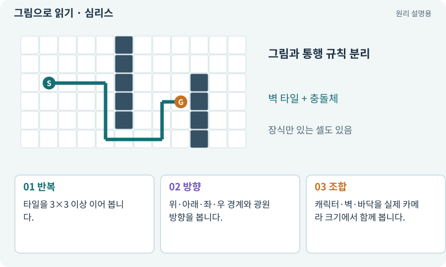

# 심리스·타일 반복·스타일 일관성

**분야:** 그림·애니메이션·화면 만들기

심리스는 이미지를 반복했을 때 경계가 자연스럽게 이어지는 성질입니다. 스타일 일관성은 원근·색·선·광원·세부 밀도가 같은 게임처럼 보이는 성질입니다.

**찾아오는 이름:** 심리스·타일 반복·스타일 일관성, 심리스, seamless, 타일링, 이음새, 스타일 일관성, 스타일 참조

## 익숙한 것에 비유하면

벽지 한 조각은 예뻐도 여러 장을 이어 붙이면 선이 어긋나거나 큰 얼룩이 반복될 수 있습니다.



개념도입니다. 실제 Unity 화면이나 검사 결과가 아닙니다. 그림의 순서·색은 역할을 구분하며 실제 설정값은 프로젝트에서 확인합니다.

## 이렇게 작동합니다

### 1. 반복

타일을 3×3 이상 이어 봅니다.

### 2. 방향

위·아래·좌·우 경계와 광원 방향을 봅니다.

### 3. 조합

캐릭터·벽·바닥을 실제 카메라 크기에서 함께 봅니다.

## 우리 RPG에서는 이렇게 만나요

AI가 만든 돌바닥 하나가 잘 보여도 큰 던전에 깔면 십자무늬가 반복될 수 있습니다. 미리보기에서 큰 특이 무늬를 줄이고 변형을 섞습니다.

## 이것과 혼동하지 마세요

심리스 이미지가 모서리·문·절벽 타일셋 전체를 대체하지는 않습니다.

## 이해했는지 한 번 생각해 보기

끝이 이어지는 바닥이면 벽 코너도 해결되나요?

<details><summary>답과 이유</summary>

아닙니다. 경계 타일과 자동 타일링 규칙을 별도로 마련합니다.

</details>

## 내 프로젝트에서 확인하고 싶다면

아래 요청은 읽기 전용으로 실제 대상을 확인하는 선택 요청입니다. 코드나 설정을 직접 편집할 필요는 없습니다.

```text
현재 프로젝트에서 심리스·타일 반복·스타일 일관성 관련 요소가 어떻게 사용되는지 읽기 전용으로 확인해 줘. 실제 대상과 설정을 찾아 쉬운 말과 작은 예로 설명해 줘. 특히 다음 혼동을 구분해 줘: 심리스 이미지가 모서리·문·절벽 타일셋 전체를 대체하지는 않습니다. 아직 코드·설정·파일은 바꾸지 말고, 확인할 수 없는 내용은 따로 알려 줘.
```

## 이어지는 개념

[자동 타일링·Rule Tile·경계 마스크](autotile.md) · [Tilemap·Tile·타일 팔레트](tilemap.md) · [아트 규격·레퍼런스·키 포즈](art-spec.md) · [조명·Lit·Unlit·그림자](lighting.md)

## 이 개념을 사용하는 실습

[33 · 기본 캐릭터·몬스터·타일 아트 만들기](../index.html#lesson-033) · [55 · 어떤 그림도 맞춰 넣는 아트 규격 정하기](../index.html#lesson-055) · [57 · Unity AI로 바닥과 벽 타일 만들기](../index.html#lesson-057) · [66 · 타일 경계와 랜덤맵 외형 연결하기](../index.html#lesson-066)

## 참고와 설명의 범위

기본 도구 동작은 아래 공식 자료를 참고했습니다. 비유·그림·RPG의 예시 수치와 정책은 이해를 위한 자체 예제입니다. 실제 API·지원 기능은 설치 버전과 계정에서 확인합니다.

- [Unity · Sprite](https://docs.unity3d.com/6000.3/Documentation/Manual/sprite/sprite-landing.html)

그림·계산 예제·조작 모형은 자체 제작한 설명입니다. 실제 Unity 화면, 서비스 생성 결과, 성능 실측 또는 게임 테스트 결과가 아닙니다. 자료 확인: 2026년 9월 26일.
