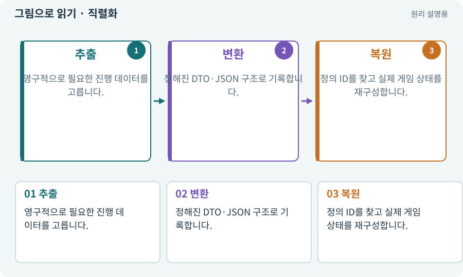

# 직렬화·역직렬화

**분야:** 코드·데이터·저장·검사

직렬화는 메모리의 데이터를 파일·전송 가능한 표현으로 바꾸는 과정이고 역직렬화는 이를 다시 데이터로 읽는 과정입니다. 저장할 수 없는 실행 중 참조는 안정된 ID로 바꾸는 등의 설계가 필요합니다.

**찾아오는 이름:** 직렬화·역직렬화, 직렬화, 역직렬화, Serialization, serialize, deserialize

## 익숙한 것에 비유하면

방 안 물건을 이삿짐 목록에 적고 새집에서 목록대로 다시 배치하는 것입니다. 벽에 붙은 임시 위치 표시까지 같은 의미로 옮길 수는 없습니다.



개념도입니다. 실제 Unity 화면이나 검사 결과가 아닙니다. 그림의 순서·색은 역할을 구분하며 실제 설정값은 프로젝트에서 확인합니다.

## 이렇게 작동합니다

### 1. 추출

영구적으로 필요한 진행 데이터를 고릅니다.

### 2. 변환

정해진 DTO·JSON 구조로 기록합니다.

### 3. 복원

정의 ID를 찾고 실제 게임 상태를 재구성합니다.

## 우리 RPG에서는 이렇게 만나요

런타임 GameObject 참조를 그대로 저장하는 대신 아이템 정의 ID·고유 ID·옵션을 저장합니다. 씬이 바뀌어도 데이터를 재구성할 수 있어야 합니다.

## 이것과 혼동하지 마세요

게임 오브젝트 전체를 직렬화하면 모든 것이 자동으로 저장된다고 생각하지 않습니다.

## 이해했는지 한 번 생각해 보기

씬 참조를 그대로 저장하면 왜 위험한가요?

<details><summary>답과 이유</summary>

다음 실행에 같은 객체가 존재하지 않을 수 있습니다. 안정된 데이터 표현이 필요합니다.

</details>

## 내 프로젝트에서 확인하고 싶다면

아래 요청은 읽기 전용으로 실제 대상을 확인하는 선택 요청입니다. 코드나 설정을 직접 편집할 필요는 없습니다.

```text
현재 프로젝트에서 직렬화·역직렬화 관련 요소가 어떻게 사용되는지 읽기 전용으로 확인해 줘. 실제 대상과 설정을 찾아 쉬운 말과 작은 예로 설명해 줘. 특히 다음 혼동을 구분해 줘: 게임 오브젝트 전체를 직렬화하면 모든 것이 자동으로 저장된다고 생각하지 않습니다. 아직 코드·설정·파일은 바꾸지 말고, 확인할 수 없는 내용은 따로 알려 줘.
```

## 이어지는 개념

[파일 저장·게임 세이브·백업](save.md) · [DTO·저장 데이터와 런타임 상태](dto.md) · [JSON·객체·배열·필드](json.md) · [ID·고유 식별자·버전](identifier.md)

## 이 개념을 사용하는 실습

[20 · 같은 검 두 자루를 다른 물건으로 다루기](../index.html#lesson-020) · [25 · 게임을 껐다 켜도 장비 유지하기](../index.html#lesson-025) · [77 · 앱을 바꾸지 않고 외형 업데이트하기](../index.html#lesson-077)

## 참고와 설명의 범위

기본 도구 동작은 아래 공식 자료를 참고했습니다. 비유·그림·RPG의 예시 수치와 정책은 이해를 위한 자체 예제입니다. 실제 API·지원 기능은 설치 버전과 계정에서 확인합니다.

- [Python · JSON](https://docs.python.org/3/library/json.html)

그림·계산 예제·조작 모형은 자체 제작한 설명입니다. 실제 Unity 화면, 서비스 생성 결과, 성능 실측 또는 게임 테스트 결과가 아닙니다. 자료 확인: 2026년 9월 26일.
