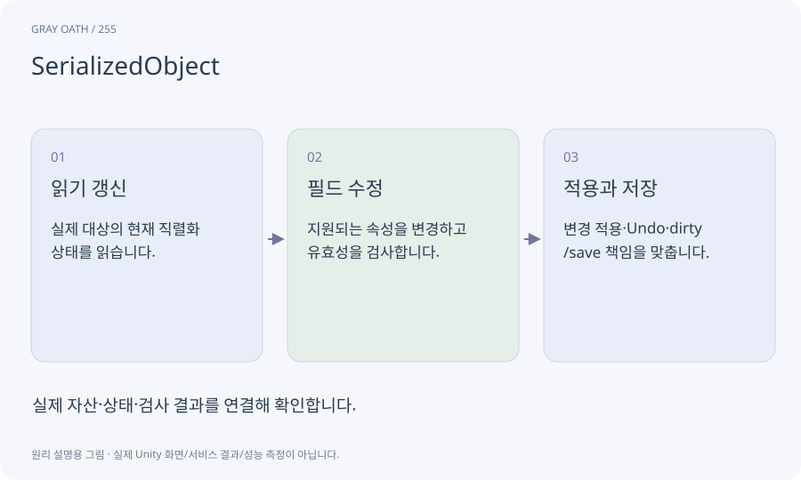

# SerializedObject

Unity가 저장하는 객체의 값을 Editor 도구에서 다루는 통로입니다. 직렬화되는 필드를 읽고 변경 사항을 적용하며 여러 객체 편집·Undo와 일관된 흐름을 만드는 데 사용합니다.

## 익숙한 비유

원본 장부를 아무 곳에서나 고치는 대신 수정 절차가 있는 접수창구를 통하는 것입니다.



## 작동 원리

### 1. 읽기 갱신

실제 대상의 현재 직렬화 상태를 읽습니다.

### 2. 필드 수정

지원되는 속성을 변경하고 유효성을 검사합니다.

### 3. 적용과 저장

변경 적용·Undo·dirty/save 책임을 맞춥니다.

## 게임 속 예

AI가 만든 퀘스트 창은 보상 수치를 변경할 때 실제 QuestDefinition을 갱신하고, 창을 다시 열어도 남는지 검사합니다.

## 혼동하지 않기

화면의 임시 변수만 바꾸거나 자산을 직접 바꾸고 저장을 누락하면 재개방 때 값이 사라집니다.

## 확인 질문

창에 새 값이 보이면 저장 성공인가요?

아닙니다. 실제 자산을 저장하고 다시 열어 같은 값인지 확인해야 합니다.

## 내 프로젝트에서 확인하기

```text
현재 GrayOathRPG3D에서 SerializedObject을 사용하는 실제 대상과 동작을 읽기 전용으로 확인해 줘. 쉬운 말과 작은 사례로 설명하고 화면의 임시 변수만 바꾸거나 자산을 직접 바꾸고 저장을 누락하면 재개방 때 값이 사라집니다. 이 문제를 어떻게 막는지 보여 줘. 코드·데이터·설정은 아직 수정하지 마.
```

## 관련 해설

[serialization](serialization.md) · [undo](undo.md) · [assetdatabase](assetdatabase.md)

## 공식 참고

- [Unity · SerializedObject](https://docs.unity3d.com/6000.3/Documentation/ScriptReference/SerializedObject.html)
- [Unity · Undo](https://docs.unity3d.com/6000.3/Documentation/ScriptReference/Undo.html)
