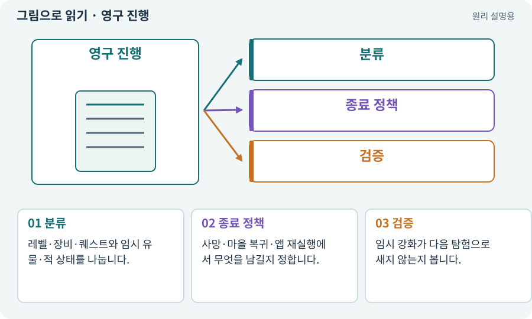

# 영구 진행·탐험 세션·런타임 상태

**분야:** 코드·데이터·저장·검사

영구 진행은 재실행 후에도 남는 데이터이고 탐험 세션은 이번 던전 동안만 유지할 상태입니다. 런타임 상태는 현재 살아 있는 객체·타이머·입력 등을 포함합니다.

**찾아오는 이름:** 영구 진행·탐험 세션·런타임 상태, 탐험 세션, 이번 탐험, 영구 진행, 영구 데이터, 세션 상태, run-local, 유물

## 익숙한 것에 비유하면

호텔 회원 포인트와 이번 숙박의 객실키를 구분하는 것입니다. 객실키를 다음 방문까지 영구 보상으로 남기지 않습니다.



개념도입니다. 실제 Unity 화면이나 검사 결과가 아닙니다. 그림의 순서·색은 역할을 구분하며 실제 설정값은 프로젝트에서 확인합니다.

## 이렇게 작동합니다

### 1. 분류

레벨·장비·퀘스트와 임시 유물·적 상태를 나눕니다.

### 2. 종료 정책

사망·마을 복귀·앱 재실행에서 무엇을 남길지 정합니다.

### 3. 검증

임시 강화가 다음 탐험으로 새지 않는지 봅니다.

## 우리 RPG에서는 이렇게 만나요

우리 RPG는 재접속 시 마을에서 시작하는 단순 정책을 사용합니다. 바닥 아이템과 적 위치를 저장하지 않는 것은 명시한 범위이지 저장 실패가 아닙니다.

## 이것과 혼동하지 마세요

하네스의 작업 run과 게임의 던전 run도 다른 개념입니다.

## 이해했는지 한 번 생각해 보기

이번 탐험 유물이 게임을 껐다 켜도 남으면?

<details><summary>답과 이유</summary>

설계에 따라 다르지만 임시 규칙이라면 정리·저장 분류를 확인해야 합니다.

</details>

## 내 프로젝트에서 확인하고 싶다면

아래 요청은 읽기 전용으로 실제 대상을 확인하는 선택 요청입니다. 코드나 설정을 직접 편집할 필요는 없습니다.

```text
현재 프로젝트에서 영구 진행·탐험 세션·런타임 상태 관련 요소가 어떻게 사용되는지 읽기 전용으로 확인해 줘. 실제 대상과 설정을 찾아 쉬운 말과 작은 예로 설명해 줘. 특히 다음 혼동을 구분해 줘: 하네스의 작업 run과 게임의 던전 run도 다른 개념입니다. 아직 코드·설정·파일은 바꾸지 말고, 확인할 수 없는 내용은 따로 알려 줘.
```

## 이어지는 개념

[파일 저장·게임 세이브·백업](save.md) · [수명주기·초기화·정리](lifecycle.md) · [능력치·클램프·정수·부동소수점](stats.md) · [run·attempt·revision·인수인계](run.md)

## 이 개념을 사용하는 실습

[29 · 방마다 적과 상자 배치하기](../index.html#lesson-029) · [144 · 이번 탐험에만 남는 유물 고르기](../index.html#lesson-144) · [151 · 도감과 장비 비교로 새 기능 찾기](../index.html#lesson-151)

## 참고와 설명의 범위

이 항목의 비유·그림·RPG 수치·운영 규칙은 개념을 이해하기 위한 자체 설계 예제입니다. 특정 도구가 이 규칙을 자동으로 구현한다는 뜻은 아닙니다.


그림·계산 예제·조작 모형은 자체 제작한 설명입니다. 실제 Unity 화면, 서비스 생성 결과, 성능 실측 또는 게임 테스트 결과가 아닙니다. 자료 확인: 2026년 9월 26일.
