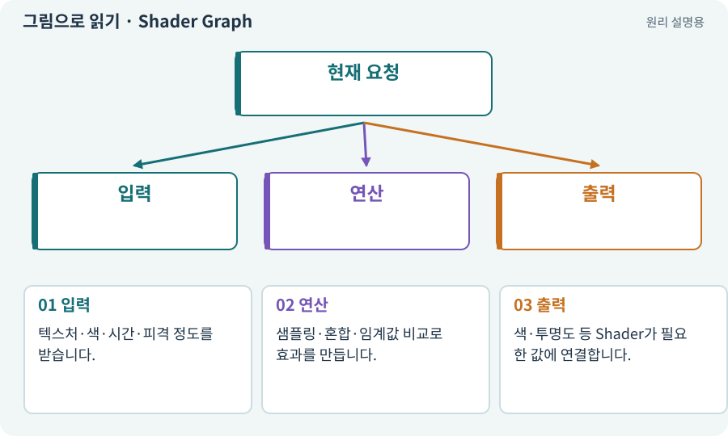

# Shader Graph·노드·마스크

**분야:** 그림·애니메이션·화면 만들기

Shader Graph는 셰이더 계산을 노드와 선으로 표현하는 도구입니다. 마스크는 어떤 부분에 효과를 적용할지 고르는 값이며 흑백이나 알파 자료로 사용할 수 있습니다.

**찾아오는 이름:** Shader Graph·노드·마스크, Shader Graph, 셰이더 그래프, 마스크, Mask, 노드, dissolve, 디졸브

## 익숙한 것에 비유하면

사진에서 특정 부분만 색칠할 수 있는 종이 틀과 색 혼합 순서도입니다.



개념도입니다. 실제 Unity 화면이나 검사 결과가 아닙니다. 그림의 순서·색은 역할을 구분하며 실제 설정값은 프로젝트에서 확인합니다.

## 이렇게 작동합니다

### 1. 입력

텍스처·색·시간·피격 정도를 받습니다.

### 2. 연산

샘플링·혼합·임계값 비교로 효과를 만듭니다.

### 3. 출력

색·투명도 등 Shader가 필요한 값에 연결합니다.

## 우리 RPG에서는 이렇게 만나요

적 피격 강조는 원래 알파를 보존하며 색만 바꾸게 합니다. 디졸브는 사라지는 시각 효과이지 사망·보상 사건을 대신 실행하는 기능이 아닙니다.

## 이것과 혼동하지 마세요

그래프가 연결됐다고 모바일에서 빠르거나 해당 Renderer와 호환되는 것은 아닙니다.

## 이해했는지 한 번 생각해 보기

마스크를 잘못 연결하면 캐릭터 밖 네모가 보일 수 있나요?

<details><summary>답과 이유</summary>

가능합니다. 원래 알파와 효과 범위를 보존하는지 확인합니다.

</details>

## 내 프로젝트에서 확인하고 싶다면

아래 요청은 읽기 전용으로 실제 대상을 확인하는 선택 요청입니다. 코드나 설정을 직접 편집할 필요는 없습니다.

```text
현재 프로젝트에서 Shader Graph·노드·마스크 관련 요소가 어떻게 사용되는지 읽기 전용으로 확인해 줘. 실제 대상과 설정을 찾아 쉬운 말과 작은 예로 설명해 줘. 특히 다음 혼동을 구분해 줘: 그래프가 연결됐다고 모바일에서 빠르거나 해당 Renderer와 호환되는 것은 아닙니다. 아직 코드·설정·파일은 바꾸지 말고, 확인할 수 없는 내용은 따로 알려 줘.
```

## 이어지는 개념

[Material과 Shader](material.md) · [알파·RGBA·투명 배경](alpha.md) · [VFX·Particle System·플립북](vfx.md) · [텍스처·픽셀·해상도](texture.md)

## 이 개념을 사용하는 실습

[45 · 무작위 방과 통로 만들기](../index.html#lesson-045) · [47 · 실패하는 시드를 찾고 복구하기](../index.html#lesson-047) · [65 · 스프라이트를 정리해 실제 캐릭터에 넣기](../index.html#lesson-065) · [66 · 타일 경계와 랜덤맵 외형 연결하기](../index.html#lesson-066) · [70 · 피격 강조와 보스 예고 셰이더 만들기](../index.html#lesson-070)

## 참고와 설명의 범위

기본 도구 동작은 아래 공식 자료를 참고했습니다. 비유·그림·RPG의 예시 수치와 정책은 이해를 위한 자체 예제입니다. 실제 API·지원 기능은 설치 버전과 계정에서 확인합니다.

- [Unity Shader Graph · 시작](https://docs.unity3d.com/Packages/com.unity.shadergraph@17.3/manual/Getting-Started.html)

그림·계산 예제·조작 모형은 자체 제작한 설명입니다. 실제 Unity 화면, 서비스 생성 결과, 성능 실측 또는 게임 테스트 결과가 아닙니다. 자료 확인: 2026년 9월 26일.
