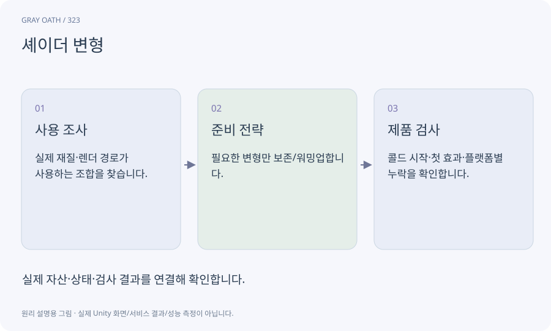

# 셰이더 변형

라이트·그림자·재질 옵션 조합에 따라 필요한 셰이더 프로그램의 여러 형태입니다. 필요한 변형의 준비·보존 여부가 첫 렌더링이나 빌드 결과에 영향을 줄 수 있습니다.

## 익숙한 비유

같은 조리법에 옵션을 조합한 여러 준비 방법입니다.



## 작동 원리

### 1. 사용 조사

실제 재질·렌더 경로가 사용하는 조합을 찾습니다.

### 2. 준비 전략

필요한 변형만 보존/워밍업합니다.

### 3. 제품 검사

콜드 시작·첫 효과·플랫폼별 누락을 확인합니다.

## 게임 속 예

처음 잿불을 쓸 때만 끊기면 셰이더 준비 외에 자산 로드·업로드도 함께 분리합니다. 모든 변형을 넣으면 크기와 로딩 비용이 늘 수 있습니다.

## 혼동하지 않기

첫 시전 끊김을 모두 셰이더 때문이라고 단정하지 않습니다.

## 확인 질문

워밍업하면 무조건 빨라지나요?

초기 준비 비용과 상주 비용을 앞당기는 면도 있으므로 전체 흐름을 측정합니다.

## 내 프로젝트에서 확인하기

```text
현재 GrayOathRPG3D에서 셰이더 변형을 사용하는 실제 대상과 동작을 읽기 전용으로 확인해 줘. 쉬운 말과 작은 사례로 설명하고 첫 시전 끊김을 모두 셰이더 때문이라고 단정하지 않습니다. 이 문제를 어떻게 막는지 보여 줘. 코드·데이터·설정은 아직 수정하지 마.
```

## 관련 해설

[shader-graph](shader-graph.md) · [streaming-cell](streaming-cell.md) · [profiler-marker](profiler-marker.md)

## 공식 참고

- [Unity · URP performance](https://docs.unity3d.com/6000.3/Documentation/Manual/urp/understand-performance.html)
