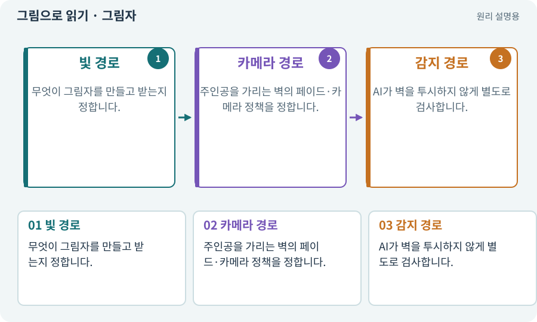

# 그림자·가림·가시성

**분야:** 자산 제작·렌더링 보충

그림자는 빛이 물체에 가려져 생기는 어두운 영역이고, 카메라 가림은 시점과 대상 사이의 물체가 화면을 막는 문제입니다. 적 시야 차단은 게임 규칙의 감지 판정이라 세 가지를 구분합니다.

**찾아오는 이름:** 그림자·가림·가시성, 그림자, Shadow, shadow, 가림, Occlusion, occlusion, 가시성

## 익숙한 것에 비유하면

가로등 아래 그림자, 눈앞 기둥 때문에 안 보이는 사람, 경비병이 벽 너머를 못 보는 규칙은 원인이 다릅니다.



개념도입니다. 실제 Unity 화면이나 검사 결과가 아닙니다. 그림의 순서·색은 역할을 구분하며 실제 설정값은 프로젝트에서 확인합니다.

## 이렇게 작동합니다

### 1. 빛 경로

무엇이 그림자를 만들고 받는지 정합니다.

### 2. 카메라 경로

주인공을 가리는 벽의 페이드·카메라 정책을 정합니다.

### 3. 감지 경로

AI가 벽을 투시하지 않게 별도로 검사합니다.

## 우리 RPG에서는 이렇게 만나요

벽을 투명하게 보여 주더라도 Collider와 적 시야 차단은 유지할 수 있습니다. 화면 가독성을 위해 벽을 숨겼다고 투사체까지 통과시키지 않습니다.

## 이것과 혼동하지 마세요

3D 그림자 설정을 바꾼 것이 2D 스프라이트 정렬이나 적 LOS 문제의 해결은 아닙니다.

## 이해했는지 한 번 생각해 보기

벽을 반투명하게 하면 적이 플레이어를 볼 수 있나요?

<details><summary>답과 이유</summary>

게임의 LOS·충돌 규칙이 결정합니다. 단순 시각 변경과 별개입니다.

</details>

## 내 프로젝트에서 확인하고 싶다면

아래 요청은 읽기 전용으로 실제 대상을 확인하는 선택 요청입니다. 코드나 설정을 직접 편집할 필요는 없습니다.

```text
현재 프로젝트에서 그림자·가림·가시성 관련 요소가 어떻게 사용되는지 읽기 전용으로 확인해 줘. 실제 대상과 설정을 찾아 쉬운 말과 작은 예로 설명해 줘. 특히 다음 혼동을 구분해 줘: 3D 그림자 설정을 바꾼 것이 2D 스프라이트 정렬이나 적 LOS 문제의 해결은 아닙니다. 아직 코드·설정·파일은 바꾸지 말고, 확인할 수 없는 내용은 따로 알려 줘.
```

## 이어지는 개념

[조명·Lit·Unlit·그림자](lighting.md) · [시야·LOS·마지막 목격 위치](los.md) · [Sorting Layer·Order·발 정렬](sorting.md) · [Material과 Shader](material.md)

## 이 개념을 사용하는 실습

[07 · 캐릭터와 벽이 있는 공간 만들기](../index.html#lesson-007) · [28 · 여덟 구역의 첫 던전 만들기](../index.html#lesson-028) · [35 · 앞뒤 가림과 PC 조작 다듬기](../index.html#lesson-035) · [83 · 3D 카메라와 재질로 공간 보기](../index.html#lesson-083) · [95 · 3D 조명과 환경을 읽기 좋게 만들기](../index.html#lesson-095) · [96 · 3D 카메라 가림과 터치 조작 다듬기](../index.html#lesson-096) · [97 · 선택: 3D 모델에서 2D 시트 만들기](../index.html#lesson-097) · [101 · 3D Android 성능 다시 측정하기](../index.html#lesson-101) · [103 · 같은 전투를 2D와 3D로 플레이하기](../index.html#lesson-103) · [104 · 2D와 3D를 두 플랫폼에서 완주하기](../index.html#lesson-104)

## 참고와 설명의 범위

기본 도구 동작은 아래 공식 자료를 참고했습니다. 비유·그림·RPG의 예시 수치와 정책은 이해를 위한 자체 예제입니다. 실제 API·지원 기능은 설치 버전과 계정에서 확인합니다.

- [Unity · 2D Renderer](https://docs.unity3d.com/6000.3/Documentation/Manual/urp/2DRendererData-overview.html)

그림·계산 예제·조작 모형은 자체 제작한 설명입니다. 실제 Unity 화면, 서비스 생성 결과, 성능 실측 또는 게임 테스트 결과가 아닙니다. 자료 확인: 2026년 9월 26일.
