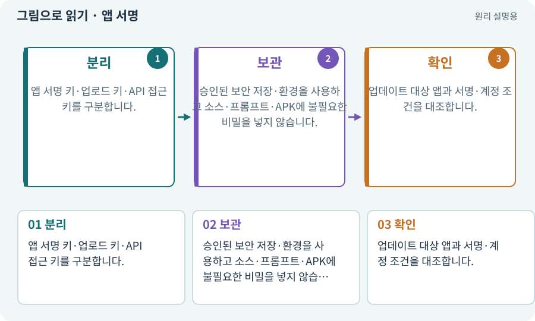

# 앱 서명·키·자격 증명

**분야:** 비동기·다운로드·빌드·버전 관리

서명은 앱이나 자료가 특정 키의 소유자에게서 왔음을 검증하는 데 쓰입니다. API 키·로그인 토큰은 서비스 접근 권한입니다. 내용 변경 감지용 해시와 목적이 다릅니다.

**찾아오는 이름:** 앱 서명·키·자격 증명, 서명, Signature, Keystore, 키스토어, 인증, 자격 증명, API 키, 비밀키

## 익숙한 것에 비유하면

봉투 내용의 지문이 해시라면 발신자의 도장은 서명에 가깝습니다. 출입증인 API 키는 또 다른 물건입니다.



개념도입니다. 실제 Unity 화면이나 검사 결과가 아닙니다. 그림의 순서·색은 역할을 구분하며 실제 설정값은 프로젝트에서 확인합니다.

## 이렇게 작동합니다

### 1. 분리

앱 서명 키·업로드 키·API 접근 키를 구분합니다.

### 2. 보관

승인된 보안 저장·환경을 사용하고 소스·프롬프트·APK에 불필요한 비밀을 넣지 않습니다.

### 3. 확인

업데이트 대상 앱과 서명·계정 조건을 대조합니다.

## 우리 RPG에서는 이렇게 만나요

로그인·권한은 직접 승인하지만 비밀번호나 일회용 인증 코드를 채팅에 보내지 않습니다. AI는 인증 성공 여부와 공개 메타데이터만 확인하게 합니다.

## 이것과 혼동하지 마세요

해시가 같다고 작성자를 증명하거나 파일이 무해하다는 뜻은 아닙니다.

## 이해했는지 한 번 생각해 보기

API 키를 편하게 프로젝트 JSON에 넣어도 될까요?

<details><summary>답과 이유</summary>

노출 위험이 있어 승인된 비밀 관리 경로를 사용해야 합니다.

</details>

## 내 프로젝트에서 확인하고 싶다면

아래 요청은 읽기 전용으로 실제 대상을 확인하는 선택 요청입니다. 코드나 설정을 직접 편집할 필요는 없습니다.

```text
현재 프로젝트에서 앱 서명·키·자격 증명 관련 요소가 어떻게 사용되는지 읽기 전용으로 확인해 줘. 실제 대상과 설정을 찾아 쉬운 말과 작은 예로 설명해 줘. 특히 다음 혼동을 구분해 줘: 해시가 같다고 작성자를 증명하거나 파일이 무해하다는 뜻은 아닙니다. 아직 코드·설정·파일은 바꾸지 말고, 확인할 수 없는 내용은 따로 알려 줘.
```

## 이어지는 개념

[해시·SHA-256·체크섬](hash.md) · [권한·승인·최소 권한](permission.md) · [APK·Android 설치 파일](apk.md) · [비용 한도·예약·실사용량](budget.md)

## 이 개념을 사용하는 실습

[01 · 빈 2D 프로젝트 만들기](../index.html#lesson-001) · [02 · 내 게임을 알아듣는 개발 스킬 만들기](../index.html#lesson-002) · [03 · AI와 실행 중인 Unity 연결하기](../index.html#lesson-003) · [04 · 되돌릴 수 있는 작업 습관 만들기](../index.html#lesson-004) · [11 · PC와 휴대폰에서 처음 실행하기](../index.html#lesson-011) · [39 · 다른 PC와 Android 에서 실행할 파일 만들기](../index.html#lesson-039) · [55 · 어떤 그림도 맞춰 넣는 아트 규격 정하기](../index.html#lesson-055) · [63 · Grok 이미지로 같은 자산 시험하기](../index.html#lesson-063) · [74 · 추가 외형을 서버에서 받게 준비하기](../index.html#lesson-074) · [78 · 선택: Google Play 에셋 전달 사용하기](../index.html#lesson-078) · [79 · 추가 기능을 하나의 게임으로 합치기](../index.html#lesson-079) · [102 · 네 배포물을 구분해 만들기](../index.html#lesson-102) · [117 · Unity 작업을 한 창구로 모으기](../index.html#lesson-117) · [118 · 모의 응답 대신 실제 Claude 연결하기](../index.html#lesson-118) · [129 · 기존 2D 게임에서 확장팩 시작하기](../index.html#lesson-129) · [155 · 기록을 보고 제작 경제와 전투 조정하기](../index.html#lesson-155) · [159 · 최종 확장판 배포 후보 만들기](../index.html#lesson-159)

## 참고와 설명의 범위

기본 도구 동작은 아래 공식 자료를 참고했습니다. 비유·그림·RPG의 예시 수치와 정책은 이해를 위한 자체 예제입니다. 실제 API·지원 기능은 설치 버전과 계정에서 확인합니다.

- [Unity · Android 빌드](https://docs.unity3d.com/6000.3/Documentation/Manual/android-BuildProcess.html)

그림·계산 예제·조작 모형은 자체 제작한 설명입니다. 실제 Unity 화면, 서비스 생성 결과, 성능 실측 또는 게임 테스트 결과가 아닙니다. 자료 확인: 2026년 9월 26일.
