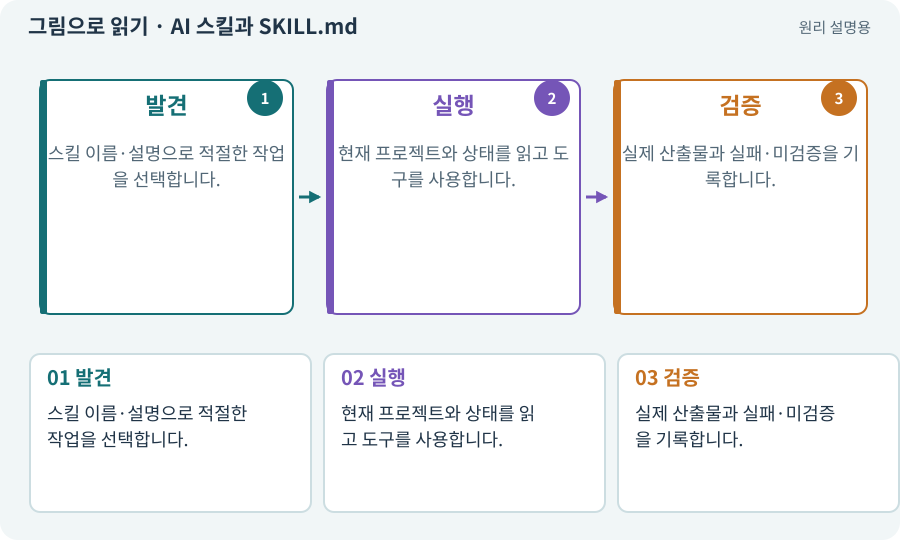

# AI 스킬과 SKILL.md

**분야:** AI·스킬·훅·하네스 운영

AI 스킬은 반복 작업의 절차·참고 자료·도구 사용 방법을 묶은 정의입니다. 이 과정에서는 계획·구현·검사·수정·상태 조회를 자연어로 요청하는 입구로 사용합니다.

**찾아오는 이름:** AI 스킬과 SKILL.md, AI 스킬, 개발 스킬, SKILL.md, game-work, game-feature, game-plan, game-verify, game-fix, game-resume, game-status

## 익숙한 것에 비유하면

직원이 특정 업무 때 꺼내 읽는 작업 지침서입니다. 지침서 자체가 기계를 켜거나 검사를 통과시키는 것은 아닙니다.



개념도입니다. 실제 Unity 화면이나 검사 결과가 아닙니다. 그림의 순서·색은 역할을 구분하며 실제 설정값은 프로젝트에서 확인합니다.

## 이렇게 작동합니다

### 1. 발견

스킬 이름·설명으로 적절한 작업을 선택합니다.

### 2. 실행

현재 프로젝트와 상태를 읽고 도구를 사용합니다.

### 3. 검증

실제 산출물과 실패·미검증을 기록합니다.

## 우리 RPG에서는 이렇게 만나요

“현재 결과를 검증해 줘”는 game-verify 같은 스킬로 연결할 수 있습니다. AI가 스킬 파일을 만들고 실제 세션에서 읽히는지 확인합니다.

## 이것과 혼동하지 마세요

게임 안 공격 스킬과 AI 작업 스킬은 다른 의미입니다. 스킬 등록은 실제 계정·도구 연결을 대신하지 않습니다.

## 이해했는지 한 번 생각해 보기

스킬이 있다고 Unity 테스트를 안 하고 PASS로 써도 되나요?

<details><summary>답과 이유</summary>

안 됩니다. 스킬은 검사를 수행하는 절차이며 결과 근거는 실제 실행입니다.

</details>

## 내 프로젝트에서 확인하고 싶다면

아래 요청은 읽기 전용으로 실제 대상을 확인하는 선택 요청입니다. 코드나 설정을 직접 편집할 필요는 없습니다.

```text
현재 프로젝트에서 AI 스킬과 SKILL.md 관련 요소가 어떻게 사용되는지 읽기 전용으로 확인해 줘. 실제 대상과 설정을 찾아 쉬운 말과 작은 예로 설명해 줘. 특히 다음 혼동을 구분해 줘: 게임 안 공격 스킬과 AI 작업 스킬은 다른 의미입니다. 스킬 등록은 실제 계정·도구 연결을 대신하지 않습니다. 아직 코드·설정·파일은 바꾸지 말고, 확인할 수 없는 내용은 따로 알려 줘.
```

## 이어지는 개념

[훅·사전/사후 이벤트](hook.md) · [개발 하네스](harness.md) · [도구 호출·로컬·클라우드](tool.md) · [스킬트리·노드·선행 조건](skill-tree.md)

## 이 개념을 사용하는 실습

[02 · 내 게임을 알아듣는 개발 스킬 만들기](../index.html#lesson-002) · [106 · 도구가 상태를 기억하게 만들기](../index.html#lesson-106) · [116 · “어디까지 됐어?”에 근거로 답하기](../index.html#lesson-116) · [119 · 막힌 작업을 안전하게 이어가기](../index.html#lesson-119) · [120 · 자연어 요청을 계획으로 바꾸기](../index.html#lesson-120) · [122 · 내 게임에 맞는 검사기 추가하기](../index.html#lesson-122) · [126 · 한 요청으로 필터 기능 끝내기](../index.html#lesson-126) · [127 · 내 반복 업무에 맞게 도구 개조하기](../index.html#lesson-127) · [128 · 내 도구를 대화로 운영하기](../index.html#lesson-128) · [129 · 기존 2D 게임에서 확장팩 시작하기](../index.html#lesson-129) · [130 · 첫 확장 작업을 하네스에 연결하기](../index.html#lesson-130) · [131 · 중요한 전리품만 표시하는 규칙 만들기](../index.html#lesson-131) · [132 · 필터를 실제 던전과 모바일에 연결하기](../index.html#lesson-132) · [133 · 첫 기능의 실패를 고쳐 다음 기준 만들기](../index.html#lesson-133) · [134 · 화상·냉기·표식으로 전투 확장하기](../index.html#lesson-134) · [135 · 벽을 통과하지 않는 회피 만들기](../index.html#lesson-135) · [136 · 방패병과 화염술사 정예 추가하기](../index.html#lesson-136) · [137 · 기름·폭발통·밸브로 공간 활용하기](../index.html#lesson-137) · [138 · 장비를 분해해 재료 얻기](../index.html#lesson-138) · [139 · 재료로 장비 제작하기](../index.html#lesson-139) · [140 · 개인 창고와 즐겨찾기 만들기](../index.html#lesson-140) · [141 · 소켓 한 칸에 룬 장착하기](../index.html#lesson-141) · [142 · 배운 스킬의 변형 선택하기](../index.html#lesson-142) · [143 · 새 랜덤 지역 봉인된 대장간 만들기](../index.html#lesson-143) · [144 · 이번 탐험에만 남는 유물 고르기](../index.html#lesson-144) · [145 · 지원 동료 하나 만들기](../index.html#lesson-145) · [146 · 대장장이 구조 퀘스트 만들기](../index.html#lesson-146) · [147 · 용광로 감시자와 3단계 전투 만들기](../index.html#lesson-147) · [148 · 아트 역할로 새 지역 외형 완성하기](../index.html#lesson-148) · [149 · 상태와 보스 효과를 같은 데이터로 맞추기](../index.html#lesson-149) · [150 · 소리가 없어도 읽히는 전투 만들기](../index.html#lesson-150) · [151 · 도감과 장비 비교로 새 기능 찾기](../index.html#lesson-151) · [152 · 이전 저장을 새 확장판으로 가져오기](../index.html#lesson-152) · [153 · 대장간 고해상도팩 선택 다운로드하기](../index.html#lesson-153) · [154 · 확장 기능을 켠 휴대폰 성능 고치기](../index.html#lesson-154) · [155 · 기록을 보고 제작 경제와 전투 조정하기](../index.html#lesson-155) · [156 · 기능 조합에서 숨은 오류 찾기](../index.html#lesson-156) · [157 · 하네스가 실패해도 기록 지키기](../index.html#lesson-157) · [158 · 룬 교체 버그를 역할로 수정하기](../index.html#lesson-158) · [159 · 최종 확장판 배포 후보 만들기](../index.html#lesson-159) · [160 · 대장간 보스까지 완주하고 새 기능 맡기기](../index.html#lesson-160)

## 참고와 설명의 범위

기본 도구 동작은 아래 공식 자료를 참고했습니다. 비유·그림·RPG의 예시 수치와 정책은 이해를 위한 자체 예제입니다. 실제 API·지원 기능은 설치 버전과 계정에서 확인합니다.

- [Claude Code · Skills](https://code.claude.com/docs/en/skills)

그림·계산 예제·조작 모형은 자체 제작한 설명입니다. 실제 Unity 화면, 서비스 생성 결과, 성능 실측 또는 게임 테스트 결과가 아닙니다. 자료 확인: 2026년 9월 26일.
