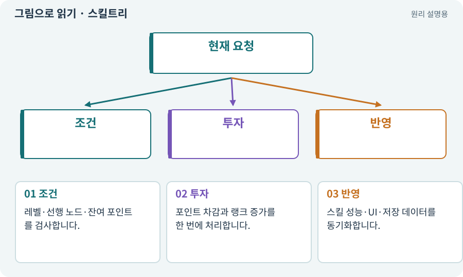

# 스킬트리·노드·선행 조건

**분야:** 코드·데이터·저장·검사

스킬트리는 포인트와 선행 조건을 통해 능력을 선택하는 구조입니다. 노드는 해금·강화 한 항목이고 랭크는 같은 항목의 투자 단계입니다.

**찾아오는 이름:** 스킬트리·노드·선행 조건, 스킬트리, 스킬 트리, 노드, 선행 조건, 스킬 포인트, rank, 랭크

## 익숙한 것에 비유하면

교과목 수강표처럼 앞 항목을 익혀야 다음 항목을 선택하고, 제한된 시간 대신 포인트를 나눠 씁니다.



개념도입니다. 실제 Unity 화면이나 검사 결과가 아닙니다. 그림의 순서·색은 역할을 구분하며 실제 설정값은 프로젝트에서 확인합니다.

## 이렇게 작동합니다

### 1. 조건

레벨·선행 노드·잔여 포인트를 검사합니다.

### 2. 투자

포인트 차감과 랭크 증가를 한 번에 처리합니다.

### 3. 반영

스킬 성능·UI·저장 데이터를 동기화합니다.

## 우리 RPG에서는 이렇게 만나요

본편은 9개 노드에 한정된 포인트를 배분합니다. 초기화할 때 배운 스킬은 바뀌지만 마나·쿨다운이 무료로 회복되는 편법은 허용하지 않습니다.

## 이것과 혼동하지 마세요

AI 도구의 Skill은 이 스킬트리의 공격 기술과 다른 뜻입니다.

## 이해했는지 한 번 생각해 보기

초기화 버튼을 두 번 눌렀더니 포인트가 더 늘면?

<details><summary>답과 이유</summary>

원래 투자량과 트랜잭션 중복 처리, 현재 상태 기반 재계산을 확인합니다.

</details>

## 내 프로젝트에서 확인하고 싶다면

아래 요청은 읽기 전용으로 실제 대상을 확인하는 선택 요청입니다. 코드나 설정을 직접 편집할 필요는 없습니다.

```text
현재 프로젝트에서 스킬트리·노드·선행 조건 관련 요소가 어떻게 사용되는지 읽기 전용으로 확인해 줘. 실제 대상과 설정을 찾아 쉬운 말과 작은 예로 설명해 줘. 특히 다음 혼동을 구분해 줘: AI 도구의 Skill은 이 스킬트리의 공격 기술과 다른 뜻입니다. 아직 코드·설정·파일은 바꾸지 말고, 확인할 수 없는 내용은 따로 알려 줘.
```

## 이어지는 개념

[트랜잭션·거래의 한 번 적용](transaction.md) · [쿨다운·마나·자원 소비](cooldown.md) · [캐릭터 빌드·로드아웃](build-loadout.md) · [AI 스킬과 SKILL.md](skill-agent.md)

## 이 개념을 사용하는 실습

[01 · 빈 2D 프로젝트 만들기](../index.html#lesson-001) · [18 · 베기·마력탄·회전 공격 만들기](../index.html#lesson-018) · [41 · 선택할 수 있는9노드 스킬트리 만들기](../index.html#lesson-041) · [42 · 트리에서 투자하고 저장하기](../index.html#lesson-042) · [43 · 빌드를 바꾸며 전투 비교하기](../index.html#lesson-043) · [79 · 추가 기능을 하나의 게임으로 합치기](../index.html#lesson-079) · [82 · 게임 규칙은 재사용하고 공간만 바꾸기](../index.html#lesson-082) · [93 · 3D 마을과 퀘스트 연결하기](../index.html#lesson-093) · [99 · 2D와 3D 사이에 진행 가져오기](../index.html#lesson-099) · [104 · 2D와 3D를 두 플랫폼에서 완주하기](../index.html#lesson-104) · [142 · 배운 스킬의 변형 선택하기](../index.html#lesson-142) · [152 · 이전 저장을 새 확장판으로 가져오기](../index.html#lesson-152)

## 참고와 설명의 범위

이 항목의 비유·그림·RPG 수치·운영 규칙은 개념을 이해하기 위한 자체 설계 예제입니다. 특정 도구가 이 규칙을 자동으로 구현한다는 뜻은 아닙니다.


그림·계산 예제·조작 모형은 자체 제작한 설명입니다. 실제 Unity 화면, 서비스 생성 결과, 성능 실측 또는 게임 테스트 결과가 아닙니다. 자료 확인: 2026년 9월 26일.
