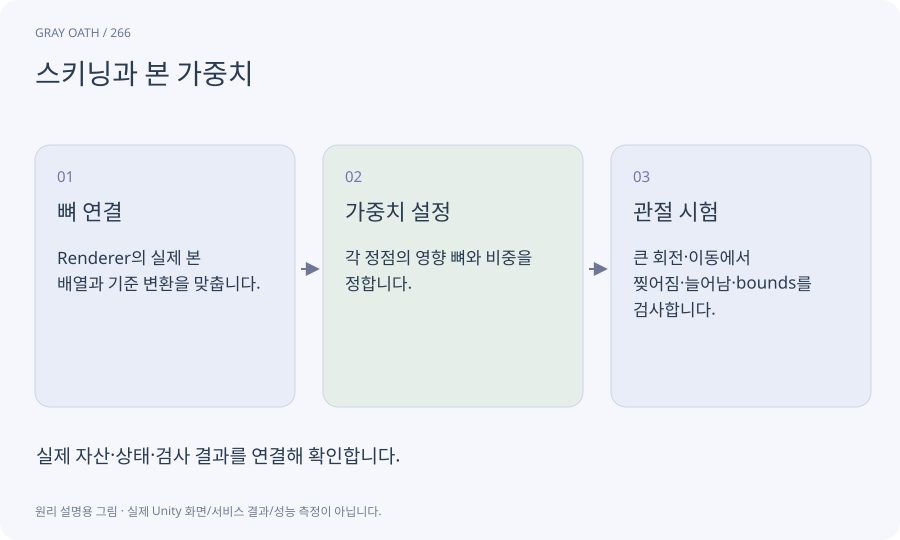

# 스키닝과 본 가중치

메시의 각 정점이 어느 뼈를 얼마나 따라갈지 정해 관절 움직임에 따라 형태를 바꾸는 기술입니다. 뼈가 있어도 가중치가 없으면 제대로 휘지 않습니다.

## 익숙한 비유

천의 각 부분을 여러 손이 비율을 나눠 잡고 움직이는 것과 같습니다.



## 작동 원리

### 1. 뼈 연결

Renderer의 실제 본 배열과 기준 변환을 맞춥니다.

### 2. 가중치 설정

각 정점의 영향 뼈와 비중을 정합니다.

### 3. 관절 시험

큰 회전·이동에서 찢어짐·늘어남·bounds를 검사합니다.

## 게임 속 예

팔꿈치 주변 정점에 위팔/아래팔 영향을 나눕니다. 내부 제작 로우폴리는 처음에는 구획을 단순하게 해 안정적인 변형을 목표로 합니다.

## 혼동하지 않기

리그를 만들었다는 보고만으로 메시가 실제로 변형되는지 알 수 없습니다.

## 확인 질문

머리만 움직이면 몸 전체가 끌려오는 이유는?

가중치나 bone index가 잘못되었을 수 있습니다. 실제 정점 영향을 표시해 확인합니다.

## 내 프로젝트에서 확인하기

```text
현재 GrayOathRPG3D에서 스키닝과 본 가중치을 사용하는 실제 대상과 동작을 읽기 전용으로 확인해 줘. 쉬운 말과 작은 사례로 설명하고 리그를 만들었다는 보고만으로 메시가 실제로 변형되는지 알 수 없습니다. 이 문제를 어떻게 막는지 보여 줘. 코드·데이터·설정은 아직 수정하지 마.
```

## 관련 해설

[bindpose](bindpose.md) · [rig](rig.md) · [humanoid](humanoid.md)

## 공식 참고

- [Unity · Animation Rigging](https://docs.unity3d.com/Packages/com.unity.animation.rigging@1.3/manual/index.html)
