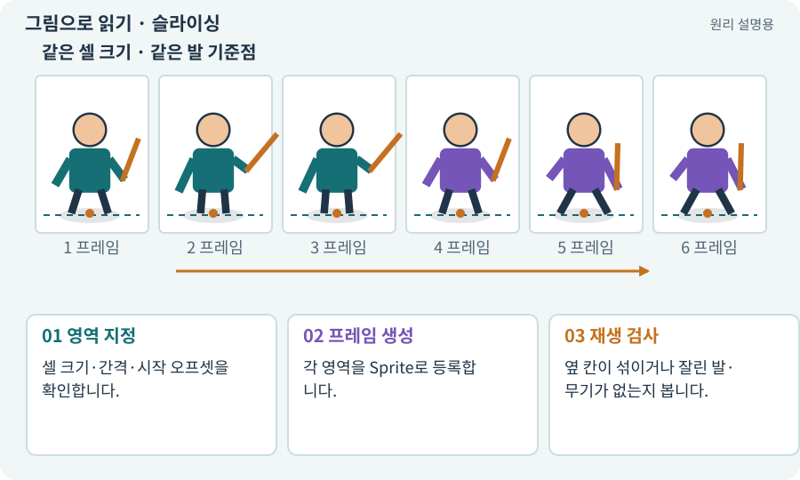

# 슬라이싱·프레임 분리

**분야:** 그림·애니메이션·화면 만들기

슬라이싱은 큰 이미지에서 각각 사용할 Sprite 영역을 나누는 과정입니다. 균일 격자나 개별 영역으로 나눌 수 있으며 이름·순서·Pivot을 함께 관리합니다.

**찾아오는 이름:** 슬라이싱·프레임 분리, 슬라이싱, 슬라이스, slicing, 프레임 분리, Sprite Editor

## 익숙한 것에 비유하면

쿠키 반죽을 같은 틀로 자르는 것과 같습니다. 칼선이 어긋나면 옆 쿠키 조각이 섞입니다.



개념도입니다. 실제 Unity 화면이나 검사 결과가 아닙니다. 그림의 순서·색은 역할을 구분하며 실제 설정값은 프로젝트에서 확인합니다.

## 이렇게 작동합니다

### 1. 영역 지정

셀 크기·간격·시작 오프셋을 확인합니다.

### 2. 프레임 생성

각 영역을 Sprite로 등록합니다.

### 3. 재생 검사

옆 칸이 섞이거나 잘린 발·무기가 없는지 봅니다.

## 우리 RPG에서는 이렇게 만나요

128픽셀 셀 사이에 2픽셀 간격이 있다면 단순 128격자로만 잘라서는 뒤쪽 프레임이 어긋날 수 있습니다. 원본 시트 규격과 가져오기 설정을 일치시킵니다.

## 이것과 혼동하지 마세요

자동으로 불투명 영역을 자르면 프레임마다 크기가 달라질 수 있습니다. 발 기준 오프셋을 보존해야 합니다.

## 이해했는지 한 번 생각해 보기

가끔 옆 캐릭터의 픽셀이 보이면?

<details><summary>답과 이유</summary>

셀 범위·간격·필터링·패딩을 함께 확인합니다.

</details>

## 내 프로젝트에서 확인하고 싶다면

아래 요청은 읽기 전용으로 실제 대상을 확인하는 선택 요청입니다. 코드나 설정을 직접 편집할 필요는 없습니다.

```text
현재 프로젝트에서 슬라이싱·프레임 분리 관련 요소가 어떻게 사용되는지 읽기 전용으로 확인해 줘. 실제 대상과 설정을 찾아 쉬운 말과 작은 예로 설명해 줘. 특히 다음 혼동을 구분해 줘: 자동으로 불투명 영역을 자르면 프레임마다 크기가 달라질 수 있습니다. 발 기준 오프셋을 보존해야 합니다. 아직 코드·설정·파일은 바꾸지 말고, 확인할 수 없는 내용은 따로 알려 줘.
```

## 이어지는 개념

[스프라이트 시트](sprite-sheet.md) · [트리밍·오프셋·고정 셀](trimming.md) · [패딩·여백·필터링 번짐](padding.md) · [Pivot과 발 기준점](pivot.md)

## 이 개념을 사용하는 실습

[65 · 스프라이트를 정리해 실제 캐릭터에 넣기](../index.html#lesson-065)

## 참고와 설명의 범위

기본 도구 동작은 아래 공식 자료를 참고했습니다. 비유·그림·RPG의 예시 수치와 정책은 이해를 위한 자체 예제입니다. 실제 API·지원 기능은 설치 버전과 계정에서 확인합니다.

- [Unity · Sprite](https://docs.unity3d.com/6000.3/Documentation/Manual/sprite/sprite-landing.html)

그림·계산 예제·조작 모형은 자체 제작한 설명입니다. 실제 Unity 화면, 서비스 생성 결과, 성능 실측 또는 게임 테스트 결과가 아닙니다. 자료 확인: 2026년 9월 26일.
