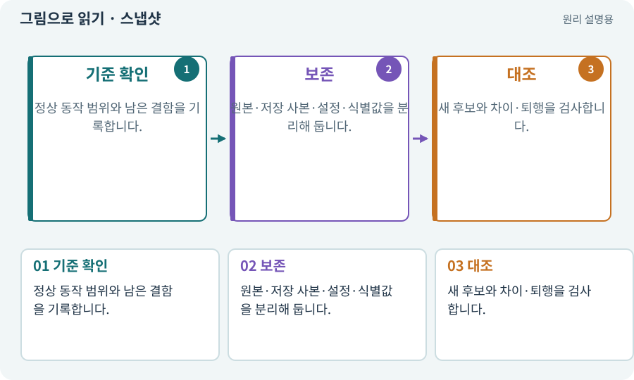

# 스냅샷·기준선·baseline

**분야:** 비동기·다운로드·빌드·버전 관리

스냅샷은 특정 시점의 상태를 보존한 사본이고 기준선은 비교·복구의 출발점입니다. 소스뿐 아니라 엔진·패키지·설정·테스트 저장·빌드 식별을 포함해 무엇을 보존했는지 명시합니다.

**찾아오는 이름:** 스냅샷·기준선·baseline, 스냅샷, Snapshot, snapshot, baseline, 기준선, 기준판

## 익숙한 것에 비유하면

집을 수리하기 전 도면·사진·가구 목록을 남기는 것입니다. 사진 한 장만으로 배관 상태를 복구할 수는 없습니다.



개념도입니다. 실제 Unity 화면이나 검사 결과가 아닙니다. 그림의 순서·색은 역할을 구분하며 실제 설정값은 프로젝트에서 확인합니다.

## 이렇게 작동합니다

### 1. 기준 확인

정상 동작 범위와 남은 결함을 기록합니다.

### 2. 보존

원본·저장 사본·설정·식별값을 분리해 둡니다.

### 3. 대조

새 후보와 차이·퇴행을 검사합니다.

## 우리 RPG에서는 이렇게 만나요

2D를 3D로 바꿀 때 유일한 2D 프로젝트를 덮어쓰지 않습니다. 별도 3D 후보를 만들고 같은 규칙·데이터의 결과를 기준선과 비교합니다.

## 이것과 혼동하지 마세요

폴더 이름에 baseline을 붙여도 검증된 상태라는 증거는 아닙니다.

## 이해했는지 한 번 생각해 보기

기준선이 이미 오류가 있다면 어떻게 하나요?

<details><summary>답과 이유</summary>

기존 결함으로 기록하고 새 변경의 결함과 구분해 다룹니다.

</details>

## 내 프로젝트에서 확인하고 싶다면

아래 요청은 읽기 전용으로 실제 대상을 확인하는 선택 요청입니다. 코드나 설정을 직접 편집할 필요는 없습니다.

```text
현재 프로젝트에서 스냅샷·기준선·baseline 관련 요소가 어떻게 사용되는지 읽기 전용으로 확인해 줘. 실제 대상과 설정을 찾아 쉬운 말과 작은 예로 설명해 줘. 특히 다음 혼동을 구분해 줘: 폴더 이름에 baseline을 붙여도 검증된 상태라는 증거는 아닙니다. 아직 코드·설정·파일은 바꾸지 말고, 확인할 수 없는 내용은 따로 알려 줘.
```

## 이어지는 개념

[Git·저장소·커밋](git.md) · [해시·SHA-256·체크섬](hash.md) · [후보·스테이징·변경 적용](candidate.md) · [회귀·기준선·수정 전후 비교](regression.md)

## 이 개념을 사용하는 실습

[14 · 나를 발견하고 공격하는 적 만들기](../index.html#lesson-014) · [43 · 빌드를 바꾸며 전투 비교하기](../index.html#lesson-043) · [81 · 2D 게임을 남기고 3D 작업 시작하기](../index.html#lesson-081) · [84 · 같은 지도를 3D 바닥과 벽으로 만들기](../index.html#lesson-084) · [86 · 3D에서도 클릭한 곳까지 돌아가기](../index.html#lesson-086) · [91 · 보스 예고를 3D 바닥에 맞추기](../index.html#lesson-091) · [129 · 기존 2D 게임에서 확장팩 시작하기](../index.html#lesson-129) · [133 · 첫 기능의 실패를 고쳐 다음 기준 만들기](../index.html#lesson-133) · [142 · 배운 스킬의 변형 선택하기](../index.html#lesson-142)

## 참고와 설명의 범위

이 항목의 비유·그림·RPG 수치·운영 규칙은 개념을 이해하기 위한 자체 설계 예제입니다. 특정 도구가 이 규칙을 자동으로 구현한다는 뜻은 아닙니다.


그림·계산 예제·조작 모형은 자체 제작한 설명입니다. 실제 Unity 화면, 서비스 생성 결과, 성능 실측 또는 게임 테스트 결과가 아닙니다. 자료 확인: 2026년 9월 26일.
