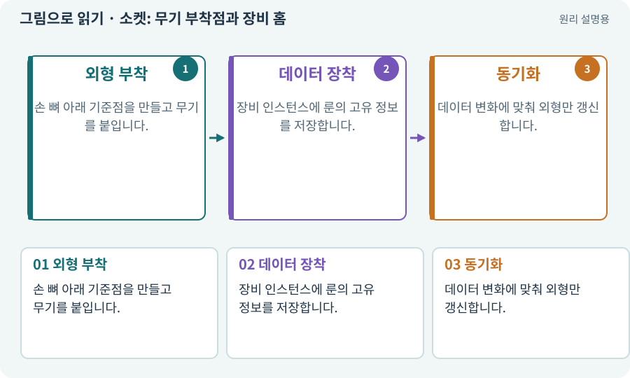

# 소켓: 무기 부착점과 장비 홈

**분야:** 그림·애니메이션·화면 만들기

소켓은 두 문맥으로 쓰입니다. 외형의 소켓은 검을 손에 붙일 기준점이고, 장비 시스템의 소켓은 룬을 끼우는 데이터상의 슬롯입니다. 이름은 같지만 책임이 다릅니다.

**찾아오는 이름:** 소켓: 무기 부착점과 장비 홈, WeaponSocket, 무기 소켓, 소켓, socket

## 익숙한 것에 비유하면

옷걸이에 가방을 거는 위치와 반지에 보석을 끼우는 홈을 구분합니다.



개념도입니다. 실제 Unity 화면이나 검사 결과가 아닙니다. 그림의 순서·색은 역할을 구분하며 실제 설정값은 프로젝트에서 확인합니다.

## 이렇게 작동합니다

### 1. 외형 부착

손 뼈 아래 기준점을 만들고 무기를 붙입니다.

### 2. 데이터 장착

장비 인스턴스에 룬의 고유 정보를 저장합니다.

### 3. 동기화

데이터 변화에 맞춰 외형만 갱신합니다.

## 우리 RPG에서는 이렇게 만나요

장비 검의 룬을 교체하면 공격력은 데이터로 재계산하고, 손의 검 발광은 표시만 바꿉니다. 검 오브젝트의 개수로 능력치를 합산하지 않습니다.

## 이것과 혼동하지 마세요

외형 소켓에 모델을 붙였다고 장비 데이터가 자동 장착되지는 않습니다.

## 이해했는지 한 번 생각해 보기

손의 검을 숨기면 공격력도 사라져야 하나요?

<details><summary>답과 이유</summary>

데이터상 장착이 유지된다면 외형 숨김만으로 능력치는 바뀌지 않아야 합니다.

</details>

## 내 프로젝트에서 확인하고 싶다면

아래 요청은 읽기 전용으로 실제 대상을 확인하는 선택 요청입니다. 코드나 설정을 직접 편집할 필요는 없습니다.

```text
현재 프로젝트에서 소켓: 무기 부착점과 장비 홈 관련 요소가 어떻게 사용되는지 읽기 전용으로 확인해 줘. 실제 대상과 설정을 찾아 쉬운 말과 작은 예로 설명해 줘. 특히 다음 혼동을 구분해 줘: 외형 소켓에 모델을 붙였다고 장비 데이터가 자동 장착되지는 않습니다. 아직 코드·설정·파일은 바꾸지 말고, 확인할 수 없는 내용은 따로 알려 줘.
```

## 이어지는 개념

[리그·본·스키닝·Avatar](rig.md) · [아이템 인스턴스와 소유권](item-instance.md) · [장비·슬롯·재계산](equipment.md) · [트랜잭션·거래의 한 번 적용](transaction.md)

## 이 개념을 사용하는 실습

[87 · 같은 캐릭터를 실제 3D 모델로 만들기](../index.html#lesson-087) · [88 · 3D 모델에 걷기와 공격 연결하기](../index.html#lesson-088) · [92 · 무기를 손에 쥐고 전리품 표시하기](../index.html#lesson-092) · [129 · 기존 2D 게임에서 확장팩 시작하기](../index.html#lesson-129) · [141 · 소켓 한 칸에 룬 장착하기](../index.html#lesson-141)

## 참고와 설명의 범위

기본 도구 동작은 아래 공식 자료를 참고했습니다. 비유·그림·RPG의 예시 수치와 정책은 이해를 위한 자체 예제입니다. 실제 API·지원 기능은 설치 버전과 계정에서 확인합니다.

- [Unity · Transform](https://docs.unity3d.com/6000.3/Documentation/Manual/class-Transform.html)

그림·계산 예제·조작 모형은 자체 제작한 설명입니다. 실제 Unity 화면, 서비스 생성 결과, 성능 실측 또는 게임 테스트 결과가 아닙니다. 자료 확인: 2026년 9월 26일.
