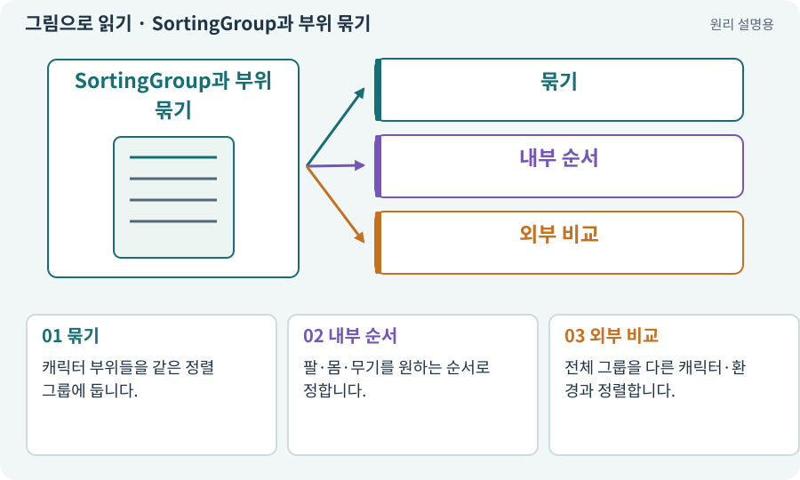

# SortingGroup과 부위 묶기

**분야:** 그림·애니메이션·화면 만들기

SortingGroup은 여러 SpriteRenderer를 바깥 객체와 비교할 때 하나의 정렬 묶음으로 다루도록 돕습니다. 묶음 안에서는 무기·몸·머리의 내부 순서를 유지할 수 있습니다.

**찾아오는 이름:** SortingGroup과 부위 묶기, SortingGroup, Sorting Group, 정렬 그룹

## 익숙한 것에 비유하면

사람 한 명의 몸·팔·검 종이를 한 세트로 묶어 다른 사람과 겹치는 것입니다. 검만 다른 사람 사이로 끼어들지 않게 합니다.



개념도입니다. 실제 Unity 화면이나 검사 결과가 아닙니다. 그림의 순서·색은 역할을 구분하며 실제 설정값은 프로젝트에서 확인합니다.

## 이렇게 작동합니다

### 1. 묶기

캐릭터 부위들을 같은 정렬 그룹에 둡니다.

### 2. 내부 순서

팔·몸·무기를 원하는 순서로 정합니다.

### 3. 외부 비교

전체 그룹을 다른 캐릭터·환경과 정렬합니다.

## 우리 RPG에서는 이렇게 만나요

부위별 2D 캐릭터가 나무 뒤에 갈 때 머리만 앞에 남지 않도록 확인합니다. 별도 바닥 그림자 등은 그룹과 역할을 신중히 구분합니다.

## 이것과 혼동하지 마세요

그룹을 쓴다고 잘못된 Pivot이나 겹침 구조가 자동으로 해결되는 것은 아닙니다.

## 이해했는지 한 번 생각해 보기

무기만 다른 캐릭터 몸 사이에 들어가면?

<details><summary>답과 이유</summary>

같은 캐릭터 부위의 정렬 그룹과 내부 Order를 확인합니다.

</details>

## 내 프로젝트에서 확인하고 싶다면

아래 요청은 읽기 전용으로 실제 대상을 확인하는 선택 요청입니다. 코드나 설정을 직접 편집할 필요는 없습니다.

```text
현재 프로젝트에서 SortingGroup과 부위 묶기 관련 요소가 어떻게 사용되는지 읽기 전용으로 확인해 줘. 실제 대상과 설정을 찾아 쉬운 말과 작은 예로 설명해 줘. 특히 다음 혼동을 구분해 줘: 그룹을 쓴다고 잘못된 Pivot이나 겹침 구조가 자동으로 해결되는 것은 아닙니다. 아직 코드·설정·파일은 바꾸지 말고, 확인할 수 없는 내용은 따로 알려 줘.
```

## 이어지는 개념

[Sorting Layer·Order·발 정렬](sorting.md) · [Hierarchy와 부모·자식](hierarchy.md) · [Pivot과 발 기준점](pivot.md) · [리그·본·스키닝·Avatar](rig.md)

## 이 개념을 사용하는 실습

[07 · 캐릭터와 벽이 있는 공간 만들기](../index.html#lesson-007)

## 참고와 설명의 범위

기본 도구 동작은 아래 공식 자료를 참고했습니다. 비유·그림·RPG의 예시 수치와 정책은 이해를 위한 자체 예제입니다. 실제 API·지원 기능은 설치 버전과 계정에서 확인합니다.

- [Unity · 스프라이트 정렬](https://docs.unity3d.com/6000.3/Documentation/Manual/sprite/sort-sprites/sort-sprites.html)

그림·계산 예제·조작 모형은 자체 제작한 설명입니다. 실제 Unity 화면, 서비스 생성 결과, 성능 실측 또는 게임 테스트 결과가 아닙니다. 자료 확인: 2026년 9월 26일.
