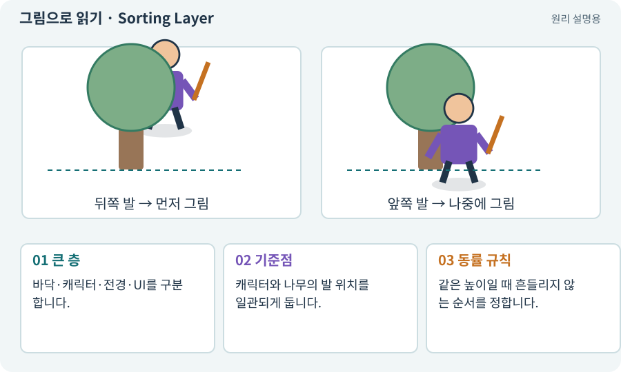

# Sorting Layer·Order·발 정렬

**분야:** 그림·애니메이션·화면 만들기

2D에서 무엇을 앞에 그릴지 정하는 규칙입니다. 큰 범주의 Sorting Layer와 세부 순서, 카메라·투명 정렬 설정 등이 함께 작용합니다. 발 높이 기준은 이 게임의 탑다운 표현 규칙입니다.

**찾아오는 이름:** Sorting Layer·Order·발 정렬, Sorting Layer, Sorting, Order in Layer, 정렬 순서, 앞뒤 정렬, Y 정렬

## 익숙한 것에 비유하면

종이 인형을 겹쳐 놓는 순서입니다. 바닥에 선 발이 더 아래쪽이면 관찰자에게 가까운 것으로 보여 앞에 그릴 수 있습니다.



개념도입니다. 실제 Unity 화면이나 검사 결과가 아닙니다. 그림의 순서·색은 역할을 구분하며 실제 설정값은 프로젝트에서 확인합니다.

## 이렇게 작동합니다

### 1. 큰 층

바닥·캐릭터·전경·UI를 구분합니다.

### 2. 기준점

캐릭터와 나무의 발 위치를 일관되게 둡니다.

### 3. 동률 규칙

같은 높이일 때 흔들리지 않는 순서를 정합니다.

## 2D 그림의 앞뒤와 게임의 충돌은 별개예요

탑다운 2D에서는 같은 높이의 발 기준점을 비교해 화면 아래쪽 대상을 나중에 그리는 규칙을 사용할 수 있습니다. 나무 뒤로 걸어가면 캐릭터가 가려지고 앞으로 나오면 나무 앞에 보이는 식입니다.

Sorting Layer의 큰 그룹, Order in Layer의 순서, 프로젝트의 투명 정렬 설정을 함께 확인합니다. 서로 다른 설정을 섞으면 Y값만 바꿔도 기대대로 정렬되지 않을 수 있습니다.

긴 무기·머리·몸을 별도 SpriteRenderer로 만들 때 SortingGroup으로 한 캐릭터의 부위를 묶어 다른 캐릭터와 섞이지 않게 할 수 있습니다. 실제 판정 영역은 Physics2D가 별도로 처리합니다.

| 변경 | 영향 | 영향받지 않아야 할 것 |
| --- | --- | --- |
| 발 Y 위치 | 대상 앞뒤 순서 | 피해량 |
| Sorting Layer | 큰 렌더 그룹 | 통행 가능성 |
| 나무 그림 반투명 | 가독성 | 벽 충돌·적 시야 규칙 |

## 직접 값을 바꾸며 보기

[웹 해설의 조작 모형 열기](../index.html#tech-sorting). 조작은 설명용 모형만 바꿉니다. 실제 프로젝트·AI·진행 체크·게임 테스트는 실행하거나 변경하지 않습니다.

## 우리 RPG에서는 이렇게 만나요

나무 뒤를 지날 때 몸이 가려지고 나무 앞에서는 캐릭터가 앞에 나와야 합니다. 머리 중심으로 정렬하면 큰 몬스터가 갑자기 앞뒤로 튈 수 있습니다.

## 이것과 혼동하지 마세요

정렬 순서와 물리 Layer는 다른 기능입니다. Z를 바꿔 충돌 문제를 고치려 하지 않습니다.

## 이해했는지 한 번 생각해 보기

큰 모자를 쓴 뒤 가림 순서가 달라지면?

<details><summary>답과 이유</summary>

그림 중심이 아니라 발 기준점으로 정렬하는지 확인합니다.

</details>

## 내 프로젝트에서 확인하고 싶다면

아래 요청은 읽기 전용으로 실제 대상을 확인하는 선택 요청입니다. 코드나 설정을 직접 편집할 필요는 없습니다.

```text
현재 프로젝트에서 Sorting Layer·Order·발 정렬 관련 요소가 어떻게 사용되는지 읽기 전용으로 확인해 줘. 실제 대상과 설정을 찾아 쉬운 말과 작은 예로 설명해 줘. 특히 다음 혼동을 구분해 줘: 정렬 순서와 물리 Layer는 다른 기능입니다. Z를 바꿔 충돌 문제를 고치려 하지 않습니다. 아직 코드·설정·파일은 바꾸지 말고, 확인할 수 없는 내용은 따로 알려 줘.
```

## 이어지는 개념

[Pivot과 발 기준점](pivot.md) · [SortingGroup과 부위 묶기](sorting-group.md) · [Layer·LayerMask·Tag](layer.md) · [카메라·직교·원근](camera.md)

## 이 개념을 사용하는 실습

[05 · 말로 스프라이트 하나 만들기](../index.html#lesson-005) · [07 · 캐릭터와 벽이 있는 공간 만들기](../index.html#lesson-007) · [13 · 적을 클릭해 접근하고 공격하기](../index.html#lesson-013) · [33 · 기본 캐릭터·몬스터·타일 아트 만들기](../index.html#lesson-033) · [35 · 앞뒤 가림과 PC 조작 다듬기](../index.html#lesson-035) · [66 · 타일 경계와 랜덤맵 외형 연결하기](../index.html#lesson-066) · [68 · 피격 불꽃과 먼지 만들기](../index.html#lesson-068)

## 참고와 설명의 범위

기본 도구 동작은 아래 공식 자료를 참고했습니다. 비유·그림·RPG의 예시 수치와 정책은 이해를 위한 자체 예제입니다. 실제 API·지원 기능은 설치 버전과 계정에서 확인합니다.

- [Unity · 스프라이트 정렬](https://docs.unity3d.com/6000.3/Documentation/Manual/sprite/sort-sprites/sort-sprites.html)

그림·계산 예제·조작 모형은 자체 제작한 설명입니다. 실제 Unity 화면, 서비스 생성 결과, 성능 실측 또는 게임 테스트 결과가 아닙니다. 자료 확인: 2026년 9월 26일.
