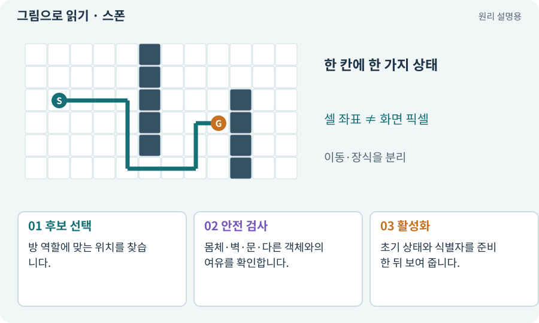

# 스폰·디스폰·안전한 배치

**분야:** 지도·적 AI·전투 규칙

스폰은 게임 세계에 캐릭터·적·아이템을 생성하거나 활성화해 배치하는 일입니다. 안전한 스폰은 지면·충돌·다른 객체·접근 가능성까지 확인합니다.

**찾아오는 이름:** 스폰·디스폰·안전한 배치, 스폰, Spawn, SpawnPoint, 디스폰, Despawn

## 익숙한 것에 비유하면

행사장에 의자를 놓을 때 그림상 빈 곳뿐 아니라 통로를 막지 않고 사람이 앉을 수 있는지 보는 것입니다.



개념도입니다. 실제 Unity 화면이나 검사 결과가 아닙니다. 그림의 순서·색은 역할을 구분하며 실제 설정값은 프로젝트에서 확인합니다.

## 이렇게 작동합니다

### 1. 후보 선택

방 역할에 맞는 위치를 찾습니다.

### 2. 안전 검사

몸체·벽·문·다른 객체와의 여유를 확인합니다.

### 3. 활성화

초기 상태와 식별자를 준비한 뒤 보여 줍니다.

## 우리 RPG에서는 이렇게 만나요

보스를 벽 속에 만들거나 전리품을 갈 수 없는 섬에 놓으면 랜덤맵 생성 성공이어도 플레이는 막힙니다. 실패 위치와 시드를 기록합니다.

## 이것과 혼동하지 마세요

Instantiate 호출이 성공했다고 플레이 가능한 배치가 된 것은 아닙니다.

## 이해했는지 한 번 생각해 보기

사라진 적을 풀에서 다시 꺼냈는데 이미 죽어 있다면?

<details><summary>답과 이유</summary>

체력·상태·구독 등 스폰 초기화가 누락됐을 수 있습니다.

</details>

## 내 프로젝트에서 확인하고 싶다면

아래 요청은 읽기 전용으로 실제 대상을 확인하는 선택 요청입니다. 코드나 설정을 직접 편집할 필요는 없습니다.

```text
현재 프로젝트에서 스폰·디스폰·안전한 배치 관련 요소가 어떻게 사용되는지 읽기 전용으로 확인해 줘. 실제 대상과 설정을 찾아 쉬운 말과 작은 예로 설명해 줘. 특히 다음 혼동을 구분해 줘: Instantiate 호출이 성공했다고 플레이 가능한 배치가 된 것은 아닙니다. 아직 코드·설정·파일은 바꾸지 말고, 확인할 수 없는 내용은 따로 알려 줘.
```

## 이어지는 개념

[오브젝트 풀링](pool.md) · [수명주기·초기화·정리](lifecycle.md) · [절차적·무작위 지형 생성](generation.md) · [몸체 여유·모서리 통과](clearance.md)

## 이 개념을 사용하는 실습

[07 · 캐릭터와 벽이 있는 공간 만들기](../index.html#lesson-007) · [08 · WASD로 벽에 부딪히며 이동하기](../index.html#lesson-008) · [16 · 물약을 쓰고 죽은 뒤 다시 시작하기](../index.html#lesson-016) · [21 · 몬스터가 장비를 떨어뜨리게 하기](../index.html#lesson-021) · [26 · 새 게임·이어하기·마을 연결하기](../index.html#lesson-026) · [29 · 방마다 적과 상자 배치하기](../index.html#lesson-029) · [37 · 느려지는 원인을 측정해 고치기](../index.html#lesson-037) · [46 · 랜덤 지도 위를 실제로 걷기](../index.html#lesson-046) · [47 · 실패하는 시드를 찾고 복구하기](../index.html#lesson-047) · [48 · 적이 나를 보고 놓치게 만들기](../index.html#lesson-048) · [66 · 타일 경계와 랜덤맵 외형 연결하기](../index.html#lesson-066) · [84 · 같은 지도를 3D 바닥과 벽으로 만들기](../index.html#lesson-084) · [94 · 같은 랜덤 던전을 3D로 생성하기](../index.html#lesson-094)

## 참고와 설명의 범위

기본 도구 동작은 아래 공식 자료를 참고했습니다. 비유·그림·RPG의 예시 수치와 정책은 이해를 위한 자체 예제입니다. 실제 API·지원 기능은 설치 버전과 계정에서 확인합니다.

- [Unity · Tilemap Collider 2D](https://docs.unity3d.com/6000.3/Documentation/Manual/tilemaps/work-with-tilemaps/tilemap-collider-2d.html)

그림·계산 예제·조작 모형은 자체 제작한 설명입니다. 실제 Unity 화면, 서비스 생성 결과, 성능 실측 또는 게임 테스트 결과가 아닙니다. 자료 확인: 2026년 9월 26일.
