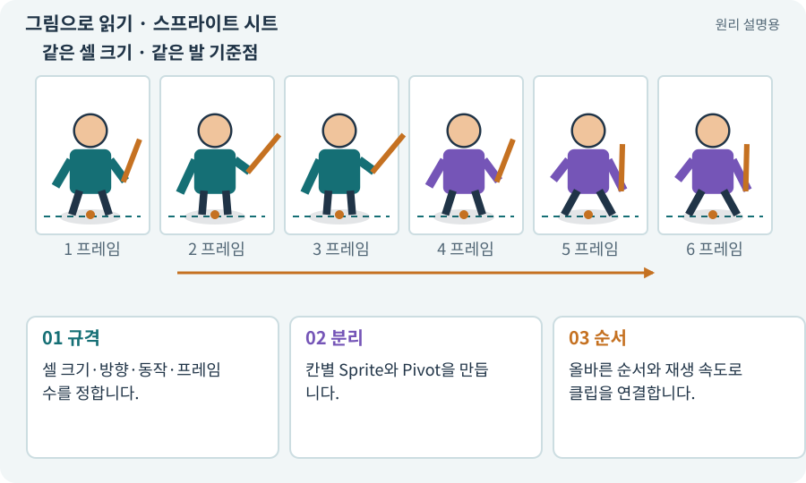

# 스프라이트 시트

**분야:** 그림·애니메이션·화면 만들기

여러 동작 그림을 한 이미지에 배열한 자료입니다. 각 칸이 애니메이션 프레임이 되지만, 배열만 있다고 자동으로 올바른 동작이 재생되는 것은 아닙니다.

**찾아오는 이름:** 스프라이트 시트, spritesheet, sprite sheet, 시트, 프레임 시트

## 익숙한 것에 비유하면

작은 플립북의 페이지를 한 장에 펼쳐 놓은 것입니다. 읽는 순서와 한 장당 시간을 알아야 움직임이 됩니다.



개념도입니다. 실제 Unity 화면이나 검사 결과가 아닙니다. 그림의 순서·색은 역할을 구분하며 실제 설정값은 프로젝트에서 확인합니다.

## 이렇게 작동합니다

### 1. 규격

셀 크기·방향·동작·프레임 수를 정합니다.

### 2. 분리

칸별 Sprite와 Pivot을 만듭니다.

### 3. 순서

올바른 순서와 재생 속도로 클립을 연결합니다.

## 걷기 한 동작을 읽는 순서

6개의 프레임을 초당 12프레임으로 재생하면 한 번 재생하는 데 6÷12=0.5초가 걸립니다. 같은 시트를 6fps로 재생하면 1초입니다. 게임 자체가 60fps로 그려지더라도 동작의 그림 교체 속도는 12fps로 유지할 수 있습니다.

행은 방향, 열은 시간이라는 규칙을 정할 수 있습니다. 예를 들어 4방향×6프레임이면 총 24장입니다. 이 배치는 프로젝트 규격이며 모든 서비스가 자동으로 같은 규격을 사용하지는 않습니다.

대기·걷기는 반복해도 자연스러워야 하고 공격·사망은 끝에서 계속 처음으로 돌아갈지 정책이 다릅니다. 빈 프레임, 방향 뒤바뀜, 무기 사라짐, 발 흔들림을 실제 재생으로 확인합니다.

| 데이터 | 역할 | 실수 예 |
| --- | --- | --- |
| 그림 프레임 | 외형 표현 | 마지막 프레임 누락 |
| 클립 재생 속도 | 그림 교체 시점 | 게임 FPS와 혼동 |
| 전투 타격 사건 | 실제 피해 | 그림과 타이머가 각각 피해 |

## 직접 값을 바꾸며 보기

[웹 해설의 조작 모형 열기](../index.html#tech-sprite-sheet). 조작은 설명용 모형만 바꿉니다. 실제 프로젝트·AI·진행 체크·게임 테스트는 실행하거나 변경하지 않습니다.

## 우리 RPG에서는 이렇게 만나요

남쪽 걷기 6프레임과 공격 8프레임을 같은 시트에 놓더라도 각 동작의 끝과 반복 여부를 따로 정합니다. 공격 클립을 무조건 반복하면 피해도 반복될 위험이 있습니다.

## 이것과 혼동하지 마세요

아틀라스와 목적이 다릅니다. 시트는 주로 동작 프레임 배열, 아틀라스는 렌더링 자료 묶음입니다. 하나의 파일이 두 용도로 쓰일 수는 있습니다.

## 이해했는지 한 번 생각해 보기

시트에 그림 8개가 있으면 걷기가 완성된 건가요?

<details><summary>답과 이유</summary>

순서·Pivot·방향·프레임 간 일관성과 실제 재생을 확인해야 합니다.

</details>

## 내 프로젝트에서 확인하고 싶다면

아래 요청은 읽기 전용으로 실제 대상을 확인하는 선택 요청입니다. 코드나 설정을 직접 편집할 필요는 없습니다.

```text
현재 프로젝트에서 스프라이트 시트 관련 요소가 어떻게 사용되는지 읽기 전용으로 확인해 줘. 실제 대상과 설정을 찾아 쉬운 말과 작은 예로 설명해 줘. 특히 다음 혼동을 구분해 줘: 아틀라스와 목적이 다릅니다. 시트는 주로 동작 프레임 배열, 아틀라스는 렌더링 자료 묶음입니다. 하나의 파일이 두 용도로 쓰일 수는 있습니다. 아직 코드·설정·파일은 바꾸지 말고, 확인할 수 없는 내용은 따로 알려 줘.
```

## 이어지는 개념

[스프라이트와 SpriteRenderer](sprite.md) · [Sprite Atlas와 패킹](atlas.md) · [애니메이션 클립·프레임·키프레임](animation-clip.md) · [슬라이싱·프레임 분리](slicing.md)

## 이 개념을 사용하는 실습

[37 · 느려지는 원인을 측정해 고치기](../index.html#lesson-037) · [55 · 어떤 그림도 맞춰 넣는 아트 규격 정하기](../index.html#lesson-055) · [56 · Unity AI로 캐릭터 움직임 만들기](../index.html#lesson-056) · [58 · PixelLab로 방향별 픽셀 캐릭터 만들기](../index.html#lesson-058) · [60 · Scenario로 스타일과 동작 유지하기](../index.html#lesson-060) · [61 · Ludo.ai로 키 포즈를 지정해 움직임 만들기](../index.html#lesson-061) · [62 · OpenAI 이미지로 게임 자산 만들기](../index.html#lesson-062) · [63 · Grok 이미지로 같은 자산 시험하기](../index.html#lesson-063) · [65 · 스프라이트를 정리해 실제 캐릭터에 넣기](../index.html#lesson-065) · [67 · 내 게임의 아트 제작 경로 선택하기](../index.html#lesson-067) · [69 · 베기와 폭발을 시트 애니메이션으로 만들기](../index.html#lesson-069) · [97 · 선택: 3D 모델에서 2D 시트 만들기](../index.html#lesson-097) · [149 · 상태와 보스 효과를 같은 데이터로 맞추기](../index.html#lesson-149)

## 참고와 설명의 범위

기본 도구 동작은 아래 공식 자료를 참고했습니다. 비유·그림·RPG의 예시 수치와 정책은 이해를 위한 자체 예제입니다. 실제 API·지원 기능은 설치 버전과 계정에서 확인합니다.

- [Unity · Sprite](https://docs.unity3d.com/6000.3/Documentation/Manual/sprite/sprite-landing.html)

그림·계산 예제·조작 모형은 자체 제작한 설명입니다. 실제 Unity 화면, 서비스 생성 결과, 성능 실측 또는 게임 테스트 결과가 아닙니다. 자료 확인: 2026년 9월 26일.
