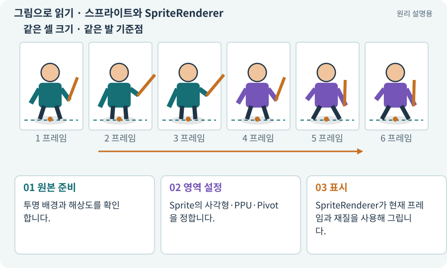

# 스프라이트와 SpriteRenderer

**분야:** 그림·애니메이션·화면 만들기

Sprite는 2D 그림에서 사용할 영역과 기준점을 나타내는 에셋이고, SpriteRenderer는 그것을 게임 세계에 그리는 컴포넌트입니다. PNG 전체와 화면의 캐릭터가 항상 같은 개념은 아닙니다.

**찾아오는 이름:** 스프라이트와 SpriteRenderer, 스프라이트, SpriteRenderer, Sprite, 스프라이트 렌더러

## 익숙한 것에 비유하면

사진 한 장에서 인물 부분만 잘라 앨범에 붙이는 것과 같습니다. 원본 사진·자른 영역·붙이는 장치가 구분됩니다.



개념도입니다. 실제 Unity 화면이나 검사 결과가 아닙니다. 그림의 순서·색은 역할을 구분하며 실제 설정값은 프로젝트에서 확인합니다.

## 이렇게 작동합니다

### 1. 원본 준비

투명 배경과 해상도를 확인합니다.

### 2. 영역 설정

Sprite의 사각형·PPU·Pivot을 정합니다.

### 3. 표시

SpriteRenderer가 현재 프레임과 재질을 사용해 그립니다.

## 우리 RPG에서는 이렇게 만나요

한 PNG에 걷기 8프레임이 있으면 8개의 Sprite 영역으로 나누어 순서대로 보여 줍니다. 원본을 바꿀 때 참조와 프레임 순서를 확인합니다.

## 이것과 혼동하지 마세요

SpriteRenderer는 이동이나 체력을 자동으로 만들지 않습니다. 그림과 몸체는 분리합니다.

## 이해했는지 한 번 생각해 보기

Sprite가 있는데 캐릭터가 안 보이면 무엇을 보나요?

<details><summary>답과 이유</summary>

Renderer 참조·활성·카메라·정렬·재질·알파를 확인합니다.

</details>

## 내 프로젝트에서 확인하고 싶다면

아래 요청은 읽기 전용으로 실제 대상을 확인하는 선택 요청입니다. 코드나 설정을 직접 편집할 필요는 없습니다.

```text
현재 프로젝트에서 스프라이트와 SpriteRenderer 관련 요소가 어떻게 사용되는지 읽기 전용으로 확인해 줘. 실제 대상과 설정을 찾아 쉬운 말과 작은 예로 설명해 줘. 특히 다음 혼동을 구분해 줘: SpriteRenderer는 이동이나 체력을 자동으로 만들지 않습니다. 그림과 몸체는 분리합니다. 아직 코드·설정·파일은 바꾸지 말고, 확인할 수 없는 내용은 따로 알려 줘.
```

## 이어지는 개념

[텍스처·픽셀·해상도](texture.md) · [스프라이트 시트](sprite-sheet.md) · [PPU: 픽셀과 월드 크기](ppu.md) · [Pivot과 발 기준점](pivot.md) · [렌더링·Renderer](render.md)

## 이 개념을 사용하는 실습

[05 · 말로 스프라이트 하나 만들기](../index.html#lesson-005) · [06 · 시작 메뉴와 테스트 공간 연결하기](../index.html#lesson-006) · [07 · 캐릭터와 벽이 있는 공간 만들기](../index.html#lesson-007) · [13 · 적을 클릭해 접근하고 공격하기](../index.html#lesson-013) · [14 · 나를 발견하고 공격하는 적 만들기](../index.html#lesson-014) · [33 · 기본 캐릭터·몬스터·타일 아트 만들기](../index.html#lesson-033) · [34 · 걷기·공격·피격·사망 움직임 연결하기](../index.html#lesson-034) · [35 · 앞뒤 가림과 PC 조작 다듬기](../index.html#lesson-035) · [37 · 느려지는 원인을 측정해 고치기](../index.html#lesson-037) · [55 · 어떤 그림도 맞춰 넣는 아트 규격 정하기](../index.html#lesson-055) · [56 · Unity AI로 캐릭터 움직임 만들기](../index.html#lesson-056) · [57 · Unity AI로 바닥과 벽 타일 만들기](../index.html#lesson-057) · [60 · Scenario로 스타일과 동작 유지하기](../index.html#lesson-060) · [61 · Ludo.ai로 키 포즈를 지정해 움직임 만들기](../index.html#lesson-061) · [65 · 스프라이트를 정리해 실제 캐릭터에 넣기](../index.html#lesson-065) · [67 · 내 게임의 아트 제작 경로 선택하기](../index.html#lesson-067) · [69 · 베기와 폭발을 시트 애니메이션으로 만들기](../index.html#lesson-069) · [70 · 피격 강조와 보스 예고 셰이더 만들기](../index.html#lesson-070) · [73 · 주소로 에셋 불러오기](../index.html#lesson-073) · [74 · 추가 외형을 서버에서 받게 준비하기](../index.html#lesson-074) · [79 · 추가 기능을 하나의 게임으로 합치기](../index.html#lesson-079) · [83 · 3D 카메라와 재질로 공간 보기](../index.html#lesson-083) · [87 · 같은 캐릭터를 실제 3D 모델로 만들기](../index.html#lesson-087) · [88 · 3D 모델에 걷기와 공격 연결하기](../index.html#lesson-088) · [136 · 방패병과 화염술사 정예 추가하기](../index.html#lesson-136) · [148 · 아트 역할로 새 지역 외형 완성하기](../index.html#lesson-148) · [149 · 상태와 보스 효과를 같은 데이터로 맞추기](../index.html#lesson-149) · [153 · 대장간 고해상도팩 선택 다운로드하기](../index.html#lesson-153)

## 참고와 설명의 범위

기본 도구 동작은 아래 공식 자료를 참고했습니다. 비유·그림·RPG의 예시 수치와 정책은 이해를 위한 자체 예제입니다. 실제 API·지원 기능은 설치 버전과 계정에서 확인합니다.

- [Unity · Sprite](https://docs.unity3d.com/6000.3/Documentation/Manual/sprite/sprite-landing.html)

그림·계산 예제·조작 모형은 자체 제작한 설명입니다. 실제 Unity 화면, 서비스 생성 결과, 성능 실측 또는 게임 테스트 결과가 아닙니다. 자료 확인: 2026년 9월 26일.
