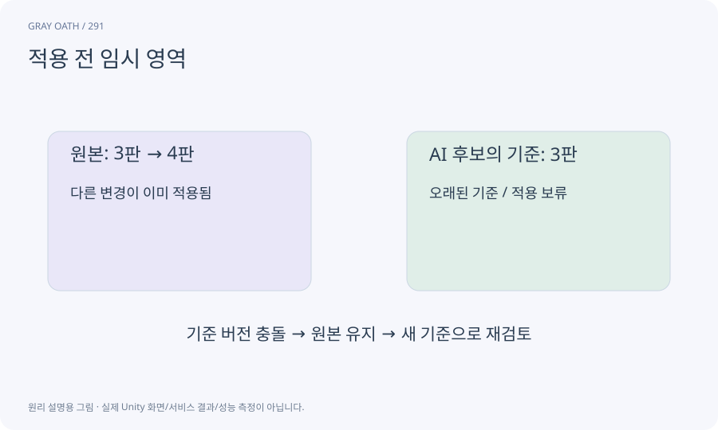

# 적용 전 임시 영역

새 생성 결과를 원본과 분리해 보관하고 검사하는 위치입니다. 받기·검사·승인·적용을 나누어 잘못된 응답이 제품 데이터에 바로 들어가지 않게 합니다.

## 익숙한 비유

새 물건을 진열대에 놓기 전에 검수대에 올리는 과정입니다.



## 작동 원리

### 1. 결과 회수

원본과 다른 경로에 파일과 메타데이터를 남깁니다.

### 2. 검토

차이·참조·비용·형식·권리·실행 조건을 검사합니다.

### 3. 승인 적용

현재 revision과 승인 대상을 다시 확인하고 커밋합니다.

## 게임 속 예

Meshy 모델을 받은 즉시 기존 서린 프리팹을 덮어쓰지 않습니다. 비교 장면에서 크기와 동작을 본 후 승인한 자산만 연결합니다.

## 혼동하지 않기

임시 폴더를 쓰는 것만으로 악성 코드 실행이나 경로 탈출이 막히지는 않습니다.

## 확인 질문

검토 도중 원본이 바뀌었다면?

승인 전 기준 revision을 다시 대조해 오래된 후보를 거부합니다.

## 내 프로젝트에서 확인하기

```text
현재 GrayOathRPG3D에서 적용 전 임시 영역을 사용하는 실제 대상과 동작을 읽기 전용으로 확인해 줘. 쉬운 말과 작은 사례로 설명하고 임시 폴더를 쓰는 것만으로 악성 코드 실행이나 경로 탈출이 막히지는 않습니다. 이 문제를 어떻게 막는지 보여 줘. 코드·데이터·설정은 아직 수정하지 마.
```

## 관련 해설

[candidate](candidate.md) · [diff](diff.md) · [optimistic-revision](optimistic-revision.md)

## 공식 참고

- [Unity · AssetDatabase](https://docs.unity3d.com/6000.3/Documentation/ScriptReference/AssetDatabase.html)
- [Claude Code · Programmatic use](https://code.claude.com/docs/en/headless)
