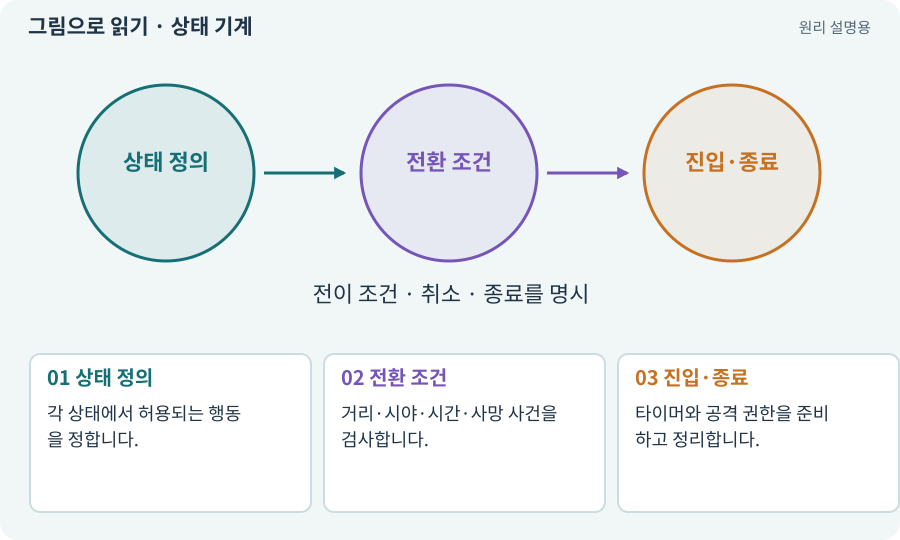

# 상태 기계·FSM

**분야:** 지도·적 AI·전투 규칙

상태 기계는 현재 상태와 사건에 따라 다음 행동을 정하는 구조입니다. 대기·추적·공격 준비·공격·회복·사망처럼 동시에 해서는 안 되는 동작을 명확히 나눕니다.

**찾아오는 이름:** 상태 기계·FSM, 상태 기계, FSM, 상태 전환, Idle, Chase, Windup, Recovery, Dead

## 익숙한 것에 비유하면

신호등은 빨강과 초록을 아무렇게나 동시에 켜지 않습니다. 조건에 따라 정해진 다음 상태로 넘어갑니다.



개념도입니다. 실제 Unity 화면이나 검사 결과가 아닙니다. 그림의 순서·색은 역할을 구분하며 실제 설정값은 프로젝트에서 확인합니다.

## 이렇게 작동합니다

### 1. 상태 정의

각 상태에서 허용되는 행동을 정합니다.

### 2. 전환 조건

거리·시야·시간·사망 사건을 검사합니다.

### 3. 진입·종료

타이머와 공격 권한을 준비하고 정리합니다.

## 우리 RPG에서는 이렇게 만나요

적이 공격 예고 중 죽으면 Dead로 전환하며 예약한 공격과 토큰을 취소합니다. 눈에 보이는 애니메이션만 멈추고 피해 타이머가 남아서는 안 됩니다.

## 이것과 혼동하지 마세요

상태 이름을 enum으로 만든 것만으로 안전한 전이가 보장되지는 않습니다. 모든 종료 경로를 검사합니다.

## 이해했는지 한 번 생각해 보기

사망 후 지연 공격이 나가는 이유는?

<details><summary>답과 이유</summary>

상태 전환 때 예약 공격·콜백을 무효화하지 않았을 수 있습니다.

</details>

## 내 프로젝트에서 확인하고 싶다면

아래 요청은 읽기 전용으로 실제 대상을 확인하는 선택 요청입니다. 코드나 설정을 직접 편집할 필요는 없습니다.

```text
현재 프로젝트에서 상태 기계·FSM 관련 요소가 어떻게 사용되는지 읽기 전용으로 확인해 줘. 실제 대상과 설정을 찾아 쉬운 말과 작은 예로 설명해 줘. 특히 다음 혼동을 구분해 줘: 상태 이름을 enum으로 만든 것만으로 안전한 전이가 보장되지는 않습니다. 모든 종료 경로를 검사합니다. 아직 코드·설정·파일은 바꾸지 말고, 확인할 수 없는 내용은 따로 알려 줘.
```

## 이어지는 개념

[시야·LOS·마지막 목격 위치](los.md) · [쿨다운·마나·자원 소비](cooldown.md) · [수명주기·초기화·정리](lifecycle.md) · [동시 공격 제한·공격 토큰](attack-token.md)

## 이 개념을 사용하는 실습

[14 · 나를 발견하고 공격하는 적 만들기](../index.html#lesson-014) · [34 · 걷기·공격·피격·사망 움직임 연결하기](../index.html#lesson-034) · [48 · 적이 나를 보고 놓치게 만들기](../index.html#lesson-048) · [50 · 석궁수가 거리를 유지하게 만들기](../index.html#lesson-050) · [51 · 전투 전체의 압박 조절하기](../index.html#lesson-051) · [55 · 어떤 그림도 맞춰 넣는 아트 규격 정하기](../index.html#lesson-055) · [65 · 스프라이트를 정리해 실제 캐릭터에 넣기](../index.html#lesson-065) · [70 · 피격 강조와 보스 예고 셰이더 만들기](../index.html#lesson-070) · [88 · 3D 모델에 걷기와 공격 연결하기](../index.html#lesson-088) · [90 · 적의 판단을 3D 공간에 연결하기](../index.html#lesson-090) · [98 · 3D 팩을 2D 팩과 따로 내려받기](../index.html#lesson-098) · [135 · 벽을 통과하지 않는 회피 만들기](../index.html#lesson-135)

## 참고와 설명의 범위

이 항목의 비유·그림·RPG 수치·운영 규칙은 개념을 이해하기 위한 자체 설계 예제입니다. 특정 도구가 이 규칙을 자동으로 구현한다는 뜻은 아닙니다.


그림·계산 예제·조작 모형은 자체 제작한 설명입니다. 실제 Unity 화면, 서비스 생성 결과, 성능 실측 또는 게임 테스트 결과가 아닙니다. 자료 확인: 2026년 9월 26일.
