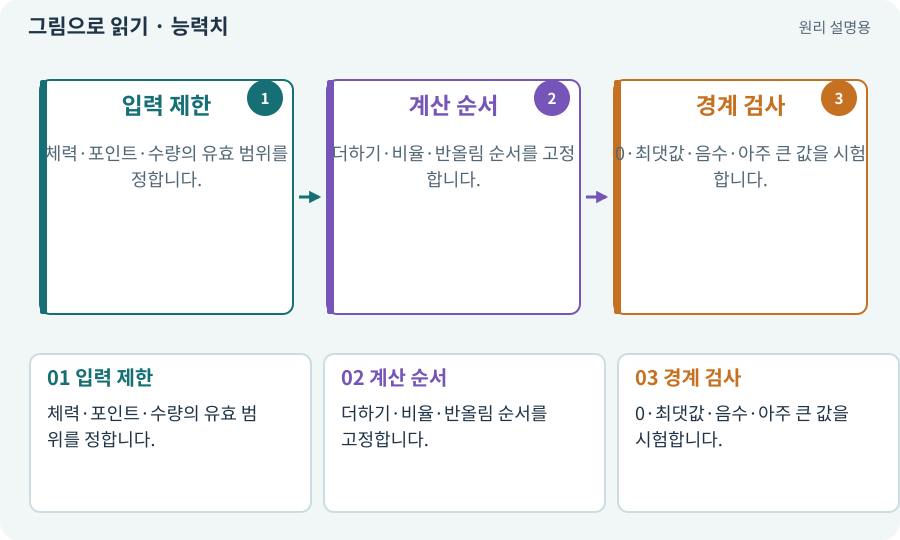

# 능력치·클램프·정수·부동소수점

**분야:** 코드·데이터·저장·검사

능력치는 체력·공격력·속도 같은 게임 수치입니다. clamp는 값을 최소·최대 사이로 제한하며 부동소수점은 소수 근사로 계산하므로 정확 비교에 주의합니다.

**찾아오는 이름:** 능력치·클램프·정수·부동소수점, 능력치, Stat, Stats, clamp, 클램프, 부동소수점, 반올림, 최소 피해

## 익숙한 것에 비유하면

측정 저울의 최소·최대와 눈금을 정하는 것입니다. 소수점이 있는 값은 어떻게 반올림할지도 약속합니다.



개념도입니다. 실제 Unity 화면이나 검사 결과가 아닙니다. 그림의 순서·색은 역할을 구분하며 실제 설정값은 프로젝트에서 확인합니다.

## 이렇게 작동합니다

### 1. 입력 제한

체력·포인트·수량의 유효 범위를 정합니다.

### 2. 계산 순서

더하기·비율·반올림 순서를 고정합니다.

### 3. 경계 검사

0·최댓값·음수·아주 큰 값을 시험합니다.

## 우리 RPG에서는 이렇게 만나요

체력 감소 후 0 아래로 내려가도 표시와 사망 판정이 일치해야 합니다. 장비 보너스 10%와 고정 +4의 적용 순서가 다르면 최종 공격력이 달라질 수 있습니다.

## 이것과 혼동하지 마세요

모든 소수를 반올림하면 좋은 것은 아닙니다. 이동은 부드러움, 재화는 정확한 정수처럼 용도에 맞춥니다.

## 이해했는지 한 번 생각해 보기

체력이 -3인데 살아 있다면?

<details><summary>답과 이유</summary>

체력 제한과 사망 조건, 사건 발행 순서가 일치하는지 확인합니다.

</details>

## 내 프로젝트에서 확인하고 싶다면

아래 요청은 읽기 전용으로 실제 대상을 확인하는 선택 요청입니다. 코드나 설정을 직접 편집할 필요는 없습니다.

```text
현재 프로젝트에서 능력치·클램프·정수·부동소수점 관련 요소가 어떻게 사용되는지 읽기 전용으로 확인해 줘. 실제 대상과 설정을 찾아 쉬운 말과 작은 예로 설명해 줘. 특히 다음 혼동을 구분해 줘: 모든 소수를 반올림하면 좋은 것은 아닙니다. 이동은 부드러움, 재화는 정확한 정수처럼 용도에 맞춥니다. 아직 코드·설정·파일은 바꾸지 말고, 확인할 수 없는 내용은 따로 알려 줘.
```

## 이어지는 개념

[피해 계산·스냅샷·피해 사건](damage.md) · [장비·슬롯·재계산](equipment.md) · [순수 함수·불변 조건·결정적 계산](pure-function.md) · [단위·통합·회귀 테스트](test.md)

## 이 개념을 사용하는 실습

[12 · 체력과 피해를 눈으로 확인하기](../index.html#lesson-012) · [15 · 다른 방식으로 싸우는 적 추가하기](../index.html#lesson-015) · [17 · 적을 잡아 레벨 올리기](../index.html#lesson-017) · [23 · 장비를 바꾸고 능력치 확인하기](../index.html#lesson-023) · [25 · 게임을 껐다 켜도 장비 유지하기](../index.html#lesson-025) · [26 · 새 게임·이어하기·마을 연결하기](../index.html#lesson-026) · [41 · 선택할 수 있는9노드 스킬트리 만들기](../index.html#lesson-041) · [43 · 빌드를 바꾸며 전투 비교하기](../index.html#lesson-043) · [79 · 추가 기능을 하나의 게임으로 합치기](../index.html#lesson-079) · [92 · 무기를 손에 쥐고 전리품 표시하기](../index.html#lesson-092) · [134 · 화상·냉기·표식으로 전투 확장하기](../index.html#lesson-134) · [139 · 재료로 장비 제작하기](../index.html#lesson-139) · [141 · 소켓 한 칸에 룬 장착하기](../index.html#lesson-141) · [142 · 배운 스킬의 변형 선택하기](../index.html#lesson-142) · [144 · 이번 탐험에만 남는 유물 고르기](../index.html#lesson-144) · [151 · 도감과 장비 비교로 새 기능 찾기](../index.html#lesson-151) · [156 · 기능 조합에서 숨은 오류 찾기](../index.html#lesson-156) · [158 · 룬 교체 버그를 역할로 수정하기](../index.html#lesson-158)

## 참고와 설명의 범위

이 항목의 비유·그림·RPG 수치·운영 규칙은 개념을 이해하기 위한 자체 설계 예제입니다. 특정 도구가 이 규칙을 자동으로 구현한다는 뜻은 아닙니다.


그림·계산 예제·조작 모형은 자체 제작한 설명입니다. 실제 Unity 화면, 서비스 생성 결과, 성능 실측 또는 게임 테스트 결과가 아닙니다. 자료 확인: 2026년 9월 26일.
