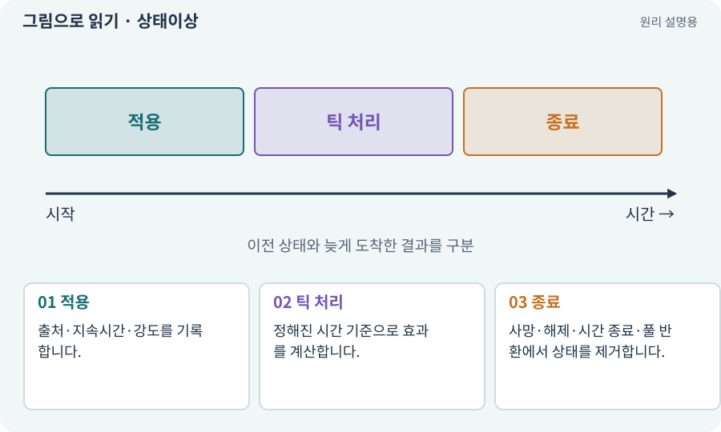

# 상태이상·DoT·중첩

**분야:** 지도·적 AI·전투 규칙

상태이상은 일정 시간 동안 대상에게 적용되는 규칙입니다. DoT는 일정 간격마다 발생하는 지속 피해이며, 중첩은 같은 효과를 여러 번 받았을 때의 결합 방식입니다.

**찾아오는 이름:** 상태이상·DoT·중첩, 상태이상, DoT, DOT, 화상, 냉기, 표식, 중첩, tick

## 익숙한 것에 비유하면

시계가 달린 조건표를 붙이는 것과 같습니다. 같은 표를 또 붙였을 때 시간을 늘릴지 강도를 늘릴지 정해야 합니다.



개념도입니다. 실제 Unity 화면이나 검사 결과가 아닙니다. 그림의 순서·색은 역할을 구분하며 실제 설정값은 프로젝트에서 확인합니다.

## 이렇게 작동합니다

### 1. 적용

출처·지속시간·강도를 기록합니다.

### 2. 틱 처리

정해진 시간 기준으로 효과를 계산합니다.

### 3. 종료

사망·해제·시간 종료·풀 반환에서 상태를 제거합니다.

## 우리 RPG에서는 이렇게 만나요

화상 틱이 다시 화상을 발동하면 연쇄가 무한해질 수 있습니다. 직접 타격·지속 피해·동료 공격의 damageKind를 구분하고 표식 소비 조건을 정합니다.

## 이것과 혼동하지 마세요

중첩은 항상 단순 더하기가 아닙니다. 최대 수·새로고침·강한 효과 우선 등을 명시합니다.

## 이해했는지 한 번 생각해 보기

화상 중 다시 불에 맞으면 시간과 피해가 어떻게 되나요?

<details><summary>답과 이유</summary>

정한 중첩 정책에 따라 달라집니다. 그 정책을 데이터와 검사에 동일하게 적용합니다.

</details>

## 내 프로젝트에서 확인하고 싶다면

아래 요청은 읽기 전용으로 실제 대상을 확인하는 선택 요청입니다. 코드나 설정을 직접 편집할 필요는 없습니다.

```text
현재 프로젝트에서 상태이상·DoT·중첩 관련 요소가 어떻게 사용되는지 읽기 전용으로 확인해 줘. 실제 대상과 설정을 찾아 쉬운 말과 작은 예로 설명해 줘. 특히 다음 혼동을 구분해 줘: 중첩은 항상 단순 더하기가 아닙니다. 최대 수·새로고침·강한 효과 우선 등을 명시합니다. 아직 코드·설정·파일은 바꾸지 말고, 확인할 수 없는 내용은 따로 알려 줘.
```

## 이어지는 개념

[피해 계산·스냅샷·피해 사건](damage.md) · [공격 ID·사건 ID·중복 피해 방지](event-id.md) · [수명주기·초기화·정리](lifecycle.md) · [게임 시간·실시간·일시정지](time-scale.md)

## 이 개념을 사용하는 실습

[51 · 전투 전체의 압박 조절하기](../index.html#lesson-051) · [84 · 같은 지도를 3D 바닥과 벽으로 만들기](../index.html#lesson-084) · [129 · 기존 2D 게임에서 확장팩 시작하기](../index.html#lesson-129) · [134 · 화상·냉기·표식으로 전투 확장하기](../index.html#lesson-134) · [135 · 벽을 통과하지 않는 회피 만들기](../index.html#lesson-135) · [136 · 방패병과 화염술사 정예 추가하기](../index.html#lesson-136) · [137 · 기름·폭발통·밸브로 공간 활용하기](../index.html#lesson-137) · [141 · 소켓 한 칸에 룬 장착하기](../index.html#lesson-141) · [142 · 배운 스킬의 변형 선택하기](../index.html#lesson-142) · [144 · 이번 탐험에만 남는 유물 고르기](../index.html#lesson-144) · [147 · 용광로 감시자와 3단계 전투 만들기](../index.html#lesson-147) · [149 · 상태와 보스 효과를 같은 데이터로 맞추기](../index.html#lesson-149) · [150 · 소리가 없어도 읽히는 전투 만들기](../index.html#lesson-150) · [151 · 도감과 장비 비교로 새 기능 찾기](../index.html#lesson-151) · [154 · 확장 기능을 켠 휴대폰 성능 고치기](../index.html#lesson-154)

## 참고와 설명의 범위

이 항목의 비유·그림·RPG 수치·운영 규칙은 개념을 이해하기 위한 자체 설계 예제입니다. 특정 도구가 이 규칙을 자동으로 구현한다는 뜻은 아닙니다.


그림·계산 예제·조작 모형은 자체 제작한 설명입니다. 실제 Unity 화면, 서비스 생성 결과, 성능 실측 또는 게임 테스트 결과가 아닙니다. 자료 확인: 2026년 9월 26일.
